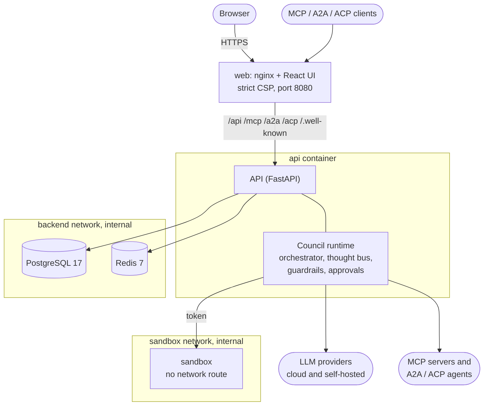
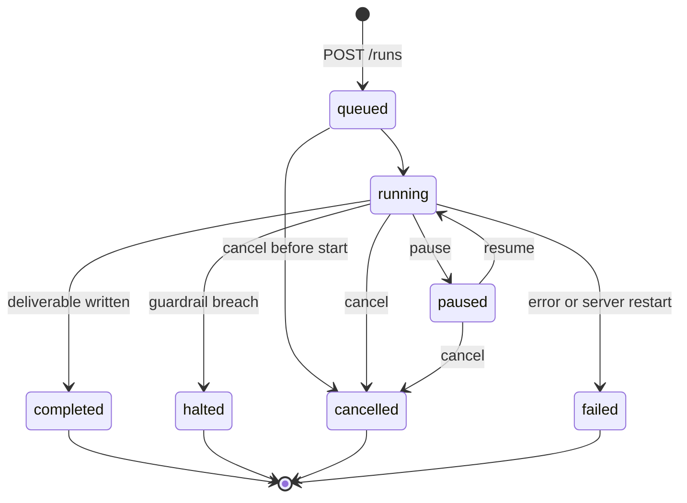
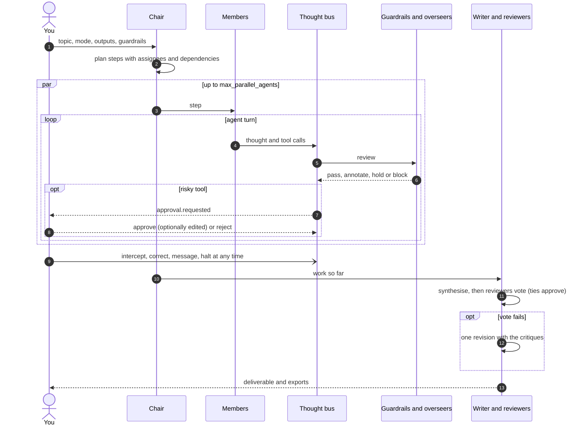
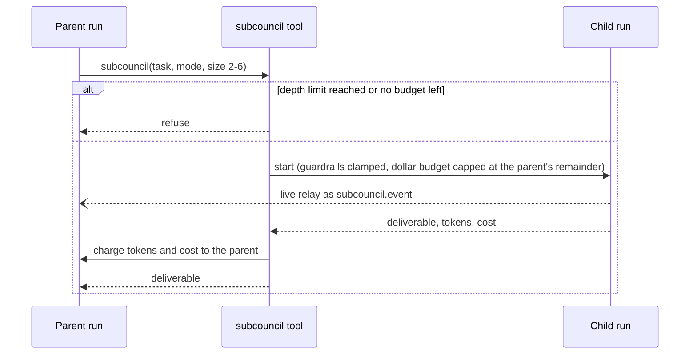
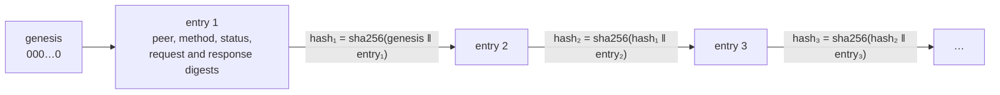

<p align="center">
  <picture>
    <source media="(prefers-color-scheme: dark)" srcset="docs/brand/argus-lockup-dark.svg">
    
  </picture>
</p>

<p align="center">
  <a href="https://github.com/lordprime/Argus-Council/actions/workflows/ci.yml"></a>
  <a href="https://github.com/lordprime/Argus-Council/actions/workflows/pages.yml"></a>
  <a href="https://lordprime.github.io/Argus-Council/"></a>
  <a href="LICENSE"></a>
</p>

<p align="center"><b>A council of LLM agents that plans, debates, votes and delivers, with you in the loop.</b></p>

Argus Council is a self-hosted platform for autonomous, guarded multi-agent work in **research**,
**coding** and **chat**. You give it a topic and a goal; a council of agents (a chair, researchers,
analysts, coders, testers, writers, and overseers such as a monitor, a critic and a security
officer) plans the work, executes it with tools and skills, votes on the result and delivers it as
Markdown, plain text, HTML, LaTeX, PDF, DOCX or JSON. Every thought passes a *thought bus* before it
is acted on, where guardrails and overseer agents can annotate, hold or block it; risky tool calls
wait for a human; and you can intercept and correct any agent, or the whole council, at any moment.

**Documentation: [lordprime.github.io/Argus-Council](https://lordprime.github.io/Argus-Council/)**

## Contents

- [Features](#features)
- [Architecture](#architecture)
- [Quick start](#quick-start)
- [Configuration](#configuration)
- [Using the API](#using-the-api)
- [How a run works](#how-a-run-works)
- [Agent protocols and the ledger](#agent-protocols-and-the-ledger)
- [Project layout](#project-layout)
- [Development](#development)
- [Security](#security)
- [Contributing](#contributing)
- [License](#license)

## Features

| Area | What you get |
| --- | --- |
| **Councils** | Resizable groups of seats with a role, provider, model, persona and tools; twelve built-in roles and a priority roster per mode |
| **Modes** | `research` (cited reports), `coding` (versioned workspace and a network-less sandbox), `chat`, `general` |
| **Oversight** | A thought bus with deterministic guardrails, a loop detector and overseer agents; hold, correct, release, halt and message from the UI or API |
| **Guardrails and approvals** | Budgets in dollars and tokens, step, runtime, parallelism and file limits, tool, skill and domain allow and deny lists, content policy, and human approval for risky tools (with argument editing) |
| **Sub-councils** | Members delegate self-contained tasks to child councils with clamped guardrails, a depth limit and budget charge-back |
| **Models** | Anthropic, OpenAI, Gemini, Mistral, Groq, OpenRouter, DeepSeek, xAI, Together, Ollama, vLLM, LM Studio, llama.cpp, any OpenAI-compatible endpoint, and an offline `mock` provider; retries, fallbacks, caching, cost accounting and health checks |
| **CLI agents** | Opt-in seats on Claude Code, the Codex CLI or the Gemini CLI, signed in with your own account or a CLI API key, mixed with API-key seats and falling back between them ([docs](https://github.com/lordprime/Argus-Council/blob/main/docs/cli-agents.md)) |
| **Skills** | `SKILL.md` packages loaded on demand, six built-ins, an eight-skill marketplace, import and export, version history and restore |
| **Knowledge** | Knowledge bases of Markdown, text and HTML with BM25 search and citations; council-scoped long-term memory |
| **Protocols** | MCP, A2A and ACP as both server and client, MCP trust levels, and a per-user SHA-256 hash-chained ledger of every call |
| **Run views** | Timeline, isometric Map, Gantt, Heatmap and Route, all live from one resumable event stream, with replay of finished runs |
| **Outputs** | `md`, `txt`, `html`, `latex`, `pdf`, `docx`, `json`, regenerated on demand |
| **Operations** | Webhooks, templates with variables, in-app notifications, Prometheus metrics, an audit log, insights, data retention, account export and deletion, and deploy, update, rollback, backup and restore scripts |

## Architecture



| Layer | Implementation |
| --- | --- |
| API | FastAPI, Pydantic v2, async SQLAlchemy 2, Alembic migrations |
| Database | PostgreSQL 17 (SQLite for local development and tests) |
| Cache | Redis 7 (JSON cache, request coalescing, rate limiting, event fan-out); in-memory fallback |
| Auth | Argon2id passwords, short-lived JWT access tokens, rotating single-use refresh tokens, scoped API keys, roles (admin, member, viewer) |
| Web UI | React, TypeScript, Vite and Tailwind, served by the web container on the same origin as the API |
| Containers | Multi-stage builds, non-root users, read-only root filesystems, all capabilities dropped, internal networks for the database, cache and sandbox |

More in [Architecture](https://lordprime.github.io/Argus-Council/architecture/).

## Quick start

Requirements: Docker with the Compose plugin, Git, and `openssl` or Python 3.

```bash
git clone https://github.com/lordprime/Argus-Council.git
cd Argus-Council
./scripts/deploy.sh --smoke   # creates deploy/.env with generated secrets, builds, starts, waits, smoke-tests
```

Open **http://localhost:8080**. The web container serves the UI and proxies the API and agent
protocols (`/api`, `/mcp`, `/a2a`, `/acp`, `/.well-known`) on one origin with a strict
Content-Security-Policy. The first account that registers becomes an `admin`; later accounts are
`member`s. Set `ARGUS_ALLOW_REGISTRATION=false` once your accounts exist.

Without provider keys, every council runs on the offline `mock` provider. Add keys to `deploy/.env`
(for example `ANTHROPIC_API_KEY` or `ARGUS_OLLAMA_BASE_URL`) and run `./scripts/deploy.sh --no-build`,
or add your own connection under *Connections, Providers*.

```bash
./scripts/update.sh              # git pull, back up DB + artifacts to backups/, rebuild, restart; rolls back if unhealthy
./scripts/update.sh --rollback   # previous images; schema via alembic downgrade (--restore-db: pre-update backup)
./scripts/backup.sh              # verified, checksummed backup into backups/ (cron-safe)
./scripts/restore.sh --list      # then ./scripts/restore.sh <timestamp>; refuses corrupt or truncated backups
./scripts/build.sh [--version TAG] [--ca corp-ca.crt] [api|web]   # images only
```

Each script has `--help`. See [Deployment and operations](https://lordprime.github.io/Argus-Council/deployment/).

## Configuration

The API reads `ARGUS_*` environment variables (`backend/argus/core/config.py`). The most important:

| Variable | Default | Meaning |
| --- | --- | --- |
| `ARGUS_SECRET_KEY` | ephemeral outside production | Signs tokens; at least 32 characters, required in production |
| `ARGUS_ENCRYPTION_KEY` | derived from the secret key | Encrypts stored provider credentials |
| `ARGUS_DATABASE_URL` | `sqlite+aiosqlite:///./argus.db` | Async SQLAlchemy URL (Compose builds a Postgres URL) |
| `ARGUS_REDIS_URL` | unset | Redis for cache, rate limits and fan-out; in-memory fallback without it |
| `ARGUS_ALLOW_REGISTRATION` | `true` | Whether new accounts can register |
| `ARGUS_BOOTSTRAP_ADMIN_EMAIL`, `_PASSWORD` | unset | Create this admin at startup |
| `ARGUS_CORS_ORIGINS` | `http://localhost:5173,http://localhost:8080` | Allowed origins |
| `ARGUS_SEARCH_PROVIDER` | unset | `searxng`, `tavily` or `brave` (with `ARGUS_SEARCH_API_KEY` or `ARGUS_SEARXNG_URL`) |
| `ARGUS_SANDBOX_URL`, `ARGUS_SANDBOX_TOKEN` | unset | The sandbox service for `shell` (set by Compose) |
| `ARGUS_MCP_ALLOW_STDIO` | `false` | Allow admins to register stdio MCP servers |
| `ARGUS_METRICS_TOKEN` | unset | Bearer token for `/metrics` (required to scrape in production) |
| `ARGUS_RETENTION_RUN_DAYS` / `_EVENT_DAYS` / `_AUDIT_DAYS` / `_LEDGER_DAYS` | `0` / `0` / `365` / `0` | Data retention in days; `0` keeps forever |
| `ARGUS_RATE_LIMIT_PER_MINUTE` | `120` | Requests per minute per user or API key |
| `<KIND>_API_KEY`, `ARGUS_<KIND>_BASE_URL` | unset | System providers, e.g. `ANTHROPIC_API_KEY`, `OPENAI_API_KEY`, `ARGUS_OLLAMA_BASE_URL` |

The full table, including which variables Compose passes through, is in
[Configuration](https://lordprime.github.io/Argus-Council/configuration/).

## Using the API

```bash
# start an autonomous research run (uses the offline mock council unless you pick a provider)
curl -X POST localhost:8000/api/v1/runs -H "Authorization: Bearer $TOKEN" -H 'content-type: application/json' \
  -d '{"topic":"Solid-state batteries in 2026","mode":"research","outputs":["md","pdf"],
       "provider":"anthropic","model":"claude-opus-5-5","guardrails":{"budget":{"usd":3}}}'

# watch it live (Server-Sent Events): get a short-lived ticket, then stream
curl -X POST localhost:8000/api/v1/runs/$RUN/stream-ticket -H "Authorization: Bearer $TOKEN"
curl -N "localhost:8000/api/v1/runs/$RUN/events/stream?ticket=$TICKET"

# step in: correct the council, then approve a pending tool call with edited arguments
curl -X POST localhost:8000/api/v1/runs/$RUN/interventions -H "Authorization: Bearer $TOKEN" \
  -H 'content-type: application/json' -d '{"kind":"correct","text":"Prioritise peer-reviewed sources","scope":"council"}'
curl -X POST localhost:8000/api/v1/runs/$RUN/approvals/$APPROVAL -H "Authorization: Bearer $TOKEN" \
  -H 'content-type: application/json' -d '{"decision":"approve","edited_args":{"command":"pytest -q"}}'
```

| Group | Endpoints |
| --- | --- |
| Auth and keys | `/api/v1/auth/*` (register, login, refresh, me, API keys), `/api/v1/admin/users` |
| Councils | `/api/v1/councils`, `/councils/{id}/resize`, `/councils/{id}/members`, `/api/v1/roles` |
| Providers | `/api/v1/providers`, `/providers/{name}/models`, `/providers/{name}/test` |
| Runs | `/api/v1/runs`, `pause`, `resume`, `cancel`, `interventions`, `approvals/{id}`, `events`, `snapshot`, `stream-ticket`, `events/stream`, `artifacts`, `exports` |
| Skills | `/api/v1/skills`, `validate`, `import`, `marketplace`, `{name}/export`, `{name}/versions` |
| Knowledge | `/api/v1/knowledge-bases`, `/documents`, `/search`, `/api/v1/memory` |
| Connections | `/api/v1/mcp-servers`, `/api/v1/remote-agents`, `/api/v1/ledger`, `/ledger/verify` |
| Integration | `/api/v1/webhooks`, `/api/v1/templates`, `/api/v1/notifications` |
| Data and ops | `/api/v1/me/export`, `DELETE /api/v1/me`, `/api/v1/admin/retention`, `/api/v1/audit`, `/api/v1/insights`, `/metrics`, `/health/*` |

Writes need a scope on API keys (`runs:write`, `councils:write`, `providers:write`, `skills:write`,
`connections:write`, `webhooks:write`, `knowledge:write`, or `*`); viewers are read-only everywhere.
Webhooks are signed with HMAC-SHA256, run creation is idempotent with `Idempotency-Key`, and the
full reference is generated from the OpenAPI document:
[API reference](https://lordprime.github.io/Argus-Council/api/).

## How a run works





1. **Plan**: the chair turns the topic into steps with assignees and dependencies.
2. **Execute**: independent steps run in parallel (bounded by `max_parallel_agents`); each agent loops between the model and its tools.
3. **Oversight**: deterministic guardrails, a loop detector and overseer agents (security, monitor, critic) review every thought; `oversight.intercept_mode` caps what overseers may do, and the user outranks everyone.
4. **Approvals**: tools tagged with a risk in `approval_required` (by default `shell`, `package_install`, `remote_agent`, `network_write`) wait for a human decision, which can also edit the arguments.
5. **Synthesise and vote**: the writer produces the deliverable, the chair, critic, analyst, security officer and tester vote, and one revision round follows if the vote fails.
6. **Limits**: budget, steps, runtime and file size are enforced throughout; a breach halts the run.

Every event is stored in an append-only log with a per-run sequence number, so runs can be replayed
(`/events`, `/snapshot?at_seq=`) and streams resumed with `after_seq` or `Last-Event-ID`.

### Sub-councils

A member can hand a self-contained task to a smaller child council with the `subcouncil` tool. The
child is a real run with `parent_run_id`, guardrails clamped to the parent's, a depth limit
(`max_subcouncil_depth`, default 2), and its spend charged back to the parent:



## Agent protocols and the ledger

| Protocol | Argus as a server | Argus as a client |
| --- | --- | --- |
| **MCP** | `POST /mcp` (Streamable HTTP): tools `start_run`, `get_run`, `list_runs`, `intervene`, `cancel_run`, `list_councils`; deliverables as resources, skills as prompts | Registered MCP servers' tools appear as `mcp__<server>__<tool>`, gated by trust level (`trusted`, `ask`, `blocked`) and per-tool approval |
| **A2A** | Agent card at `/.well-known/agent-card.json`, JSON-RPC at `/a2a` (`message/send`, `tasks/get`, `tasks/cancel`) | Remote agents through the `remote_agent` tool, approval by default |
| **ACP** | REST under `/acp`: agents, sync and async runs, cancel | Remote ACP agents through the same tool |

```bash
claude mcp add --transport http argus http://localhost:8000/mcp --header "Authorization: Bearer argus_..."
```

Every inbound and outbound MCP, A2A and ACP call is written to a per-user ledger with SHA-256 digests
of the request and response, chained so that any edit, deletion or reordering is detected by
`GET /api/v1/ledger/verify`:



## Project layout

```
backend/            FastAPI service (uv project)
  argus/api/v1/     REST routers
  argus/runtime/    run manager, orchestrator, agents, oversight, guardrails, events
  argus/protocols/  MCP, A2A and ACP servers and clients
  argus/providers/  LLM providers, pricing, health
  argus/tools/      agent tools (web, code, shell, skills, knowledge, remote agents, sub-councils)
  argus/skills/     SKILL.md packages, built-ins and marketplace
  argus/services/   ledger, exports, webhooks, notifications, retention, audit
  alembic/          migrations
  tests/            pytest suite
frontend/           React + TypeScript + Vite web UI (npm project), nginx config, Playwright e2e
deploy/             docker-compose.yml and .env.example
scripts/            deploy, update, restore, build, smoke test, OpenAPI dump
docs/               documentation site sources (MkDocs Material), brand assets, review reports
tools/              docs requirements, wiki mirror, brand and figure generators
```

## Development

```bash
cd backend
uv sync
uv run uvicorn argus.main:create_app --factory --reload   # http://localhost:8000, docs at /docs
uv run pytest
uv run ruff check . && uv run ruff format --check .
```

```bash
cd frontend
npm ci
npm run dev          # http://localhost:5173, proxies /api to localhost:8000
npm test && npm run lint && npm run typecheck
npm run build
```

```bash
# documentation site (exact, hash-pinned requirements)
./scripts/gen-openapi.sh
uv run --no-project --with-requirements tools/docs-requirements.txt mkdocs serve
```

### Testing

CI (`.github/workflows/ci.yml`) runs the backend lint and tests, migrations against Postgres
(`alembic upgrade`, `check` and `downgrade`), integration tests with Postgres and Redis, the frontend
audit, lint, typecheck, tests and build, a Compose smoke test, a UI end-to-end test against the
production build with its strict CSP, and Trivy image and secret scans. The docs workflow builds
the site with `mkdocs build --strict` on every pull request.

## Security

See [SECURITY.md](SECURITY.md) for how to report a vulnerability, and the
[security overview](https://lordprime.github.io/Argus-Council/security-overview/) for the
controls in place. Please do not open public issues for security problems.

## Contributing

Contributions are welcome: read [CONTRIBUTING.md](CONTRIBUTING.md) and the
[code of conduct](CODE_OF_CONDUCT.md) first.

## License

[MIT](LICENSE)
