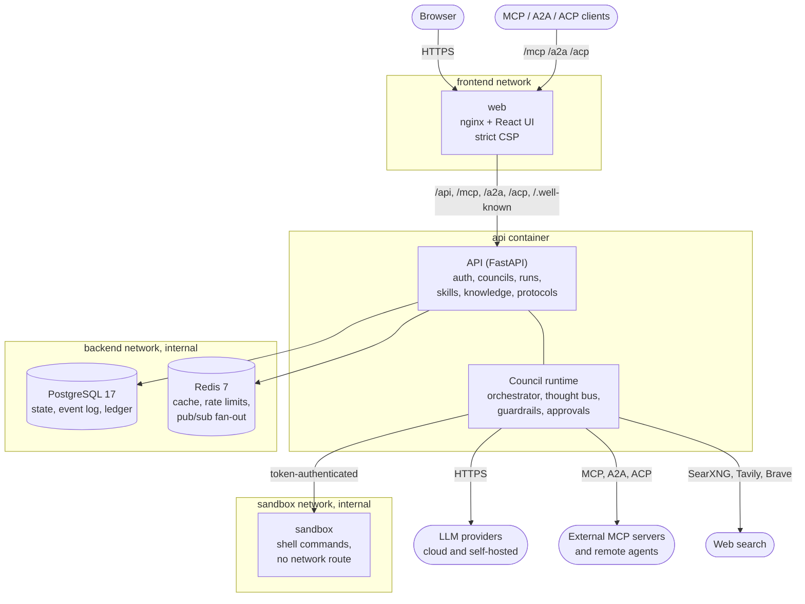
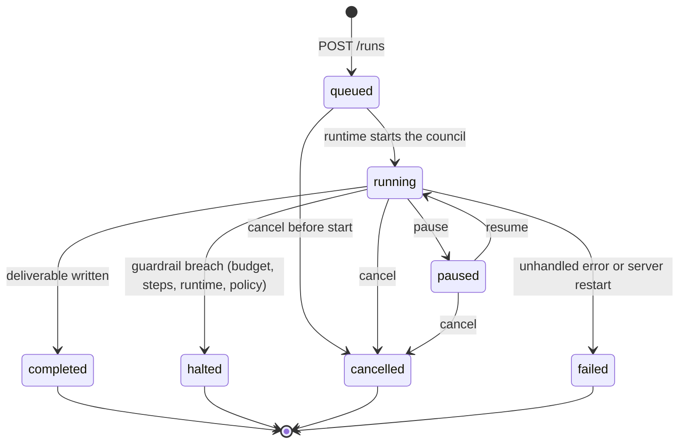
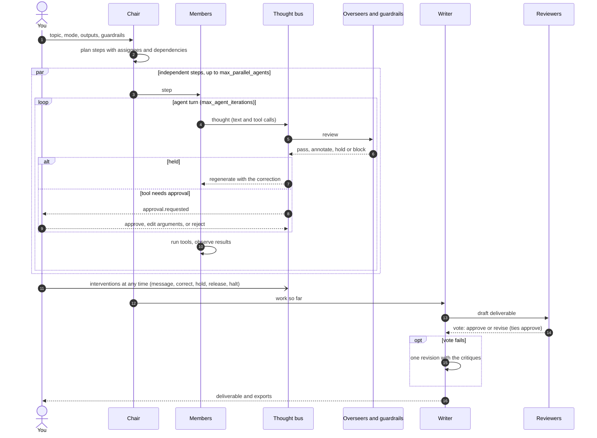
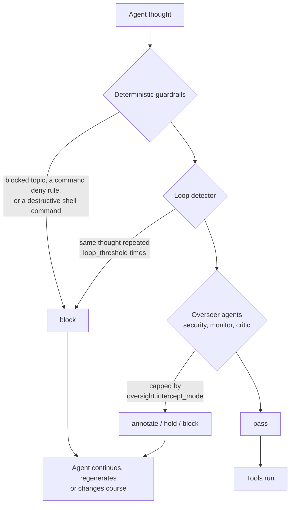
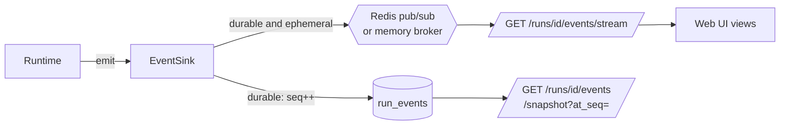

# Architecture

Argus Council is a FastAPI service with a React web UI, PostgreSQL for state, Redis for cache,
rate limits and live fan-out, and a separate sandbox container for agent shell commands. This
page shows how the pieces connect, how a run moves through its lifecycle, how a council
deliberates, and where each part lives in the code.

## System

| Container | Image | Networks | Notes |
| --- | --- | --- | --- |
| `web` | `argus-council/web` | frontend | Serves the UI and proxies the API and agent protocols on one origin; the only service published on all interfaces by default (port 8080) |
| `api` | `argus-council/api` | backend, frontend, sandbox | Runs migrations on start, the council runtime, the periodic retention task; bound to `127.0.0.1:8000` by default |
| `sandbox` | `argus-council/api` | sandbox (internal) | `uvicorn argus.sandbox.server:app`; tmpfs work area, CPU, memory and pid limits |
| `postgres` | `postgres:17-alpine` | backend (internal) | Database volume `pgdata` |
| `redis` | `redis:7-alpine` | backend (internal) | Password, LRU eviction, append-only file, `FLUSHALL` and `CONFIG` disabled |

Every container runs with `no-new-privileges`, all capabilities dropped, an init process and
log rotation; `api`, `web` and `sandbox` also have read-only root filesystems. The `backend` and
`sandbox` networks are `internal: true`, so the database, cache and sandbox have no route out.

| Layer | Implementation |
| --- | --- |
| API | FastAPI, Pydantic v2, async SQLAlchemy 2, Alembic migrations |
| Database | PostgreSQL 17 (SQLite for local development and tests) |
| Cache | Redis 7 (JSON cache, request coalescing, rate limiting, event fan-out); in-memory fallback |
| Auth | Argon2id passwords, short-lived JWT access tokens, rotating single-use refresh tokens, scoped API keys, roles (admin, member, viewer) |
| Web UI | React, TypeScript, Vite, Tailwind; served by the web container on the same origin as the API |

## Run lifecycle

A run is created `queued` and started immediately. The statuses are the ones stored in
`runs.status`; `completed`, `failed`, `cancelled` and `halted` are terminal.

On startup the API marks any run still `queued`, `running` or `paused` from a previous process
as `failed` with the reason "Interrupted by a server restart". When a run reaches a terminal
status, the runtime writes its usage (cost, tokens, steps, LLM calls, runtime), sends the
matching webhook (`run.completed`, `run.failed`, `run.halted` or `run.cancelled`) and creates an
in-app notification for completed, failed and halted runs.

## Deliberation

The figure below draws a run as a bench you can watch and touch: the chair's turret deals plan
steps onto three rails (members working in parallel), every token passes under the gate bridge
(the thought bus) where an overseer or you can drop a pin and hold it, and the ballot box's dial
counts the vote before the deliverable lands in the tray.

<iframe scrolling="no" class="argus-figure" src="../assets/figures/council-run.html" title="Interactive figure: a council run drawn as a sorting bench" loading="lazy"></iframe>

The same flow as a sequence:

### The thought bus

Each agent thought goes through three reviewers, in order of authority:

*annotate* adds a note the agent sees next turn, *hold* discards the thought and has the agent
regenerate with the correction (up to `max_corrections_per_thought`), and *block* discards it and
tells the agent why. Deterministic blocks are never downgraded by the intercept ceiling.

## Events and streaming

Every durable event gets a strictly increasing per-run `seq` and is stored in `run_events`.
High-frequency events (`thought.delta`, `tool.call.output`, `budget.update`, `subcouncil.event`)
are ephemeral: fanned out live but not stored, because their content is recoverable from durable
events. Fan-out goes through Redis pub/sub when Redis is configured, so several API replicas can
serve the same stream, and through an in-process broker otherwise.

Clients resume a stream with `after_seq` or `Last-Event-ID`. The browser cannot set headers on
an `EventSource`, so it first exchanges its bearer token for a short-lived ticket
(`POST /runs/{id}/stream-ticket`) and passes that in the query string.

## Module map

| Path | Contents |
| --- | --- |
| `backend/argus/main.py` | App factory, lifespan (cache, broker, runtime, webhooks, retention), middleware |
| `backend/argus/api/v1/` | REST routers: auth, admin, councils, providers, runs, skills, connections, observability, webhooks, data, knowledge, templates, notifications |
| `backend/argus/runtime/` | `manager` (run lifecycle), `orchestrator` (plan, execute, synthesise, vote), `agent`, `oversight`, `guardrails`, `events`, `snapshot` |
| `backend/argus/agents/roles.py` | The twelve roles, their prompts and default tools, and each mode's roster |
| `backend/argus/providers/` | Anthropic SDK, OpenAI-compatible and Gemini clients, the mock provider, pricing and health checks |
| `backend/argus/tools/` | Agent tools: notes and artifacts, web, code and shell, skills, knowledge and memory, remote agents, sub-councils |
| `backend/argus/protocols/` | MCP server and client, A2A server and client, ACP server and client, JSON-RPC helpers |
| `backend/argus/skills/` | `SKILL.md` packages, the built-in skills and the marketplace catalogue |
| `backend/argus/knowledge/` | Text extraction, chunking and BM25 ranking |
| `backend/argus/services/` | Ledger, exports, webhooks, notifications, retention, account export and erasure, audit |
| `backend/argus/sandbox/` | The sandbox server and the client the runtime uses to reach it |
| `frontend/src/` | React app: routes, feature hooks, run views (`components/viz`), stores |
| `deploy/` | `docker-compose.yml` and `.env.example` |
| `scripts/` | `deploy.sh`, `update.sh`, `restore.sh`, `build.sh`, `smoke.sh`, `gen-openapi.sh` |
