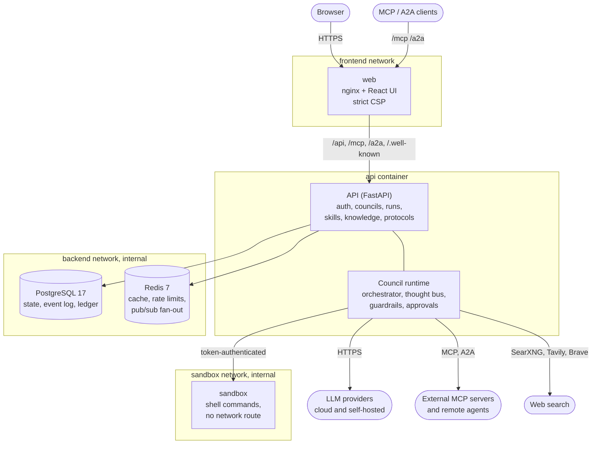
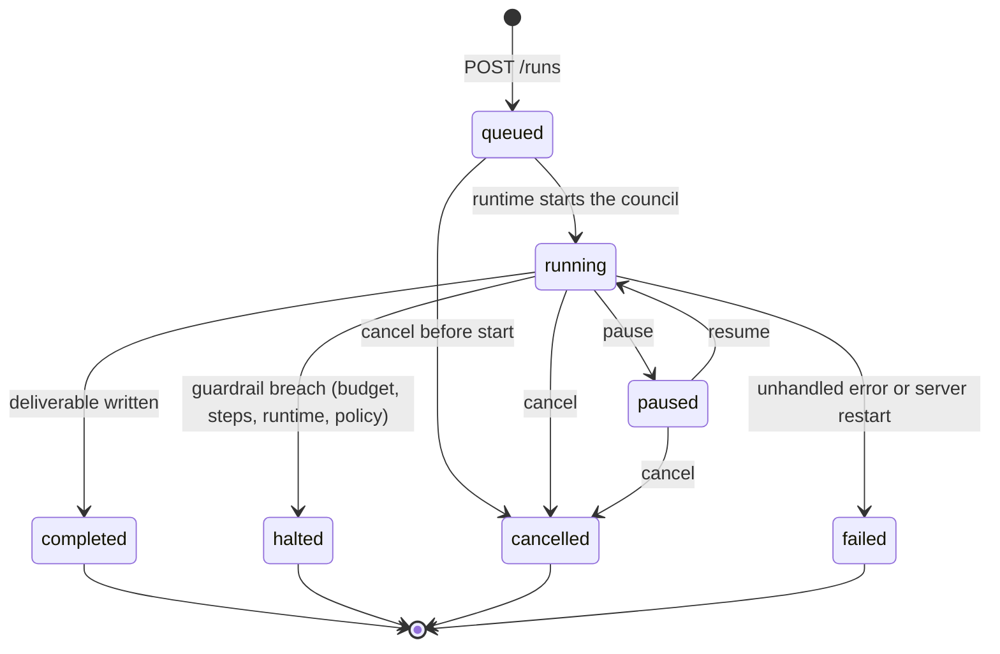
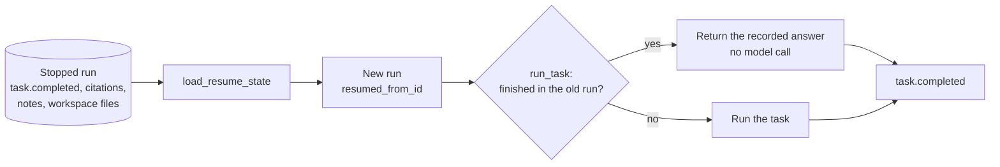
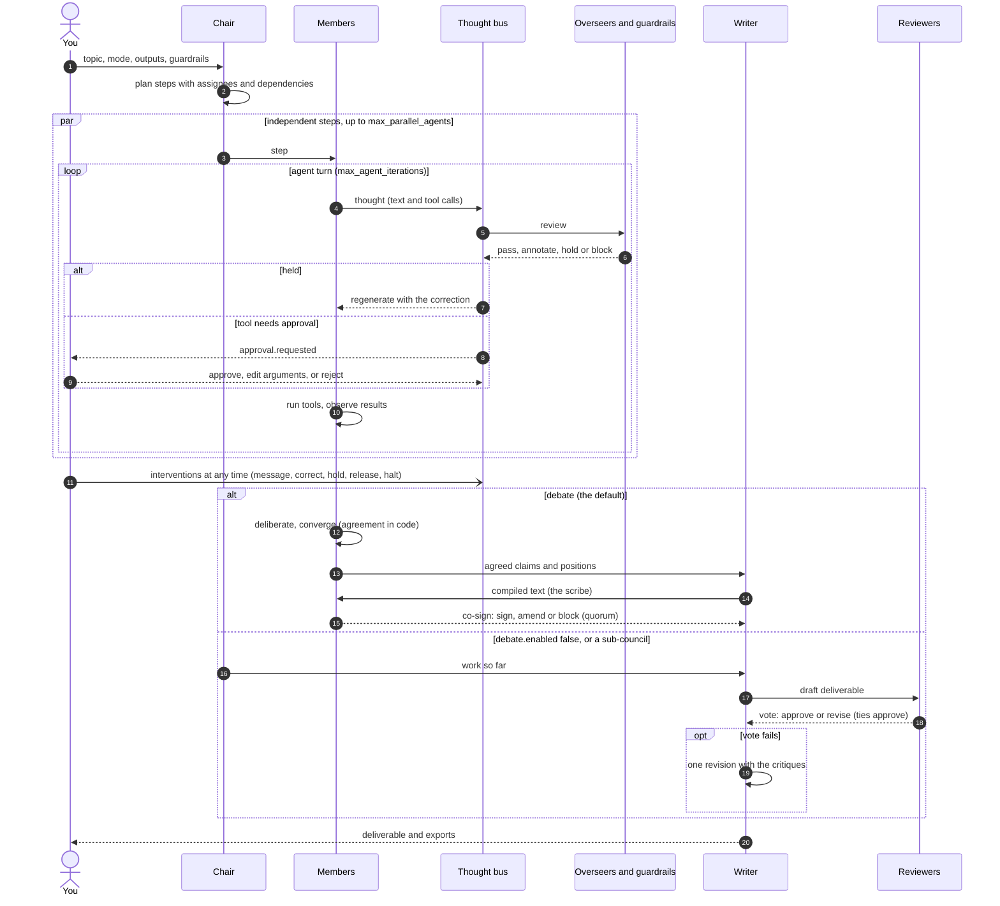
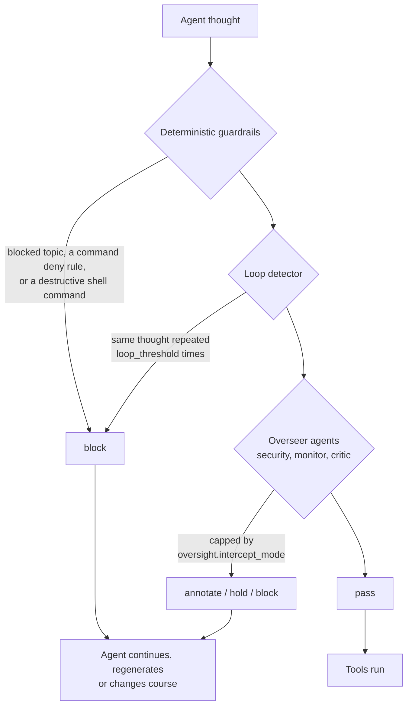
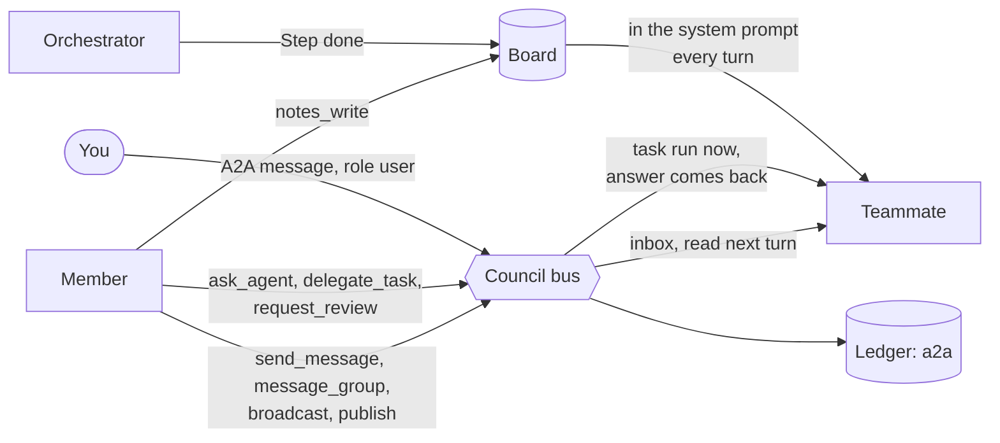
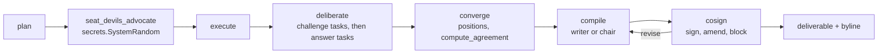
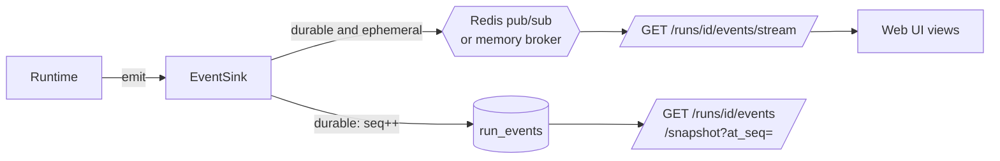

# Architecture

Argus Council is a FastAPI service with a React web UI, PostgreSQL for state, Redis for cache,
rate limits and live fan-out, and a separate sandbox container for agent shell commands. This
page shows how the pieces connect, how a run moves through its lifecycle, how a council
deliberates, and where each part lives in the code.

## System

| Container | Image | Networks | Notes |
| --- | --- | --- | --- |
| `web` | `argus-council/web` (released: `ghcr.io/lordprime/argus-council/web`) | frontend | Serves the UI and proxies the API and agent protocols on one origin; the only service published on all interfaces by default (port 8080) |
| `api` | `argus-council/api` (released: `ghcr.io/lordprime/argus-council/api`) | backend, frontend, sandbox | Runs migrations on start, the council runtime, the periodic retention task; bound to `127.0.0.1:8000` by default |
| `sandbox` | `argus-council/api` | sandbox (internal) | `uvicorn argus.sandbox.server:app`; tmpfs work area, CPU, memory and pid limits |
| `postgres` | `postgres:17-alpine` | backend (internal) | Database volume `pgdata` |
| `redis` | `redis:7-alpine` | backend (internal) | Password, LRU eviction, append-only file, `FLUSHALL` and `CONFIG` disabled |

Every container runs with `no-new-privileges`, all capabilities dropped, an init process and
log rotation; `api`, `web` and `sandbox` also have read-only root filesystems. The `backend` and
`sandbox` networks are `internal: true`, so the database, cache and sandbox have no route out.

| Layer | Implementation |
| --- | --- |
| API | FastAPI, Pydantic v2, async SQLAlchemy 2, Alembic migrations |
| Database | PostgreSQL 17 (SQLite for local development and tests) |
| Cache | Redis 7 (JSON cache, request coalescing, rate limiting, event fan-out); in-memory fallback |
| Auth | Argon2id passwords, short-lived JWT access tokens, rotating single-use refresh tokens, scoped API keys, roles (admin, member, viewer) |
| Web UI | React, TypeScript, Vite, Tailwind; served by the web container on the same origin as the API |

## Run lifecycle

A run is created `queued` and started immediately. The statuses are the ones stored in
`runs.status`; `completed`, `failed`, `cancelled` and `halted` are terminal.

On startup the API marks any run still `queued`, `running` or `paused` from a previous process
as `failed` with the reason "Interrupted by a server restart". When a run reaches a terminal
status, the runtime writes its usage (cost, tokens, steps, LLM calls, runtime), sends the
matching webhook (`run.completed`, `run.failed`, `run.halted` or `run.cancelled`) and creates an
in-app notification for completed, failed and halted runs.

A budget breach does not halt a top-level run straight away when it has a reserve
(`guardrails.budget.buffer_usd` or `buffer_tokens`): the whole reserve is added to the limit once,
without asking, and recorded as `guardrail.extended` with `buffer: true`. Only if the run is still
over the limit does it fall back to asking the user for an extension, or halting.

### Resuming a stopped run

`resume` above continues a *paused* run. A `halted`, `failed` or `cancelled` top-level run can't be
restarted in place. Instead, `POST /runs/{id}/continue` (`services/runs.resume_run`) creates a
**new** run with the same topic, mode, outputs, council snapshot and knowledge bases, and the old
guardrails with any new ones merged over them. Its `runs.resumed_from_id` points at the old run.
Limits and budget start fresh.

The new run goes through the same sequence (plan, steps, report stages, votes). Every agent task
passes through `AgentRunner.run_task`, which keys it by phase, step, step title and member, and
emits a durable `task.completed` event when it finishes. For a resumed run the manager first loads
the old run's `task.completed` events (`runtime/resume.py`). When a task's key matches one the old
run finished, `run_task` returns the recorded answer at once, with no model call. Only work that
never finished calls a model. Replayed tasks carry their answer inline in their own
`task.completed`, so a resumed run can itself be resumed. Before the council starts,
`RunManager._carry_over` brings over the old run's citations (with the same numbers), board notes
and the latest version of each text workspace file. It then emits `run.resumed` with the counts.
Runs older than `task.completed` events are recovered from their plan and step events: the plan
and finished steps are replayed, and the report is built again.

## Deliberation

The figure below draws a run as a bench you can watch and touch: the chair's turret deals plan
steps onto three rails (members working in parallel), every token passes under the gate bridge
(the thought bus) where an overseer or you can drop a pin and hold it, and the ballot box's dial
counts the vote before the deliverable lands in the tray.

<iframe scrolling="no" class="argus-figure" src="../assets/figures/council-run.html" title="Interactive figure: a council run drawn as a sorting bench" loading="lazy"></iframe>

The same flow as a sequence:

### The thought bus

Each agent thought goes through three reviewers, in order of authority:

*annotate* adds a note the agent sees next turn, *hold* discards the thought and has the agent
regenerate with the correction (up to `max_corrections_per_thought`), and *block* discards it and
tells the agent why. Deterministic blocks are never downgraded by the intercept ceiling.

### Council communication

Members talk to each other over an in-process A2A bus (`runtime/council_bus.py`). Each member has
an A2A agent card that is addressable only inside its run. Everything members say to each other is
an A2A `Message`, or an A2A `Task` for delegated work, with the sender, recipients and form in
`metadata`. Nothing goes over HTTP. Each exchange is still written to the protocol ledger as
protocol `a2a` (direction `internal`; `inbound` and `outbound` for the user) and emitted on the
timeline as `a2a.message` (and `a2a.task` for a delegated task's state).

| Form | Tool | Delivery |
| --- | --- | --- |
| `direct`, `group`, `broadcast` | `send_message`, `message_group`, `broadcast` | Put in each recipient's inbox, read at its next turn |
| `topic` | `publish`, `subscribe` | Delivered to every subscriber's inbox |
| `board` | `notes_write` | Shown to every member on every turn |
| `request` | `ask_agent` | The recipient answers now, as its own task; the answer is the tool result |
| `delegate` | `delegate_task` | An A2A task the recipient works on now; the result comes back |
| `review` | `request_review` | The recipient replies `VERDICT: approve` or `revise` with a critique, which is also posted to the board |

The orchestrator registers the communication tools (`tools/council.py`; `notes_write` is an
ordinary built-in) in every run. Every seat may use them whatever its own tool grant, though the
run's allow and deny lists still apply. Asks, delegations and reviews each cost a
model call, so a run allows 40 of them, at most two deep. On every turn `AgentRunner` rebuilds the
system prompt and appends `CouncilBus.prompt_for(member)`: the roster, how to communicate, the
member's topics, the latest board entries and the user's messages addressed to it. It then delivers
the member's inbox as messages. When a step finishes, the orchestrator posts "Step done" with its
output to the board, so members working in parallel see it at their next turn.

The user's messages during a run are A2A messages too (role `user`). They reach the addressed
members at their next turn and stay in their instructions until the run ends. Members answer with
`reply_to_user`.

The bus also keeps `CouncilBus.live`: each member's current task and the tail (300 characters) of
its latest thought, updated from `AgentRunner._think` and emitted as ephemeral `member.live`
events. `prompt_for` renders it as the *Working now* section. Within one turn, `AgentRunner` runs
the tool calls concurrently (`asyncio.gather`) when there are at least two and every one is
parallel-safe (`Tool.parallel_safe`, or any `source = "council"` tool), allowed for the seat and
not approval-gated; otherwise in order. The results are appended in call order, so the history
stays deterministic.

### The debate

`runtime/debate.py` (`Debate`) runs the conclusion; the claim ledger lives on the bus
(`CouncilBus.claims`, `CouncilBus.challenges`), and the tools in `tools/council.py`
(`make_claim`, `challenge`, `respond_to_challenge`, `resolve_challenge`) are registered only when
the council debates: `debate.enabled` and depth 0. `Debate.active` also needs two debaters
(`MemberSpec.debater`: not an overseer, not a helper).

* Every move is an A2A message with a `data` part `{"type": "argus.<form>", ...}` (forms `claim`,
  `challenge`, `response`, `resolution`, `position`, `signature`) and a `debate.*` event. A
  challenge is also an A2A task: `input-required` on the target until answered, `completed` once
  settled, `rejected` after a second rejection.
* Claim and challenge ids are digests of their content, and an answer or resolution already applied
  is ignored, so replaying a task does not record its moves twice.
* Each phase's tasks run concurrently (`Debate._each`, bounded by `max_parallel_agents`), and each
  answers in JSON that is applied through the ledger in code. `compute_agreement` turns the
  positions into `agreed`, `contested` or `rejected` against `debate.consensus`.
* The finish gate (`AgentRunner._finish_gate`) sends a step's final answer back while challenges
  against its member are open, at most `debate.max_nudges` times.
* `council_bus.conceal` replaces the giveaway phrases of a member with a secret `stance` in
  everything it sends to a shared surface. The pick itself is a durable `council.role_assigned`
  event marked `secret` and a `task.completed` record, so a resumed run seats the same advocate.
* Co-signing emits `vote.opened`, `vote.cast` and `vote.closed` as the vote did, then
  `debate.consensus` with the signatures, `quorum_met` and the outcome (`signed`, `revise` or
  `unsigned`).

### Helpers and the plan

`tools/spawn.py` holds `spawn_agents`, `await_agents` and `add_step`, and the `HelperPool` of the
run. A helper is a `MemberSpec` with `ephemeral=True` and `parent_id`, added to
`orchestrator.members` (which `LiveRun.members` is, so interventions reach it) and to the bus
(`CouncilBus.join`, which returns its agent card), and removed when it finishes. Its work is an A2A
task (form `delegate`, `metadata.spawned: true`) run as an `AgentRunner` task in phase `spawn`.

Steps and helpers share one semaphore of `max_parallel_agents` permits. Each task holds a slot
(`run_slot`), and a member waiting on its helpers gives its slot back (`yield_slot`), so a parent
can never starve its own helpers. The execute loop also waits on a `steps_changed` event, so a step
added with `CouncilOrchestrator.add_step` starts as soon as its dependencies are done; the phase
ends when no step and no helper is still running. `step.added` events carry the step's
instructions, which `runtime/resume.py` reads back (`ResumeState.added_steps`).

### The council knowledge graph

`runtime/graph.py` (`CouncilGraph`, one per run in `ctx.extra["graph"]`) listens to the run's
`EventSink` and folds its events into nodes and edges, with no model calls: `task.completed`
(result nodes for steps, helpers, delegations, synthesis and compile), `citation.added` (evidence),
board posts, and `debate.*` (claims, challenges, statuses). It writes them through to two tables,
added by migration `0021`, scoped like `memory_items` (owner plus council, or owner plus null for
ad-hoc runs):

| Table | Columns |
| --- | --- |
| `graph_nodes` | `owner_id`, `council_id`, `run_id`, `key` (`clm_…`, `chl_…`, `res_…`, `evd_…`, `nte_…`, `ent_…`), `type`, `label`, `summary` (300 characters), `body`, `author`, `status`, `confidence`, BM25 `terms` and `length`, `meta` |
| `graph_edges` | `owner_id`, `council_id`, `run_id`, `src`, `dst`, `relation`, `author` |

Rows are deleted with their owner or council; deleting a run keeps them with `run_id` set to null.
At the start of a run the graph loads the scope's newest 2,000 nodes and 8,000 edges from earlier
runs. It then supplies the context: `upstream_digest` for a step's dependencies (instead of the
last 24,000 characters of raw output), `board_text` for the board, and `recall_text` for *What this
council already knows*, which is computed once so the prompt prefix stays stable. `_upstream`
emits `context.saved` with the raw and sent characters, and new nodes and edges are announced with
the ephemeral `graph.updated`. The graph tools (`tools/graph.py`) are registered with the graph.

**Prompt caching.** `AgentRunner._system_prompt` returns a `SystemPrompt` (a `str` that knows the
length of its stable prefix) when `graph.prompt_cache` is on. `CompletionRequest.system_blocks()`
splits it into a cacheable prefix and a volatile tail; the Anthropic provider sends them as two
system blocks, the first with `cache_control: {"type": "ephemeral"}`, and puts a breakpoint on the
last tool definition too. Other providers get the joined string.

## Events and streaming

Every durable event gets a strictly increasing per-run `seq` and is stored in `run_events`.
High-frequency events (`thought.delta`, `tool.call.output`, `budget.update`, `subcouncil.event`,
`member.live`, `graph.updated`) are ephemeral: fanned out live but not stored, because their content is recoverable from durable
events. Fan-out goes through Redis pub/sub when Redis is configured, so several API replicas can
serve the same stream, and through an in-process broker otherwise.

Clients resume a stream with `after_seq` or `Last-Event-ID`. The browser cannot set headers on
an `EventSource`, so it first exchanges its bearer token for a short-lived ticket
(`POST /runs/{id}/stream-ticket`) and passes that in the query string.

## Module map

| Path | Contents |
| --- | --- |
| `backend/argus/main.py` | App factory, lifespan (cache, broker, runtime, webhooks, retention), middleware |
| `backend/argus/api/v1/` | REST routers: auth, admin, councils, providers, runs, skills, connections, observability, webhooks, data, knowledge, templates, notifications |
| `backend/argus/runtime/` | `manager` (run lifecycle), `orchestrator` (plan, execute, synthesise, vote), `debate` (deliberate, converge, compile, co-sign), `agent`, `council_bus` (A2A between members, the claim ledger), `graph` (the council knowledge graph), `resume` (replaying a stopped run), `oversight`, `guardrails`, `events`, `snapshot` |
| `backend/argus/agents/roles.py` | The twelve roles, their prompts and default tools, and each mode's roster |
| `backend/argus/providers/` | Anthropic SDK, OpenAI-compatible and Gemini clients, the mock provider, pricing and health checks |
| `backend/argus/tools/` | Agent tools: notes and artifacts, web, code and shell, skills, knowledge and memory, council communication and debate, helpers (`spawn`), the knowledge graph, remote agents, sub-councils |
| `backend/argus/protocols/` | MCP server and client, A2A server and client, JSON-RPC helpers |
| `backend/argus/skills/` | `SKILL.md` packages, the built-in skills and the marketplace catalogue |
| `backend/argus/knowledge/` | Text extraction, chunking and BM25 ranking |
| `backend/argus/services/` | Ledger, exports, webhooks, notifications, retention, account export and erasure, audit |
| `backend/argus/sandbox/` | The sandbox server and the client the runtime uses to reach it |
| `frontend/src/` | React app: routes, feature hooks, run views (`components/viz`), stores |
| `deploy/` | `docker-compose.yml` and `.env.example` |
| `scripts/` | `deploy.sh`, `update.sh`, `restore.sh`, `build.sh`, `smoke.sh`, `gen-openapi.sh` |
