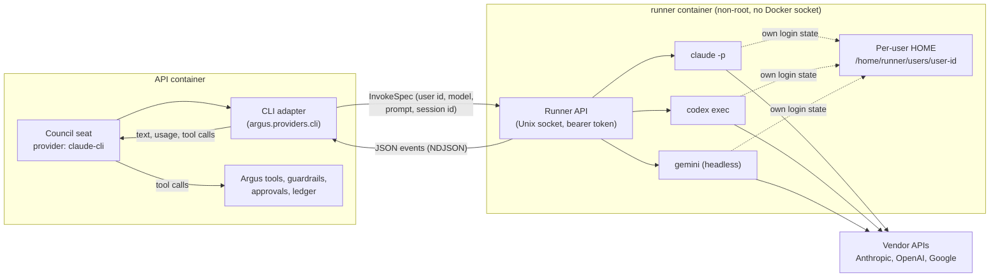
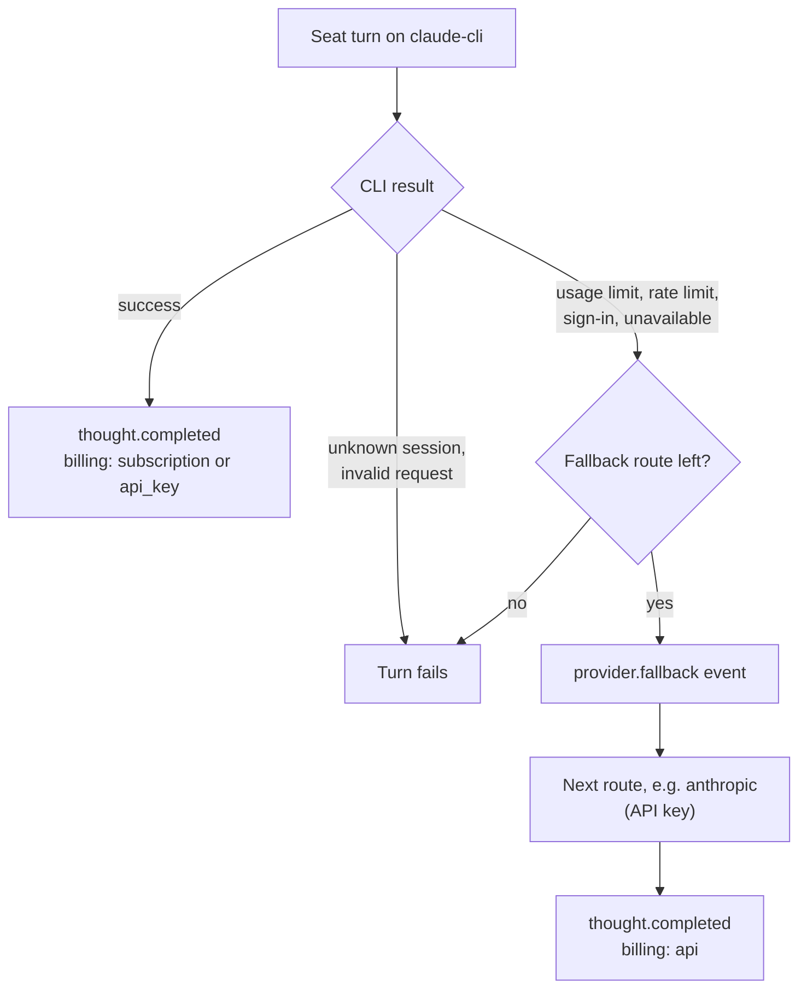

# CLI agents

A council seat can run on a vendor's official command-line agent instead of an API-key provider:
**Claude Code** (`claude`), the **OpenAI Codex CLI** (`codex`) or the **Gemini CLI** (`gemini`).
Each CLI signs in with its own login flow, so a seat can use the owner's Claude Pro/Max, ChatGPT
Plus/Pro or Google account, or a per-user CLI API key. Seats on CLI agents and seats on API-key
providers can sit on the same council, and each seat can fall back from one to the other.

!!! warning "Use within each vendor's terms"
    Each vendor's terms govern how its CLI may be used. Subscription logins are for the account
    owner's own use. On an instance that several people share, give each user's CLI an API key
    (or set `ARGUS_CLI_AGENTS_ALLOW_SUBSCRIPTION=false` to require one). Argus does not offer a
    "Sign in with Claude/ChatGPT/Google" flow and never reads, copies or forwards a vendor login:
    the CLI authenticates itself inside the runner, and Argus only starts it and reads its output.

CLI agents are **off by default**. The operator turns them on per instance.

## How it fits together



1. A seat names `claude-cli`, `codex-cli` or `gemini-cli` as its provider.
2. The adapter sends the runner a validated request: the run owner's user id, the CLI, the model,
   the prompt and the session to start or resume. It never sends a command line.
3. The runner builds a fixed argument list for that CLI, starts it with `HOME` set to that user's
   own directory on the runner volume, writes the prompt to its stdin and streams the CLI's JSON
   events back.
4. The adapter turns those events into the usual Argus stream (thought deltas, the final message,
   token usage), so interception, corrections, guardrails, transcripts and run views work the same
   as for any provider.

## Safety

| Concern | What Argus does |
| --- | --- |
| The CLIs' own tools (shell, file edits, web, MCP) | Turned off. Claude Code: `--tools ""`, `--disallowedTools "*"`, `--permission-mode dontAsk`, `--permission-prompts none`, `--strict-mcp-config` with no MCP config. Codex: `--sandbox read-only`, `approval_policy=never`, web search off, the shell, exec, plugin, browser, computer-use and multi-agent features disabled, `--ignore-user-config`. Gemini: never `--yolo`, and the image installs a root-owned admin policy that denies every tool. Each turn runs in an empty working directory. |
| Argus tools | Offered to the model as a tagged text protocol. Every call is parsed into a normal tool call and goes through the same guardrails, approvals and ledger as any other provider. |
| Command injection | No shell. The runner builds the argv itself; model names, session ids, user ids and run keys must match strict patterns; the prompt goes through stdin and the system prompt through a file. |
| One user using another's account | The user id always comes from the run's owner. Each user has their own HOME, so their own CLI login. Resuming a session is allowed only for sessions recorded for that user and CLI, checked in the database and again by the runner. There is no admin route to use, inspect or reset someone else's CLI. |
| Credential leaks | CLI API keys are encrypted at rest, sent to the runner only for that user's process, set only in that process's environment, and redacted from any error text. The runner passes nothing else from its own environment to a CLI. Account exports list which CLI has a key (a masked hint), never the key; vendor logins never leave the runner volume. Deleting an account removes that user's runner HOME. |
| Exposure | The runner has no listening port: the API reaches it through a Unix socket on a shared volume, with a shared token. The runner's only network is outbound, for the vendor APIs (point `ARGUS_RUNNER_HTTPS_PROXY` at an egress proxy to allow-list their hosts). |

## Sessions

A CLI seat keeps one vendor session for the whole run, so it keeps its context from one step to
the next. The first turn starts a session (Claude Code and Gemini with an id Argus picks, Codex with
the id it reports), later turns resume it and send only what the CLI has not seen: tool results,
corrections and the next task. Session ids are stored per seat and run (**Connections > CLI agents
> Your CLI sessions**).

To continue an earlier session in a new run, pick it in the seat's **CLI session** field (stored as
`config.cli_session`). Only sessions that Argus created for you, with that CLI, can be resumed.

## Hybrid councils and fallback

Any seat can have a fallback chain (`config.fallbacks`, edited in the seat dialog). A CLI agent
falls back when it reports a usage limit, a rate limit, a sign-in problem or that it is unavailable;
other CLI errors (an unknown session, an invalid request) fail the turn. A failed CLI turn is never
retried in place. Each switch is recorded on the run as a `provider.fallback` event.



It works the other way round too: an API-key seat can fall back to a CLI agent.

## Cost and budgets

A turn on a subscription login costs no API dollars: its `cost_usd` is 0, so budget guardrails only
count real API spend. Tokens are still counted when the CLI reports them, and `thought.completed`
carries `billing` (`subscription` or `api_key`) and `estimated_cost_usd` (Claude Code's own cost
report where present, otherwise a token estimate). With a CLI API key the turn's cost is real and
counts toward the budget.

## Setting it up

Operators:

1. In `deploy/.env` set `COMPOSE_PROFILES=cli-agents` and `ARGUS_CLI_AGENTS_ENABLED=true`
   (`./scripts/deploy.sh` generates `ARGUS_RUNNER_TOKEN`). Optional:
   `ARGUS_CLI_AGENTS_ALLOWED=claude,codex,gemini`, `ARGUS_CLI_AGENTS_ALLOW_SUBSCRIPTION=false` for
   API keys only, `ARGUS_CLI_AGENTS_TIMEOUT_S`, `ARGUS_RUNNER_HTTPS_PROXY`.
2. Run `./scripts/deploy.sh` (or `./scripts/update.sh`). `build.sh` builds the `runner` image when
   the profile is on, and update snapshots keep it for rollbacks.
3. Sign a user's CLI in with the CLI's own flow, inside the runner, in that user's HOME:

    ```bash
    ./scripts/agent-login.sh ada@example.com claude   # claude auth login
    ./scripts/agent-login.sh ada@example.com codex    # codex login --device-auth
    ./scripts/agent-login.sh ada@example.com gemini   # gemini: choose "Sign in with Google", then /quit
    ./scripts/agent-login.sh ada@example.com claude --status
    ./scripts/agent-login.sh ada@example.com claude --logout
    ```

Users:

- **Connections > CLI agents** shows, per CLI, the installed version, whether you are signed in or
  have a key, and the sign-in command. A CLI API key (`ANTHROPIC_API_KEY`, `CODEX_API_KEY` or
  `GEMINI_API_KEY`) is used instead of the sign-in, for your runs only.
- In the council builder, CLI agents appear under **Account (CLI agents)** in the provider list with
  an **Account** badge. Add a fallback route for when the account hits its limit.

| Variable | Default | Meaning |
| --- | --- | --- |
| `ARGUS_CLI_AGENTS_ENABLED` | `false` | Instance-wide switch |
| `ARGUS_CLI_AGENTS_ALLOWED` | `claude,codex,gemini` | Which CLIs seats may use |
| `ARGUS_CLI_AGENTS_ALLOW_SUBSCRIPTION` | `true` | `false`: a CLI runs only with the user's own API key |
| `ARGUS_CLI_AGENTS_TIMEOUT_S` | `600` | Limit per CLI turn |
| `ARGUS_RUNNER_URL` | compose: `unix:/run/argus-runner/runner.sock` | Where the API reaches the runner |
| `ARGUS_RUNNER_TOKEN` | generated | Shared bearer token between API and runner |
| `ARGUS_RUNNER_LOCAL` | `false` | Development only: run the CLIs on the API host; refused in production |
| `ARGUS_RUNNER_MAX_CONCURRENCY`, `ARGUS_RUNNER_MAX_PER_USER` | `8`, `4` | Concurrent CLI turns in the runner |

## Pinned versions

The runner image pins the CLIs in
[`backend/docker/runner/package.json`](https://github.com/lordprime/Argus-Council/blob/main/backend/docker/runner/package.json)
with a lockfile: `@anthropic-ai/claude-code` 2.1.308, `@openai/codex` 0.163.0 and
`@google/gemini-cli` 0.65.0. The command lines in
[`argus/runner/specs.py`](https://github.com/lordprime/Argus-Council/blob/main/backend/argus/runner/specs.py)
were checked against those versions and the vendors' documentation
([Claude Code headless mode](https://code.claude.com/docs/en/headless) and
[CLI reference](https://code.claude.com/docs/en/cli-reference),
[Codex non-interactive mode](https://developers.openai.com/codex/noninteractive),
[Gemini CLI headless mode](https://github.com/google-gemini/gemini-cli/blob/main/docs/cli/headless.md)).
Check the flags again when you bump a version: Codex exits on unknown feature names.
