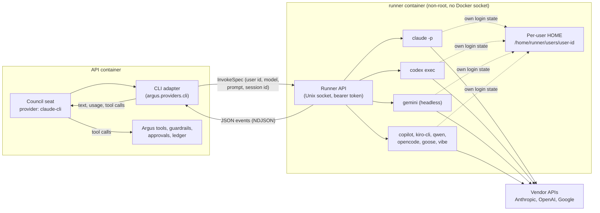
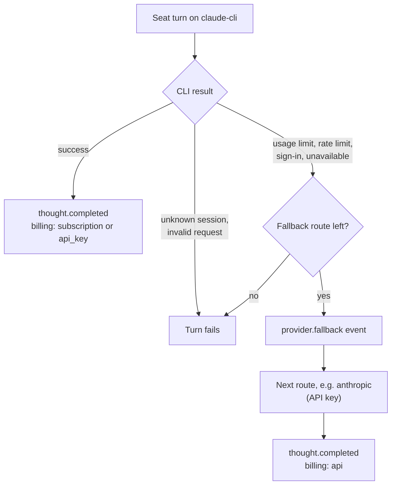

# CLI agents

A council seat can run on a vendor's official command-line agent instead of an API-key provider:

| CLI | Seat provider | Signs in with | Or a per-user key |
| --- | --- | --- | --- |
| **Claude Code** (`claude`) | `claude-cli` | Claude Pro/Max (paste code) | `ANTHROPIC_API_KEY` |
| **OpenAI Codex CLI** (`codex`) | `codex-cli` | ChatGPT Plus/Pro (device code) | `CODEX_API_KEY` |
| **Gemini CLI** (`gemini`) | `gemini-cli` | Google account (paste code) | `GEMINI_API_KEY` |
| **GitHub Copilot CLI** (`copilot`) | `copilot-cli` | GitHub account with Copilot (device code) | `COPILOT_GITHUB_TOKEN` |
| **Kiro CLI** (`kiro-cli`) | `kiro-cli` | AWS Builder ID, Google or GitHub (device code) | `KIRO_API_KEY` (paid plans) |
| **Qwen Code** (`qwen`) | `qwen-cli` | key only | DashScope (Model Studio pay-as-you-go) or OpenRouter key |
| **opencode** (`opencode`) | `opencode-cli` | GitHub Copilot or ChatGPT (device code) | Anthropic, OpenAI, Google, OpenRouter or Mistral key |
| **Goose** (`goose`) | `goose-cli` | key only | Anthropic, OpenAI, Google, OpenRouter or Mistral key |
| **Mistral Vibe** (`vibe`) | `vibe-cli` | key only | `MISTRAL_API_KEY` |

Each CLI signs in with its own login flow (or uses the user's own key), so a seat can use the
owner's own subscription. Seats on CLI agents and seats on API-key
providers can sit on the same council, and each seat can fall back from one to the other.

!!! warning "Use within each vendor's terms"
    Each vendor's terms govern how its CLI may be used. Subscription logins are for the account
    owner's own use. On an instance that several people share, give each user's CLI an API key
    (or set `ARGUS_CLI_AGENTS_ALLOW_SUBSCRIPTION=false` to require one).

    **What the in-app sign-in does.** **Sign in** on Connections > CLI agents starts the CLI's own
    login command (`claude auth login`, `codex login --device-auth`, the Gemini CLI's Google sign-in)
    inside the runner, in your own runner HOME. Argus shows you two things the CLI prints: the
    vendor's sign-in link (only if it is on that CLI's list of vendor hosts) and, for device-code
    sign-ins, the one-time code. If the CLI asks for an authorization code, the code you paste is
    checked, written once to the CLI's input, and never stored, logged or audited.

    **What it does not do.** Argus never contacts the vendors' sign-in services itself, and never
    reads, copies or forwards the login the CLI ends up with. The tokens stay in your runner HOME,
    exactly as with `./scripts/agent-login.sh`. Nobody can sign in, inspect or sign out another
    user's CLI, admins included.

CLI agents are **off by default**. The operator turns them on per instance.

## How it fits together



1. A seat names `claude-cli`, `codex-cli` or `gemini-cli` as its provider.
2. The adapter sends the runner a validated request: the run owner's user id, the CLI, the model,
   the prompt and the session to start or resume. It never sends a command line.
3. The runner builds a fixed argument list for that CLI, starts it with `HOME` set to that user's
   own directory on the runner volume, writes the prompt to its stdin and streams the CLI's JSON
   events back.
4. The adapter turns those events into the usual Argus stream (thought deltas, the final message,
   token usage), so interception, corrections, guardrails, transcripts and run views work the same
   as for any provider.

## Safety

| Concern | What Argus does |
| --- | --- |
| The CLIs' own tools (shell, file edits, web, MCP) | Turned off. Claude Code: `--tools ""`, `--disallowedTools "*"`, `--permission-mode dontAsk`, `--permission-prompts none`, `--strict-mcp-config` with no MCP config. Codex: `--sandbox read-only`, `approval_policy=never`, web search off, the shell, exec, plugin, browser, computer-use and multi-agent features disabled, `--ignore-user-config`. Gemini: never `--yolo`, and the image installs a root-owned admin policy that denies every tool. Copilot: `--available-tools=` plus `--deny-tool` for shell, write, read, url and memory (deny always wins), no built-in MCP servers, no custom instructions. Kiro: a root-owned `/etc/kiro/managed-settings.json` that denies every capability (Kiro fails closed if it is malformed), an agent with no tools, permission requests rejected. Qwen Code: a root-owned `/etc/qwen-code/settings.json` (highest precedence) that denies every built-in tool by name and every MCP tool, plus `--safe-mode` and `--max-tool-calls 0`. opencode: a root-owned `/etc/opencode/opencode.json` (loaded last) that denies every tool, plus `OPENCODE_PERMISSION={"*":"deny"}`; `run` rejects anything that asks. Goose: no extensions (`--no-profile`) and chat-only mode (`GOOSE_MODE=chat`). Vibe: `--disabled-tools '*'`, subagents and background processes off. Wherever a CLI reports its tool list at start, the runner stops the turn (`tools_not_disabled`) if the list is not empty. Each turn runs in an empty working directory. |
| Argus tools | Offered to the model as a tagged text protocol. Every call is parsed into a normal tool call and goes through the same guardrails, approvals and ledger as any other provider. |
| Command injection | No shell. The runner builds the argv itself; model names, session ids, user ids and run keys must match strict patterns; the prompt goes through stdin and the system prompt through a file. |
| One user using another's account | The user id always comes from the run's owner. Each user has their own HOME, so their own CLI login. Resuming a session is allowed only for sessions recorded for that user and CLI, checked in the database and again by the runner. There is no admin route to use, inspect or reset someone else's CLI. |
| Credential leaks | CLI API keys are encrypted at rest, sent to the runner only for that user's process, set only in that process's environment, and redacted from any error text. The runner passes nothing else from its own environment to a CLI. Account exports list which CLI has a key (a masked hint), never the key; vendor logins never leave the runner volume. Deleting an account removes that user's runner HOME. |
| Sign-in | Only for the signed-in user, from an interactive session (not an API key), and only while account sign-in is allowed. The CLI's own login runs with a fixed argv in that user's HOME. Only a link on the CLI's vendor host list and a device code are relayed, never the raw output. A pasted code must be one token of `[A-Za-z0-9._~#/+=-]` (at most 512 characters), is written once to the CLI and is never kept. Each sign-in has a 15-minute limit, at most 2 run per user and 8 per runner, starting one cancels the previous one, and starts and codes are rate-limited. Every step is audited (CLI and action only). |
| Exposure | The runner has no listening port: the API reaches it through a Unix socket on a shared volume, with a shared token. The runner's only network is outbound, for the vendor APIs (point `ARGUS_RUNNER_HTTPS_PROXY` at an egress proxy to allow-list their hosts). |

## Sessions

A CLI seat keeps one vendor session for the whole run, so it keeps its context from one step to
the next. The first turn starts a session (Claude Code and Gemini with an id Argus picks, Codex with
the id it reports), later turns resume it and send only what the CLI has not seen: tool results,
corrections and the next task. Session ids are stored per seat and run (**Connections > CLI agents
> Your CLI sessions**).

To continue an earlier session in a new run, pick it in the seat's **CLI session** field (stored as
`config.cli_session`). Only sessions that Argus created for you, with that CLI, can be resumed.

## Hybrid councils and fallback

Any seat can have a fallback chain (`config.fallbacks`, edited in the seat dialog). A CLI agent
falls back when it reports a usage limit, a rate limit, a sign-in problem or that it is unavailable;
other CLI errors (an unknown session, an invalid request) fail the turn. A failed CLI turn is never
retried in place. Each switch is recorded on the run as a `provider.fallback` event.



It works the other way round too: an API-key seat can fall back to a CLI agent.

## Cost and budgets

A turn on a subscription login costs no API dollars: its `cost_usd` is 0, so budget guardrails only
count real API spend. Tokens are still counted when the CLI reports them, and `thought.completed`
carries `billing` (`subscription` or `api_key`) and `estimated_cost_usd` (Claude Code's own cost
report where present, otherwise a token estimate). With a CLI API key the turn's cost is real and
counts toward the budget.

## Setting it up

Operators:

1. Optional, in `deploy/.env`: `ARGUS_CLI_AGENTS_ALLOWED=claude,codex,gemini`,
   `ARGUS_CLI_AGENTS_ALLOW_SUBSCRIPTION=false` for API keys only, `ARGUS_CLI_AGENTS_TIMEOUT_S`,
   `ARGUS_RUNNER_HTTPS_PROXY`.
2. Install it with `./scripts/deploy.sh --with cli-agents`. This adds `cli-agents` to
   `COMPOSE_PROFILES`, sets `ARGUS_CLI_AGENTS_ENABLED=true` and generates `ARGUS_RUNNER_TOKEN`;
   `update.sh` keeps them in step with the profile. The `runner` image is pulled with the release
   (or built, with `--local`), and update snapshots keep it for rollbacks. An admin can then turn
   CLI agents off and on in **Settings → Features**, without a restart: while off, a CLI seat's
   turn is refused and its fallback route takes over, and sign-ins and keys are kept.
   `./scripts/deploy.sh --without cli-agents` removes the runner container and keeps its volume
   with users' sign-ins. See [Deployment](deployment.md#optional-features) and
   [Configuration](configuration.md#optional-features).
3. Users sign their own CLIs in from **Connections > CLI agents** (below). An operator can still
   sign a user's CLI in from the server, inside the runner, in that user's HOME:

    ```bash
    ./scripts/agent-login.sh ada@example.com claude   # claude auth login
    ./scripts/agent-login.sh ada@example.com codex    # codex login --device-auth
    ./scripts/agent-login.sh ada@example.com gemini   # gemini: choose "Sign in with Google", then /quit
    ./scripts/agent-login.sh ada@example.com claude --status
    ./scripts/agent-login.sh ada@example.com claude --logout
    ```

Users:

- **Connections > CLI agents** shows, per CLI, the installed version and whether you are signed in
  or have a key. **Sign in with your … account** starts the CLI's own sign-in:
    - **Claude Code**: open the link, sign in to Claude, and paste the code the page shows.
    - **Codex**: open the link and enter the one-time code shown in Argus. Nothing is pasted back.
    - **Gemini CLI**: open the link, sign in to Google, and paste the authorization code. If Google
      rejects a code, the CLI shows a new link once.
    - **GitHub Copilot CLI**: open GitHub's device page and enter the one-time code.
    - **Kiro CLI**: choose AWS Builder ID, Google or GitHub, then enter the one-time code on the page.
    - **opencode**: choose GitHub Copilot or ChatGPT, then enter the one-time code on the page.
    - **Qwen Code, Goose and Mistral Vibe** have no sign-in Argus can run. Save an API key instead,
      and for Qwen Code and Goose choose which provider it is for.

  A sign-in expires after 15 minutes and can be cancelled. **Sign out** runs the CLI's own sign-out
  (for Gemini, it removes the CLI's stored Google sign-in). A CLI API key (`ANTHROPIC_API_KEY`, `CODEX_API_KEY` or
  `GEMINI_API_KEY`) is used instead of the sign-in, for your runs only.
- In the council builder, CLI agents appear under **Account (CLI agents)** in the provider list with
  an **Account** badge. Add a fallback route for when the account hits its limit.

| Variable | Default | Meaning |
| --- | --- | --- |
| `ARGUS_CLI_AGENTS_ENABLED` | `false` | Instance-wide switch |
| `ARGUS_CLI_AGENTS_ALLOWED` | `claude,codex,gemini` | Which CLIs seats may use; add `copilot`, `kiro`, `qwen`, `opencode`, `goose`, `vibe` to opt in to the others |
| `ARGUS_CLI_AGENTS_ALLOW_SUBSCRIPTION` | `true` | `false`: a CLI runs only with the user's own API key |
| `ARGUS_CLI_AGENTS_TIMEOUT_S` | `600` | Limit per CLI turn |
| `ARGUS_RUNNER_URL` | compose: `unix:/run/argus-runner/runner.sock` | Where the API reaches the runner |
| `ARGUS_RUNNER_TOKEN` | generated | Shared bearer token between API and runner |
| `ARGUS_RUNNER_LOCAL` | `false` | Development only: run the CLIs on the API host; refused in production |
| `ARGUS_RUNNER_MAX_CONCURRENCY`, `ARGUS_RUNNER_MAX_PER_USER` | `8`, `4` | Concurrent CLI turns in the runner |

## Pinned versions

The runner image pins every CLI:

| CLI | Version | Pinned by |
| --- | --- | --- |
| Claude Code | `@anthropic-ai/claude-code` 2.1.308 | [`package.json`](https://github.com/lordprime/Argus-Council/blob/main/backend/docker/runner/package.json) and its lockfile |
| Codex | `@openai/codex` 0.163.0 | the same |
| Gemini CLI | `@google/gemini-cli` 0.65.0 | the same |
| GitHub Copilot CLI | `@github/copilot` 1.0.108 | the same |
| Qwen Code | `@qwen-code/qwen-code` 0.27.1 | the same |
| opencode | `opencode-ai` 1.19.5 (1.x line) | the same |
| Kiro CLI | 3.1.0 | release zip and SHA-256 from Kiro's release manifest, in [`runner.Dockerfile`](https://github.com/lordprime/Argus-Council/blob/main/backend/docker/runner.Dockerfile) |
| Goose | 1.57.0 | GitHub release tarball and SHA-256, in `runner.Dockerfile` |
| Mistral Vibe | `mistral-vibe` 3.1.0 | hash-pinned [`vibe-requirements.txt`](https://github.com/lordprime/Argus-Council/blob/main/backend/docker/runner/vibe-requirements.txt), own venv `/opt/vibe` |

The command lines for Claude Code, Codex and the Gemini CLI are in
[`argus/runner/specs.py`](https://github.com/lordprime/Argus-Council/blob/main/backend/argus/runner/specs.py).
They were checked against those versions and the vendors' documentation:

- [Claude Code headless mode](https://code.claude.com/docs/en/headless) and
  [CLI reference](https://code.claude.com/docs/en/cli-reference)
- [Codex non-interactive mode](https://developers.openai.com/codex/noninteractive)
- [Gemini CLI headless mode](https://github.com/google-gemini/gemini-cli/blob/main/docs/cli/headless.md)

The other CLIs each have a module in
[`argus/runner/clis/`](https://github.com/lordprime/Argus-Council/tree/main/backend/argus/runner/clis)
and a parser in `argus/providers/cli/vendors/`. Their policy files are in
`backend/docker/runner/policies/`. Check the flags and policies again whenever you bump a version:

- Codex exits on unknown feature names.
- Qwen Code's deny list names every tool and must be updated when tools are added.

!!! note "Tested against fakes"
    The six CLIs added in 0.1.4 were built from each vendor's documentation and source, and tested
    against fake executables. Wherever a CLI reports its tool list at start, the runner stops the turn
    if any tool is left. Try each one on your own instance before relying on it.

## The other CLIs in detail

### GitHub Copilot CLI

**Pinned version and install.** npm `@github/copilot` 1.0.108, installed with `npm i -g` (no postinstall needed). The wrapper runs a native binary from `@github/copilot-linux-x64`. On first run it unpacks itself into `$COPILOT_CACHE_HOME` (default `~/.cache/copilot/pkg/linux-x64/1.0.108`), so each user's HOME gets its own copy. Auto-update is off (`--no-auto-update` and `COPILOT_AUTO_UPDATE=false`).

**Argv.** The prompt comes on stdin. Because stdin is a pipe, Copilot runs in prompt mode.

```
copilot --output-format json --stream on --no-color --no-auto-update
  --no-custom-instructions --no-ask-user --disable-builtin-mcps --disallow-temp-dir
  --available-tools= --deny-tool=shell --deny-tool=write --deny-tool=read
  --deny-tool=url --deny-tool=memory --sync-session=off --disable-client-telemetry
  --usage-output-file <turn dir>/copilot-usage.json
  [--model M] [--reasoning-effort E] [--session-id ID]
```

Environment: `COPILOT_AUTO_UPDATE=false`, `COPILOT_PLUGIN_DIR_ONLY=true`, `COPILOT_DISABLE_LOGIN_SHELL_ENV=1`, `COPILOT_DISABLE_RESUME_AUTO_CD=1` and `COPILOT_TELEMETRY_DISABLED=true`. When the seat uses a token, `COPILOT_GITHUB_TOKEN` is set as well.

**How its tools are turned off.** Only argv enforces this. Copilot has no local admin policy file; organisation policy comes from GitHub for each account.
- `--available-tools=` offers the model no tools.
- `--deny-tool` covers every permission kind: shell, write, read, url and memory. A deny always beats an allow, even `--allow-all`. In prompt mode, anything that would ask for permission is denied.
- `--no-ask-user` removes the question tool.
- `--disable-builtin-mcps` turns off the GitHub MCP server.
- `--no-custom-instructions` stops AGENTS.md and CLAUDE.md from loading.
- `COPILOT_PLUGIN_DIR_ONLY=true` stops plugin discovery.
- Argus never passes `--allow-all*`, `--yolo`, `--autopilot`, `--trust-folder` or `--enable-memory`.
- `~/.copilot` lives in the runner-owned per-user HOME, so its `settings.json` hooks and `mcp-config.json` hold only what Argus wrote.

The runner also kills the turn with `tools_not_disabled` when Copilot does any of these:
- reports a tool list in `session.start` or `session.tools_updated` (1.0.108 sends none);
- reports an MCP server with tools (`session.mcp_server_tools_loaded`);
- starts a tool (`tool.execution_start`).

**System prompt.** Copilot has no system-prompt flag. On a new session, Argus folds the system prompt into the prompt as a `<system_instructions>` block, the same way it does for Codex.

**Sessions.**
- `--session-id <uuid>` creates a session with the id Argus picked, or resumes that session if it already exists.
- Sessions are kept unencrypted under `~/.copilot/session-state/<id>/`. `--sync-session=off` stops them syncing to the GitHub account.
- Copilot has no one-shot mode. A turn that should not persist gets no `--session-id`, and Argus does not record it, but Copilot still saves it on disk.

**Output and usage.**
- stdout carries JSONL events: `session.start`, `assistant.message_delta`, `assistant.message`, `assistant.reasoning_delta`, `session.error`, `model.call_failure`, `session.warning` and a final `result`.
- Token counts are not on stdout. `--usage-output-file` writes the session's usage as JSON (`modelMetrics.<model>.usage`, `tokenDetails`, `totalNanoAiu`). The runner reads that file after exit.
- The file holds session totals, which Copilot rebuilds from checkpoints on resume. The adapter counts the difference from the seat's previous turn.
- Usage is billed in AI credits or premium requests, not dollars, so Argus records no reported cost.

**Sign-in and key.**
- **Key:** `COPILOT_GITHUB_TOKEN`. Use a fine-grained PAT with the "Copilot Requests" permission. Classic `ghp_` PATs are refused. A token in the environment takes precedence over a stored sign-in.
- **In-app sign-in:** `copilot login --device-code` (GitHub OAuth device flow, no terminal needed). It prints `To authenticate, visit https://github.com/login/device and enter code XXXX-XXXX`, polls, prints `Signed in successfully as ...` and exits 0. The relayed link must be on `github.com`.
- **Token storage:** the runner has no keychain, so the token is stored in plain text in `~/.copilot/config.json`, Copilot's own state file. Without a terminal, `copilot login` only saves the token there when `storeTokenPlaintext` is true. Argus merges that setting into `~/.copilot/settings.json` before each sign-in.
- **Sign-out and status:** 1.0.108 has no `logout` or status subcommand. Sign-out removes `~/.copilot/config.json`. Status reports "a sign-in is stored (not verified)" while that file exists.

**Limits and fallback signals.**

| Category | Signals |
| --- | --- |
| Rate limit | `session.error` or `model.call_failure` with `statusCode` 429. Codes such as `user_weekly_rate_limited` and `user_model_rate_limited`. Messages such as "You've hit your rate limit." |
| Quota | Codes such as `quota_exceeded`, `free_quota_exceeded` and `overage_limit_reached`, or quota, plan or premium-request text. These count as quota even when the status code is 429. |
| Auth | Status 401 or 403. The stderr lines "Error: No authentication information found." and "Authentication token found but could not be validated." |

A `model.call_failure` alone does not fail the turn, because the call may be retried. It decides the category only when the turn then fails. Leave the `continueOnAutoMode` setting off so that Argus falls back itself.

**Known caveats.**
- The JSON event stream is not documented for prompt mode. Argus reads it from the package's `schemas/session-events.schema.json` and ignores unknown fields.
- It is not verified that an empty `--available-tools=` yields zero tools. The deny rules cover every permission kind either way.
- Argus has not verified with a real sign-in that `storeTokenPlaintext` skips the plain-text consent question.
- `config.json` also holds trusted folders and installed plugins, and Copilot may write it for other reasons. Status therefore reports "stored, not verified", and sign-out deletes the whole file.
- Each user's HOME holds an unpacked copy of the CLI (about 200 MB) unless `COPILOT_CACHE_HOME` points to a shared, pre-populated directory.

**Sources.**
- https://docs.github.com/en/copilot/reference/copilot-cli-reference/cli-command-reference
- https://docs.github.com/en/copilot/reference/copilot-cli-reference/cli-programmatic-reference
- https://docs.github.com/en/copilot/how-tos/copilot-cli/allowing-tools
- https://docs.github.com/en/copilot/how-tos/copilot-cli/automate-copilot-cli/automate-with-actions
- https://github.com/github/copilot-cli
- Local, version 1.0.108: `copilot --help`, `copilot help environment|permissions|sessions|config|billing|limits`, `copilot login --help`, the package's `schemas/session-events.schema.json` and `schemas/api.schema.json` (`UsageGetMetricsResult`), and `cli-main.js` (the login command, the JSON event filter and the usage-file writer).

### Kiro CLI

**Version and install.** Kiro CLI 3.1.0 (`kiro-cli`, closed source, AWS Intellectual Property License). The image
downloads `https://desktop-release.q.us-east-1.amazonaws.com/3.1.0/kirocli-x86_64-linux.zip` with
`ADD --checksum=sha256:6f43c9ca9811d1ef2d4b47148667243b5af2d4aaea7cdef3e9a6af1c10d4c8ba` and unpacks it into
`/opt/clis/bin`. The vendor publishes only "latest" install URLs, so the exact-version URL and checksum come from the
release manifest.

**How Argus runs it.** Argus does not use `kiro-cli chat`, whose `stream-json` output is undocumented. It runs Kiro's
documented Agent Client Protocol server (ACP, Zed's JSON-RPC 2.0 protocol for coding agents; not the "Agent
Communication Protocol" Argus removed):

```
kiro-cli acp --agent-engine v2 --agent argus-seat [--model <id>]
```

Environment: `KIRO_HOME=<user home>/.kiro`, plus `KIRO_API_KEY` when the user stored a key. The runner talks
JSON-RPC to it on stdin/stdout (`argus/runner/acp.py`): `initialize` (the client offers no file system and no
terminal), `session/new` or `session/load`, then `session/prompt` with the prompt. It streams `session/update`
notifications back as events and closes stdin after the prompt result. `--agent` and `--model` are V2-only flags
of `kiro-cli acp`, so the V2 harness is named explicitly; with `--agent-engine v3` those flags are rejected.

**Tools off.** Four layers, all set by the operator:
- `/etc/kiro/managed-settings.json` (root-owned, from `backend/docker/runner/policies/kiro-managed-settings.json`)
  denies every capability: `fs_read`, `fs_write`, `shell`, `web_fetch`, `web_search`, `mcp`, `subagent`, `skill`,
  `power`, `context`, `diagnostics`, `sandbox_network`. An admin deny always wins and users cannot override it. A
  malformed file fails closed (every tool call denied).
- The custom agent `argus-seat`, written before each turn to `<turn cwd>/.kiro/agents/argus-seat.json`: `tools: []`,
  `allowedTools: []`, no MCP servers, `includeMcpJson: false`, no resources, no hooks. The system prompt is its
  `prompt: "file://<prompt file>"`. It lives in the turn's working directory so two seats of one user never share
  an agent file.
- `$KIRO_HOME/settings/cli.json` turns off `chat.enableKnowledge`, `chat.enableCodeIntelligence` and telemetry, and
  sets `chat.disableInheritingDefaultResources` (no steering files, skills or AGENTS.md).
- The ACP client refuses every `session/request_permission` (the agent's own reject option, else `cancelled`) and
  answers `fs/*`, `terminal/*` and any other agent request with a "method not allowed" error.

Argus never passes `--trust-all-tools`, `--trust-tools` or `--cloud`. As a backstop, the runner stops the turn with
`tools_not_disabled` if Kiro reports a tool call of a real tool kind (read, edit, delete, move, search, execute,
fetch), an MCP server starting, or a custom-agent load failure.

**Sessions.** Kiro assigns session ids (UUIDs) in `session/new`. Argus reads them back and checks them before
recording. Resume is `session/load`. The history Kiro replays while loading is dropped, so old text is not counted
again. Kiro saves every session itself; a one-shot turn is just not recorded by Argus.

**Sign-in and key.** In-app sign-in runs `kiro-cli login --license free --use-device-flow` (Builder ID), adding
`--social google` or `--social github` for those accounts. Kiro prints a link and a one-time code. Links are relayed
only on `view.awsapps.com`, `aws.amazon.com` or `kiro.dev`. Status is `kiro-cli whoami --format json`, of which
Argus keeps only the sign-in method. Sign-out is `kiro-cli logout`, which is user-wide. The API key is `KIRO_API_KEY`
(`ksk_...`, Pro plans and above). Kiro prefers an active login over the key.

**Limits and fallback.** Kiro documents no error codes for limits. JSON-RPC error `-32000` (ACP "authentication
required", which Kiro returns while signed out) maps to `auth`. Error text mapping:
- monthly usage, credit or quota text: `quota`
- 429, throttling or "too many requests": `rate_limit`
- sign-in text: `auth`

Kiro's `_kiro.dev/error/rate_limit` notification is kept as a rate-limit hint. Stop reasons `refusal`,
`max_tokens`, `max_turn_requests` and `cancelled` fail the turn without fallback.

**Caveats.**
- Closed source. The ACP behaviour is built from the docs and the ACP spec and tested against a fake agent only.
- The V2 harness "receives no new features". V3 selects agents and models only after `session/new`
  (`session/set_mode`, `session/set_config_option`), which this driver does not do yet.
- The docs do not say whether `managed-settings.json` is enforced by the V2 harness. The agent file, the refused
  permission requests and the tool-call backstop do not depend on it.
- The docs do not say whether `KIRO_API_KEY` works in ACP mode. If it does not, use the in-app sign-in.
- The docs do not give the device-flow link hosts or the `whoami` JSON fields.
- The ACP v1 spec has no usage report, so token counts appear only if Kiro adds `usage` to the prompt result.

**Sources.** https://kiro.dev/docs/cli/acp/ , https://kiro.dev/docs/reference/cli-commands/ ,
https://kiro.dev/docs/cli/agent-harness/ , https://kiro.dev/docs/cli/v3/acp-migration/ ,
https://kiro.dev/docs/custom-agents/configuration-reference/ , https://kiro.dev/docs/reference/settings/ ,
https://kiro.dev/docs/permissions/ , https://kiro.dev/docs/enterprise/governance/permissions/ ,
https://kiro.dev/docs/getting-started/authentication/ , https://agentclientprotocol.com/protocol/initialization ,
https://agentclientprotocol.com/protocol/prompt-turn , https://agentclientprotocol.com/protocol/tool-calls

### Qwen Code

**Pinned version and install.** npm `@qwen-code/qwen-code` 0.27.1 (needs Node 22 or later), installed
in the runner image with the other npm CLIs. The binary is `qwen`. The image also installs
`backend/docker/runner/policies/qwen-settings.json` as `/etc/qwen-code/settings.json`, owned by root,
mode 0644, in a root-owned directory.

**Command line.** Argus runs:

```
qwen --output-format stream-json --include-partial-messages --approval-mode default --safe-mode \
     --max-tool-calls 0 [-m MODEL] (--session-id ID | --resume ID | --chat-recording false)
```

The prompt goes on stdin; Qwen runs headless when stdin is a pipe. The system prompt is a file named
by `QWEN_SYSTEM_MD`. Argus also sets `ENABLE_WEB_SEARCH=false`. Argus never passes `--bare`, `--yolo`,
`--approval-mode yolo`, `--openai-api-key` or `--system-prompt`.

**How its tools are turned off.**

- `/etc/qwen-code/settings.json` is the system settings file. Qwen merges it last, so it wins over
  user and workspace settings. `permissions.deny` is union-merged, so no other scope can remove an
  entry. The file denies and disables (`permissions.deny`, `tools.disabled`) all 71 built-in tool
  names of 0.27.1, denies `mcp__*`, sets `mcp.excluded: ["*"]`, turns web search
  (`tools.webSearch.enabled`), hooks (`disableAllHooks`), telemetry, usage statistics and
  auto-update off, and fixes the auth type to the OpenAI-compatible key path.
- Qwen has no `*` wildcard for built-in tool names, so the list must be checked again on every
  version bump. A test checks the file lists all 71 names.
- `--safe-mode` turns off context files, hooks, extensions, skills and MCP servers.
  `--approval-mode default` denies anything that would ask when headless. `--max-tool-calls 0` makes
  the first tool call end the run with exit code 55.
- `--bare` is never used: in bare mode Qwen turns `read_file`, `edit`, `notebook_edit` and
  `run_shell_command` back on.
- The first event (`system/init`) lists the tools Qwen loaded. The runner kills the turn with
  `tools_not_disabled` if that list is not empty, or if it is missing.

**Sessions.** Argus picks the session UUID and passes `--session-id` on the first turn and `--resume`
after that. Qwen refuses an id that is already taken. Sessions are stored per working directory under
`~/.qwen/projects/`, so a resume runs in the same directory. A one-shot turn uses
`--chat-recording false` and stores nothing.

**Sign-in and keys.** API keys only; there is no in-app sign-in. Qwen's account sign-in exists only in
its interactive `/auth` screen, and its `qwen auth` command was removed. The free Qwen OAuth tier
ended on 2026-04-15. The key form offers two providers. Both use Qwen's OpenAI-compatible env path
(`OPENAI_API_KEY`, `OPENAI_BASE_URL`, `OPENAI_MODEL`):

- `dashscope`: Alibaba Cloud Model Studio pay-as-you-go key,
  `https://dashscope-intl.aliyuncs.com/compatible-mode/v1`. Default model `qwen3-coder-plus`.
- `openrouter`: OpenRouter key, `https://openrouter.ai/api/v1`. Default model
  `qwen/qwen3-coder-plus`.

Alibaba Cloud Coding Plan and Token Plan keys are not allowed. Their terms limit them to interactive
use in coding tools and forbid automated scripts and application backends. A council seat is that
kind of use. Status shows "Uses an API key"; there is nothing to sign out of.

**Limits and fallback.** Output is Claude-style stream-json (`system/init`, `stream_event`,
`assistant`, `result`). Tokens come from `result.usage`. Qwen reports no cost. Mapping:

- exit 41 or an "Incorrect API key", "Run /auth" or "free tier was discontinued" message: `auth`;
- 429, "rate limit" or DashScope `Throttling` messages: `rate_limit`;
- "insufficient_quota", "Arrearage" (DashScope account overdue) or `Throttling.AllocationQuota`:
  `quota`;
- an unknown model: `invalid`;
- exit 53 (turn limit) and 55 (the model asked for a tool): `error`. These are Argus's own limits,
  so the seat does not fall back.

**Known caveats.**

- The 71-name list belongs to 0.27.1. A newer version can add tools. The `system/init` check stops
  such a turn before it runs.
- `system/init` uses subtype `init` in 0.27.1, although Qwen's docs show `session_start`.
- Qwen retries 429/503/529 itself before it reports an error.

**Sources.**

- https://www.npmjs.com/package/@qwen-code/qwen-code (0.27.1)
- https://qwenlm.github.io/qwen-code-docs/en/users/features/headless/
- https://qwenlm.github.io/qwen-code-docs/en/users/configuration/auth/
- https://qwenlm.github.io/qwen-code-docs/en/users/support/tos-privacy/
- https://github.com/QwenLM/qwen-code/issues/3203 (free OAuth tier ended)
- https://www.alibabacloud.com/help/en/model-studio/coding-plan
- https://www.alibabacloud.com/help/en/model-studio/other-tools-coding-plan
- Package code, read without running it: settings merge order and system path, `ToolNames`,
  `buildSystemMessage`, the stream-json adapter, the `Fatal*Error` exit codes.

### opencode

**Version and install.** npm `opencode-ai` 1.19.5, the 1.x line. The package's `opencode` bin runs a
platform binary (`opencode-linux-x64`, a Bun single binary of about 214 MB). OpenCode 2 is a
separate beta binary (`opencode2`) with a different permission model and is not used. From 1.19.2,
1.x installs stay on 1.x. The image installs `backend/docker/runner/policies/opencode.json`
root-owned (mode 0644) at `/etc/opencode/opencode.json`.

**Command.** `opencode --pure run --format json --agent argus [-m provider/model] [--variant <effort>] [-s ses_…]`.
The prompt goes on stdin. Argus never passes `--auto`, `--yolo` or `--dangerously-skip-permissions`.

**Tools off, and how it is enforced.** opencode 1.x allows every tool by default, so the lockdown is
configuration the operator owns:

- The managed config `/etc/opencode/opencode.json` is loaded after every other layer ("managed
  settings override everything"). It denies `*` and each permission key of 1.19.5 by name, and
  defines agent `argus` (`mode: primary`, `permission: "deny"`). Keys are listed by name because the
  config merge keeps a key's first position, so a more specific key from a lower layer could
  otherwise come after `*`. A tool whose last matching rule is `* deny` is removed from the model's
  tool list.
- `OPENCODE_PERMISSION={"*":"deny"}` is merged after the managed file.
- `--agent argus` selects the agent, whose rules come after the global ones.
- `run` rejects any permission request on its own unless `--auto` is given.
- `--pure` (no external plugins), `OPENCODE_DISABLE_PROJECT_CONFIG`, `OPENCODE_DISABLE_CLAUDE_CODE`,
  `OPENCODE_DISABLE_EXTERNAL_SKILLS`, `OPENCODE_DISABLE_LSP_DOWNLOAD`, `OPENCODE_DISABLE_AUTOUPDATE`
  and `OPENCODE_DISABLE_MODELS_FETCH` (the bundled models.dev snapshot is used). `XDG_*` point into
  the user's runner HOME.
- `OPENCODE_DISABLE_DEFAULT_PLUGINS` is set only on API-key turns. In 1.19.5 it also skips the
  internal OpenAI and GitHub Copilot auth plugins, which a signed-in turn needs. Those plugins add
  no tools.
- opencode prints no tool list at start. The runner stops the turn with `tools_not_disabled` if a
  `tool_use` event shows one of opencode's tools ran.

**System prompt.** There is no flag. `OPENCODE_CONFIG_CONTENT` gives agent `argus` the prompt
`{file:<path>}`. opencode reads the file and escapes it into the config.

**Sessions.** opencode picks the id (`ses_…`). Argus reads `sessionID` from the first event and
checks it against `^ses_[A-Za-z0-9]{8,60}$`. `-s` continues a session. There is no one-shot mode:
sessions are always stored in opencode's database in the user's HOME.

**Output.** JSON lines: `text` (a whole text part once it is finished; no token deltas),
`reasoning` (only with `--thinking`, not passed), `step_finish` (`cost` in USD and `tokens` with
`input`, `output`, `reasoning`, `cache.read`, `cache.write`, summed per turn), `tool_use` and `error`.

**Sign-in and keys.** API key per provider: Anthropic (`ANTHROPIC_API_KEY`), OpenAI
(`OPENAI_API_KEY`), Google (`GOOGLE_GENERATIVE_AI_API_KEY`), OpenRouter (`OPENROUTER_API_KEY`),
Mistral (`MISTRAL_API_KEY`). Models are `provider/model`; a bare model takes the key's provider.
In-app sign-in runs `opencode auth login` in a terminal: GitHub Copilot (`-p github-copilot`,
device code at github.com) and ChatGPT Plus/Pro (`-p openai -m "ChatGPT Pro/Plus (headless)"`,
device code at auth.openai.com). opencode exits 0 even when the authorization fails, so success is
the credentials file `~/.local/share/opencode/auth.json` being written. Status runs
`opencode auth list` (provider names and credential types only). Sign-out removes `auth.json`, which
signs out of every provider. Claude Pro/Max sign-in was removed upstream; Anthropic is key only.

**Limits and fallback.** `error` events carry a NamedError. `APIError` with `statusCode` 429 is a
rate limit; 401/403 is a sign-in failure; 5xx is unavailable. `ProviderAuthError` is a sign-in
failure. "Usage limit reached", `insufficient_quota`, `FreeUsageLimitError` and `GoUsageLimitError`
are quota. opencode retries 429 and 5xx itself with backoff (honouring `retry-after`) before it
reports an error, so long backoffs end at Argus's turn timeout. A resumed session that is gone prints
"Session not found" and exits 1.

**Caveats.**

- GitHub Copilot sign-in first asks "Select GitHub deployment type". The runner presses Enter once,
  which keeps GitHub.com; GitHub Enterprise is not offered.
- The ChatGPT subscription route is personal use; OpenCode is not a confirmed OpenAI partner.
- The 1.x line is in maintenance. Re-check the permission keys on every version bump.
- Not run here: tested against a fake `opencode` built from the 1.19.5 binary's strings and docs.

**Sources.**

- https://registry.npmjs.org/opencode-ai/latest
- https://raw.githubusercontent.com/anomalyco/opencode/v1.19.5/packages/web/src/content/docs/cli.mdx
- https://raw.githubusercontent.com/anomalyco/opencode/v1.19.5/packages/web/src/content/docs/config.mdx
- https://raw.githubusercontent.com/anomalyco/opencode/v1.19.5/packages/web/src/content/docs/permissions.mdx
- https://raw.githubusercontent.com/anomalyco/opencode/v1.19.5/packages/web/src/content/docs/agents.mdx
- https://opencode.ai/changelog/v1.19.0.md , https://opencode.ai/changelog/v1.19.2.md
- https://github.blog/changelog/2026-01-16-github-copilot-now-supports-opencode/

### Goose

**Version and install.** Goose v1.57.0 (Apache-2.0), from github.com/aaif-goose/goose (formerly block/goose).
There is no npm or PyPI package. The runner image fetches the GitHub release asset
`goose-x86_64-unknown-linux-gnu.tar.gz` with `ADD --checksum=sha256:10eb96cb6a159b6e1d38eeedbef6ab64cd28168aad91948f1fa5c34eefdf98e3`
and unpacks the `goose` binary into `/opt/clis/bin`. No policy file is needed.

**Command.** The prompt goes on stdin, never in argv:

```
goose run --no-profile --output-format stream-json -i - --max-turns 4 -n <uuid>            # new session
goose run --no-profile --output-format stream-json -i - --max-turns 4 --resume -n <uuid>   # resume
goose run --no-profile --output-format stream-json -i - --max-turns 4 --no-session         # one-shot
```

Environment: `GOOSE_MODE=chat`, `GOOSE_PATH_ROOT=$HOME/.goose`, `GOOSE_DISABLE_KEYRING=1`,
`GOOSE_TELEMETRY_ENABLED=false`, `GOOSE_DISABLE_SESSION_NAMING=true`, `GOOSE_PROVIDER` and the provider's
key variable, `GOOSE_MODEL` when the seat names a model, and `GOOSE_SYSTEM_PROMPT_FILE_PATH` when there is a
system prompt. That file replaces Goose's own system prompt. Argus never uses `--system`, which only adds text.

**Tools off.** Every Goose tool comes from an extension. `--no-profile` loads no default extensions and no
plugin MCP servers, and Argus adds none, so the model is offered no tools. A resumed session reuses its saved
extension set, which is empty. `GOOSE_MODE=chat` ("Chat only, no tool calls") makes Goose skip any tool call
the model invents anyway. Environment variables outrank Goose's config file, and Goose re-applies the mode on
every run, so both controls belong to the operator. `--max-turns 4` bounds a model that keeps inventing tool
calls. Goose prints no tool list, so there is no tools-empty check for it.

**Providers and keys.** Goose has no account of its own, so there is no in-app sign-in, status or sign-out.
The user picks a provider with the key: Anthropic (`ANTHROPIC_API_KEY`, provider `anthropic`), OpenAI
(`OPENAI_API_KEY`, `openai`), Google (`GOOGLE_API_KEY`, `google`), OpenRouter (`OPENROUTER_API_KEY`,
`openrouter`) or Mistral (`MISTRAL_API_KEY`, `mistral`). Providers that run another vendor's agent
(`claude-code`, `codex`, `gemini-cli`, `cursor-agent` and the `*-acp` ones) are never offered, because those
agents have tools of their own. A turn without a key is refused, so Goose never takes its provider from its
own config file.

**Sessions.** Goose assigns ids like `20261110_3` and cannot be told one. Argus names the session with the UUID
it chose (`-n <uuid>`) and resumes it by that name. The id never appears in Goose's output; the runner keeps
the one it was given. Sessions live in SQLite under `$HOME/.goose/data/sessions/`.

**Output.** One JSON object per line. `message` events carry streamed chunks; chunks of one reply share a
message `id` and each holds only its new text. `complete` carries the session's token totals and `cost_usd`.
`error` carries the terminal error as a string.

**Limits and fallback.** Goose's provider errors read `Rate limit exceeded: ...` (rate limit),
`Credits exhausted: ...` (quota) and `Authentication error: ...` (sign-in). Inside a message they are wrapped
as `Ran into this error: ...`, so Argus matches the prefix anywhere in the string. A terminal error exits with
code 1. Credits exhausted arrives as a `creditsExhausted` notification and the run can still end normally;
Argus treats it as a quota failure.

**Caveats.**
- The token counts in `complete` are session totals. Argus bills each turn the difference from the seat's
  previous turn.
- `.goosehints` and `AGENTS.md` in the working directory are still read as context.
- When Goose reaches `--max-turns` it writes a fixed "Would you like me to continue?" message. Argus drops it
  and records a warning.

**Sources** (tag v1.57.0):
- https://github.com/aaif-goose/goose/releases/tag/v1.57.0
- https://github.com/aaif-goose/goose/blob/v1.57.0/crates/goose-cli/src/cli.rs
- https://github.com/aaif-goose/goose/blob/v1.57.0/crates/goose-cli/src/session/mod.rs
- https://github.com/aaif-goose/goose/blob/v1.57.0/crates/goose-cli/src/session/builder.rs
- https://github.com/aaif-goose/goose/blob/v1.57.0/crates/goose/src/agents/reply_parts.rs
- https://github.com/aaif-goose/goose/blob/v1.57.0/crates/goose/src/config/base.rs
- https://github.com/aaif-goose/goose/blob/v1.57.0/crates/goose/src/config/paths.rs
- https://github.com/aaif-goose/goose/blob/v1.57.0/crates/goose-provider-types/src/errors.rs
- https://github.com/aaif-goose/goose/blob/v1.57.0/crates/goose-provider-types/src/conversation/message.rs
- https://github.com/aaif-goose/goose/blob/v1.57.0/documentation/docs/getting-started/providers.md
- https://github.com/aaif-goose/goose/blob/v1.57.0/documentation/docs/guides/environment-variables.md

### Mistral Vibe

**Version and install.** PyPI `mistral-vibe==3.1.0` (Apache-2.0, Python 3.12 or later). The wheel
is `cp312-abi3` for `manylinux_2_28_x86_64` and bundles a Rust CLI and a native harness. The runner
image installs it into its own venv, `/opt/vibe`, from a hash-pinned requirements file
(`pip install --require-hashes`), with `/opt/vibe/bin` on `PATH`. Binary: `vibe`.

**Command.** One turn runs, with the prompt on stdin and no shell:

```
vibe -p --output streaming --agent ask --disabled-tools '*' \
     [--system-prompt-file <turn prompt file>] --output-dir <turn dir>/vibe-out \
     [--model <alias>]        # new sessions only
     [--resume <session id>]  # resumed sessions only
```

Environment: `VIBE_HOME=<user home>/.vibe`, `VIBE_ENABLE_SUBAGENTS=false`,
`VIBE_ENABLE_BACKGROUND_PROCESSES=false`, `VIBE_ENABLE_TELEMETRY=false`, and `MISTRAL_API_KEY`
when the user has saved a key. A one-shot turn also sets `VIBE_SESSION_LOGGING__ENABLED=false`.
The `*` is passed as one argument.

**Tools off, and how it is enforced.**
- `--disabled-tools '*'` is an fnmatch denylist. Vibe's tool manager applies it last ("the
  denylist is always final"). It also filters MCP, connector and provided tools. Vibe merges
  `disabled_tools` by concatenation across config layers, so no user, agent-profile or admin
  layer can remove the entry.
- With no tool left, the unified runtime sets each of its own builtins (file system, process,
  skill) to `deny`. Headless Vibe also always disables `ask_user_question` and `cron`.
- `--agent ask` asks before any tool runs, and there is nobody to approve in headless mode.
- The subagent and background-process switches are set in the environment, which sits above the
  user's TOML.
- Argus never passes `--auto-approve`, `--yolo`, `--smart-approve` or `--trust`. Without `--trust`
  the working folder's `.vibe/config.toml` is not loaded.
- No Vibe event lists the tools on offer, so the runner cannot check an empty tool list at start.
  Instead it watches the stream: if a completed `effect` entry (a tool call) shows a tool other
  than `run_typescript` actually executing, it kills the turn with `tools_not_disabled`.

**Residual: `run_typescript`.** The harness always offers its program tool (a deno_core sandbox).
It reaches tools only through the same tool modes, which are all `deny` here. So it can compute,
but it cannot touch files, the shell or the network. We could not confirm from the source that it
can be removed. The runner check above ignores it on purpose. Verify on the first real run.

**Output.** `--output streaming` prints each history entry once it is completed, one JSON object
per line. There are no token deltas, so text arrives one whole message at a time. Argus emits the
text of each completed assistant `message` once, `reasoning` entries as thinking, and skips
drafts with `outcome.type == "discarded"`. The session id, usage (`input_tokens`,
`output_tokens`, `cached_input_tokens`, `total_tokens`), `cost_usd`, `outcome` and
`error.code` are only in `export.json`. Vibe writes that file to `--output-dir` on every exit.
The runner reads it after exit and passes it on as one `argus.result_file` event.

**Sessions.** Vibe assigns the session id (UUID-shaped); there is no flag to choose it. Argus reads
it from `export.json`, validates it, and records it only when the turn exits 0. Resume is
`--resume <id>`. The model is pinned to a session at its first message, so `--model` is passed
only on a new session (Vibe rejects it with `--resume`). Sessions live under
`$VIBE_HOME/logs/session/`.

**Sign-in and key.** API key only: `MISTRAL_API_KEY`. There is no in-app sign-in. Vibe's own
sign-in lives in its interactive `vibe --setup` wizard. Its browser sign-in only produces a
Mistral API key ("The credential is still a Mistral API key"), so a pasted key is the same thing.
There is no status or logout command (`/status` and `/whoami` are TUI slash commands), so
Connections shows "Uses an API key."
- Plan keys (created under Code > Vibe Code CLI) draw on the plan's monthly Vibe budget and can
  stop working until the next billing period.
- Pay-as-you-go keys from the Mistral console are what Mistral recommends for API automation.
  Use one for a seat that must not stop mid-month.
- A user-reported support reply says Le Chat Pro's Vibe allowance applies only inside the
  official Vibe environment. Argus runs the official CLI, but we found no official clause on
  automated use.
- With no key in the environment, Vibe tries the OS keyring first, then `$VIBE_HOME/.env`. A
  container usually has no keyring, so a missing key fails as `auth`.

**Limits and fallback.**

| `export.json` | Category |
| --- | --- |
| `error.code` `rate_limit` | `rate_limit` (`quota` when the message says usage limit, quota, billing or credit) |
| `error.code` `unauthorized`, `invalid_api_key`; "Missing MISTRAL_API_KEY ..." | `auth` |
| `error.code` `backend_error`, `incomplete_stream`, `internal_error` | `unavailable` |
| `error.code` `invalid_model`, `context_too_long`, image errors | `invalid` |
| `outcome` `turn_limit`, `token_limit`, `price_limit` | `quota` |
| `outcome` `deadline`, `terminated`, `infrastructure_failure` | `unavailable` |

Exit codes: 0 finished, 1 usage or config error, 2 infrastructure failure (model API after
retries, or the runtime), 3 a limit, deadline, termination, length or refusal, 4 aborted. Running
out of a plan's monthly budget has no documented code. It probably shows up as `rate_limit` or
`backend_error`.

**Known caveats.**
- No live text: each message arrives whole.
- Session id and usage come only from `export.json`. A turn killed by a timeout or the tools
  check has neither.
- `run_typescript` stays offered (see above).
- Vibe has remote config layers (GrowthBook, and an admin layer fetched from Mistral). They can
  change behaviour server-side, but they cannot remove the concatenated denylist.
- Project context and `AGENTS.md` in the working folder still reach the model. Argus's working
  folders are its own.
- The model alias must be in Vibe's model list. An unknown alias is a usage error (`invalid`).

**Sources.**
- https://pypi.org/project/mistral-vibe/3.1.0/
- https://github.com/mistralai/mistral-vibe/blob/v3.1.0/README.md (Programmatic Mode, Exit Codes,
  Session Management, Tool Management)
- https://github.com/mistralai/mistral-vibe/blob/v3.1.0/vibe/cli-rust/src/cli.rs
- https://github.com/mistralai/mistral-vibe/blob/v3.1.0/vibe/cli-rust/src/headless_output.rs
- https://github.com/mistralai/mistral-vibe/blob/v3.1.0/vibe/cli-rust/src/run_export/model.rs
- https://github.com/mistralai/mistral-vibe/blob/v3.1.0/vibe/cli-rust/src/headless/drive.rs
- https://github.com/mistralai/mistral-vibe/blob/v3.1.0/vibe/app_server/models.py (`TurnErrorCode`)
- https://github.com/mistralai/mistral-vibe/blob/v3.1.0/vibe/core/tools/manager.py
- https://github.com/mistralai/mistral-vibe/blob/v3.1.0/vibe/core/config/vibe_schema.py
- https://github.com/mistralai/mistral-vibe/blob/v3.1.0/vibe/core/config/layers/environment.py
- https://github.com/mistralai/mistral-vibe/blob/v3.1.0/vibe/app_server/_runtime.py
- https://github.com/mistralai/mistral-vibe/blob/v3.1.0/vibe/setup/auth/browser_sign_in.py
- https://github.com/mistralai/mistral-vibe/blob/v3.1.0/vibe/setup/auth/api_key_persistence.py
- https://help.mistral.ai/en/articles/698531-why-am-i-hitting-api-rate-limits-and-how-do-i-increase-them
- https://mistral.ai/en/pricing

## CLIs that were considered and left out

- **Cursor CLI** (`cursor-agent -p`): its headless mode has every tool on, including shell and file
  writes. The only flags that would turn them off are internal and enforced on Cursor's servers.
- **Amazon Q Developer CLI**: replaced by Kiro CLI in November 2025 and in maintenance only.
- **Charm Crush** (`crush run`): it has no machine-readable output and approves every tool in
  non-interactive runs. Its system config has the lowest priority, so users could override any lockdown.
- **Amp** (`amp -x`): tools that run on Amp's servers cannot be turned off locally, every thread is
  stored on ampcode.com, and there is no model choice.
