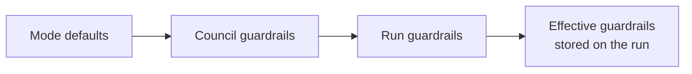

# Guardrails and Approvals

Guardrails are the limits and policies a run works within. They are enforced by the runtime,
not requested of the model: a budget breach halts the run, a denied tool is never called, and a
blocked thought is never acted on. Approvals are the human half: tool calls with risky tags wait
for your decision.

## Layering

Guardrails are deep-merged from three layers, later layers overriding earlier ones:



Councils and runs validate their layer when saved, so a typo such as `{"budjet": ...}` is
rejected with `422` instead of failing when the run starts. The only mode default today is for
`coding` councils with the isolated sandbox, which drops `shell` from `approval_required`.

## Reference

| Key | Default | Meaning |
| --- | --- | --- |
| `budget.usd` | `5.0` | Spend limit in US dollars (`null` for none) |
| `budget.tokens` | `2000000` | Token limit, input plus output (`null` for none) |
| `max_steps` | `80` | Agent model calls the whole run may make |
| `max_runtime_minutes` | `60` | Wall-clock limit |
| `max_parallel_agents` | `4` | Steps that may run at once |
| `max_agent_iterations` | `12` | Model and tool round-trips per agent per step |
| `max_subcouncil_depth` | `2` | How deep sub-councils may nest (0 to 5) |
| `tools.allow`, `tools.deny` | `["*"]`, `[]` | Glob patterns of tool names. A deny entry such as `shell:rm -rf*` matches the command line |
| `skills.allow`, `skills.deny` | `["*"]`, `[]` | Which skills the council may load |
| `network.allow_domains` | `["*"]` | Domains `web_fetch` may reach |
| `network.block_private_ips` | `true` | Refuse private, loopback, link-local and metadata addresses |
| `approval_required` | `shell`, `package_install`, `remote_agent`, `network_write` | Risk tags that need a human decision |
| `content_policy.preset` | `standard` | `off`, `standard` or `strict` (strict also flags prompt-injection phrases) |
| `content_policy.blocked_topics` | `[]` | Phrases that block a thought outright |
| `sandbox.root` | `/workspace` | Workspace root for file tools |
| `sandbox.read_only_paths` | `[]` | Paths file tools may not write |
| `sandbox.max_file_mb` | `10` | Largest file an agent may write |
| `oversight.intercept_mode` | `hold` | The furthest overseer agents may go: `annotate`, `hold` or `block` |
| `oversight.monitor_sensitivity` | `medium` | `off`, `low`, `medium` or `high`: which thoughts overseers review (below) |
| `oversight.loop_threshold` | `3` | Repeats of the same thought that count as a loop |
| `oversight.max_corrections_per_thought` | `2` | Regenerations a held thought gets |

```json
{
  "budget": {"usd": 3, "tokens": 500000},
  "max_runtime_minutes": 30,
  "tools": {"deny": ["shell:rm -rf*", "fs_delete"]},
  "network": {"allow_domains": ["*.arxiv.org", "*.nature.com"]},
  "approval_required": ["shell", "remote_agent", "network_write"],
  "oversight": {"intercept_mode": "annotate", "monitor_sensitivity": "high"}
}
```

## Oversight

Each thought is reviewed before it is acted on ([diagram](../architecture.md#the-thought-bus)):

1. **Deterministic guardrails** block a thought that mentions a blocked topic or makes a tool call
   that matches a `tool:pattern` deny rule or a destructive shell command. Secret-like values are
   redacted, and with the `strict` preset prompt-injection phrases are flagged.
2. **The loop detector** blocks a thought repeated `loop_threshold` times.
3. **Overseer agents** (security, then monitor, then critic) return `pass`, `annotate`, `hold` or
   `block`, capped at `oversight.intercept_mode`.

Overseers never review their own thoughts, and `monitor_sensitivity: off` turns them all off.
Otherwise the security officer reviews every thought that calls a tool or contains code; the
critic reviews final answers at `medium` and `high`; the monitor reviews thoughts that call tools
at `low`, adds final answers at `medium`, and reviews everything at `high`.

Deterministic blocks are never downgraded by the cap. Tool output is treated as untrusted data:
secrets in it are redacted and instruction-like text is flagged before an agent sees it.

## Approvals

A tool declares risk tags; when any of them is in `approval_required`, the call waits. The run
emits `approval.requested` (also sent as a webhook and an in-app notification), and you answer
in the run workspace or with:

```bash
curl -X POST localhost:8000/api/v1/runs/$RUN/approvals/$APPROVAL -H "Authorization: Bearer $TOKEN" \
  -H 'content-type: application/json' \
  -d '{"decision":"approve","edited_args":{"command":"pytest -q"},"reason":"narrowed the command"}'
```

`edited_args` replaces the call's arguments before it runs. Approvals still open when a run ends
expire. Calls to MCP servers can also need approval through the server's
[trust level](../protocols.md#mcp-trust-levels), and remote-agent delegations through the agent's
`requires_approval` flag.

## Limits and halting

Budget, steps, runtime and file size are checked throughout. A breach raises a violation event
and halts the run with status `halted` and the violation as its error. The budget meter in the run
workspace shows spend against the limits live (from ephemeral `budget.update` events).
