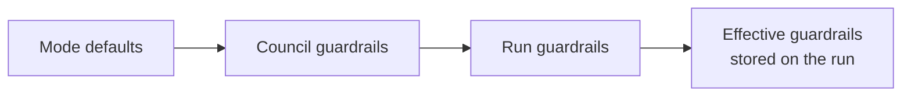

# Guardrails and Approvals

Guardrails are the limits and policies a run works within. They are enforced by the runtime,
not requested of the model: a budget breach halts the run, a denied tool is never called, and a
blocked thought is never acted on. Approvals are the human half: tool calls with risky tags wait
for your decision.

## Layering

Guardrails are deep-merged from three layers, later layers overriding earlier ones:



Councils and runs validate their layer when saved, so a typo such as `{"budjet": ...}` is
rejected with `422` instead of failing when the run starts. The only mode default today is for
`coding` councils with the isolated sandbox, which drops `shell` from `approval_required`.

## Reference

| Key | Default | Meaning |
| --- | --- | --- |
| `budget.usd` | `5.0` | Spend limit in US dollars (`null` for none) |
| `budget.tokens` | `2000000` | Token limit, input plus output (`null` for none) |
| `max_steps` | `80` | Agent model calls the whole run may make |
| `max_runtime_minutes` | `60` | Wall-clock limit |
| `max_parallel_agents` | `4` | Steps that may run at once |
| `max_agent_iterations` | `12` | Model and tool round-trips per agent per step |
| `max_subcouncil_depth` | `2` | How deep sub-councils may nest (0 to 5) |
| `tools.allow`, `tools.deny` | `["*"]`, `[]` | Glob patterns of tool names. A deny entry such as `shell:rm -rf*` matches the command line |
| `skills.allow`, `skills.deny` | `["*"]`, `[]` | Which skills the council may load |
| `network.allow_domains` | `["*"]` | Domains `web_fetch` may reach |
| `network.block_private_ips` | `true` | Refuse private, loopback, link-local and metadata addresses |
| `budget.buffer_usd`, `budget.buffer_tokens` | `0`, `0` | A reserve drawn without asking when the run reaches its budget, instead of halting ([below](#budget-reserve)) |
| `approval_required` | `shell`, `package_install`, `remote_agent`, `network_write` | Risk tags that need a human decision |
| `auto_mode` | `false` | Approve every request without asking, except limit raises ([Auto mode](#auto-mode)) |
| `content_policy.preset` | `standard` | `off`, `standard` or `strict` (strict also flags prompt-injection phrases) |
| `content_policy.blocked_topics` | `[]` | Phrases that block a thought outright |
| `sandbox.root` | `/workspace` | Workspace root for file tools |
| `sandbox.read_only_paths` | `[]` | Paths file tools may not write |
| `sandbox.max_file_mb` | `10` | Largest file an agent may write |
| `oversight.intercept_mode` | `hold` | The furthest overseer agents may go: `annotate`, `hold` or `block` |
| `oversight.monitor_sensitivity` | `medium` | `off`, `low`, `medium` or `high`: which thoughts overseers review (below) |
| `oversight.loop_threshold` | `3` | Repeats of the same thought that count as a loop |
| `oversight.max_corrections_per_thought` | `2` | Regenerations a held thought gets |
| `report.enabled` | `null` | Build a structured report: `null` means research and general runs ([Reports](reports.md)) |
| `report.depth` | `extensive` | `brief`, `standard` or `extensive` |
| `report.max_review_rounds` | `3` | Review-and-revise rounds before delivery (0 to 6) |
| `report.pass_score` | `85` | Quality score a report needs to pass |
| `report.human_checkins` | `false` | Pause for your approval of the report outline |
| `extensions.enabled` | `true` | Ask to raise a limit the run reaches instead of halting (below) |
| `extensions.limits` | `max_steps`, `max_agent_iterations`, `max_runtime_minutes`, `budget.tokens` | Limits that may be raised; add `budget.usd` to be asked about spend too |
| `extensions.factor` | `0.5` | Each raise adds this share of the starting limit |
| `extensions.max_extensions` | `3` | Raises per limit per run |
| `extensions.auto_approve` | `false` | Raise limits without asking, still within `limits` and `max_extensions` |
| `context.condense` | `true` | Summarise an agent's older history when it outgrows the budget (below) |
| `context.budget_chars` | `120000` | History size each agent turn re-sends before trimming and condensing |

```json
{
  "budget": {"usd": 3, "tokens": 500000},
  "max_runtime_minutes": 30,
  "tools": {"deny": ["shell:rm -rf*", "fs_delete"]},
  "network": {"allow_domains": ["*.arxiv.org", "*.nature.com"]},
  "approval_required": ["shell", "remote_agent", "network_write"],
  "oversight": {"intercept_mode": "annotate", "monitor_sensitivity": "high"}
}
```

## Oversight

Each thought is reviewed before it is acted on ([diagram](../architecture.md#the-thought-bus)):

1. **Deterministic guardrails** block a thought that mentions a blocked topic or makes a tool call
   that matches a `tool:pattern` deny rule or a destructive shell command. Secret-like values are
   redacted, and with the `strict` preset prompt-injection phrases are flagged.
2. **The loop detector** blocks a thought repeated `loop_threshold` times.
3. **Overseer agents** (security, then monitor, then critic) return `pass`, `annotate`, `hold` or
   `block`, capped at `oversight.intercept_mode`.

Overseers never review their own thoughts, and `monitor_sensitivity: off` turns them all off.
Otherwise the security officer reviews every thought that calls a tool or contains code; the
critic reviews final answers at `medium` and `high`; the monitor reviews thoughts that call tools
at `low`, adds final answers at `medium`, and reviews everything at `high`.

Deterministic blocks are never downgraded by the cap. Tool output is treated as untrusted data:
secrets in it are redacted and instruction-like text is flagged before an agent sees it.

## Approvals

A tool declares risk tags; when any of them is in `approval_required`, the call waits. The run
emits `approval.requested` (also sent as a webhook and an in-app notification), and you answer
in the run workspace or with:

```bash
curl -X POST localhost:8000/api/v1/runs/$RUN/approvals/$APPROVAL -H "Authorization: Bearer $TOKEN" \
  -H 'content-type: application/json' \
  -d '{"decision":"approve","edited_args":{"command":"pytest -q"},"reason":"narrowed the command"}'
```

`edited_args` replaces the call's arguments before it runs. Approvals still open when a run ends
expire. Calls to MCP servers can also need approval through the server's
[trust level](../protocols.md#mcp-trust-levels), and remote-agent delegations through the agent's
`requires_approval` flag.

### Auto mode

With `auto_mode` on, agents never stop to ask. Each request is still put on the record: the
run emits `approval.requested` (flagged `auto: true`), then at once `approval.resolved` with
`{"decision": "approved", "by": "auto"}`. The workspace shows those requests as *Auto-approved*,
and the in-app bell skips them. Report outline check-ins are approved the same way. Auto mode only
answers questions. It never widens permissions: `tools.deny`, destructive-shell blocks, the
content policy and the network policy still block.

`extensions.auto_approve` does the same for limit raises (below), so a long run is not stopped
by "raise the step limit?" questions. It stays within `extensions.limits` and
`extensions.max_extensions`, and only raises spend when `budget.usd` is listed.

Both can be switched while a run is live, from the **Auto mode** control next to Pause in the run
workspace, or with:

```bash
curl -X POST localhost:8000/api/v1/runs/$RUN/auto-mode -H "Authorization: Bearer $TOKEN" \
  -H 'content-type: application/json' -d '{"tools": true, "extensions": true}'
```

Turning a switch on also approves the requests already waiting that it now covers. The change is
recorded as a `run.auto_mode` event and passed on to running sub-councils. Sub-councils inherit
`auto_mode` from their parent.

### Budget reserve

`budget.buffer_usd` (and `budget.buffer_tokens`) is spending you approve in advance. When the run
reaches its dollar budget (or token cap), it adds the whole reserve to the limit and carries on,
without asking and without halting. A `guardrail.extended` event marked `buffer: true` records
this. The reserve works even with `extensions` off. It is drawn once, and the run halts if it runs
out again. The report pipeline counts an unused reserve as money it may spend, so it does not drop
report stages to stay under the base budget.

On a live run, the **Budget** control in the run workspace, or `POST /runs/{id}/budget`, raises
the budget at once (`add_usd`, `add_tokens`) or sets or refills the reserve (`buffer_usd`,
`buffer_tokens`):

```bash
curl -X POST localhost:8000/api/v1/runs/$RUN/budget -H "Authorization: Bearer $TOKEN" \
  -H 'content-type: application/json' -d '{"add_usd": 2.5, "buffer_usd": 5}'
```

The change is recorded as a `budget.adjusted` event. A run that already halted can be
[resumed](runs.md#resuming-a-stopped-run) with a bigger budget instead.

## Limits and halting

Budget, steps, runtime and file size are checked throughout. When the run reaches a limit listed
in `extensions.limits`, it first asks you, in the approval queue (risk `limit_extension`), whether
to raise it, by `extensions.factor` of the starting limit (80 steps become 120, then 160):

- **Approve** and the run carries on under the new limit (a `guardrail.extended` event records it).
  Agents that hit the same limit at the same time share one request. Time spent waiting for your
  answer does not count toward the runtime limit. Through the API, an approval may set the new
  value itself with `edited_args: {"limit": N}`.
- **Reject**, or let the request expire, and the run halts as before; it does not ask again for that
  limit. After `extensions.max_extensions` raises it halts without asking.

The same applies per agent: an agent that reaches `max_agent_iterations` while still calling tools
asks to raise it (for the whole run) rather than stopping mid-task. Sub-councils never ask: they
halt at their limits, which stay within their parent's.

A breach that is not raised halts the run with status `halted` and the violation as its error. The budget meter in the run
workspace shows spend against the limits live (from ephemeral `budget.update` events).

## Context condensation

Each agent turn re-sends the agent's history. Past `context.budget_chars`, older tool outputs are
first cut to a short preview (the newest three and any loaded skill stay whole). If the history is
still too long, one call on the agent's own model summarises the middle of it (the facts, figures,
sources and decisions so far, and what remains) into its task message, keeping the latest two turns
verbatim; a `context.condensed` event records how much was folded. The call counts toward the
budget but not toward `max_steps`. Seats that run through a CLI agent keep their own session
context and are not condensed, and a failed summary leaves the trimmed history as it was.
