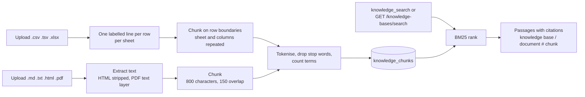

# Knowledge and Memory

Councils can draw on two kinds of stored knowledge: **knowledge bases**, which hold documents you
upload, and **memory**, which holds short notes councils (or you) save to recall in later runs.
Both are searched with BM25 inside the database: no embedding service, vector store or external
call is involved.

## Knowledge bases



| Endpoint | Purpose |
| --- | --- |
| `POST /knowledge-bases` | Create a knowledge base |
| `GET /knowledge-bases`, `GET /knowledge-bases/{id}` | List, with document and chunk counts |
| `PATCH /knowledge-bases/{id}`, `DELETE /knowledge-bases/{id}` | Rename or delete (with its documents) |
| `POST /knowledge-bases/{id}/documents` | Upload one file (multipart field `file`) |
| `GET /knowledge-bases/{id}/documents`, `DELETE .../documents/{doc_id}` | List or remove documents |
| `GET /knowledge-bases/{id}/search?q=...&k=10` | Search one knowledge base |
| `GET /knowledge-bases/search?q=...&kb=<id>&kb=<id>` | Search several, or all of yours |

Accepted files, up to 5 MB each:

| Kind | Extensions | How it is read |
| --- | --- | --- |
| Text | `.md`, `.markdown`, `.txt`, `.html`, `.htm` | UTF-8; HTML reduced to its text |
| PDF | `.pdf` | The text layer, up to 500 pages; scans without text and password-protected files are refused |
| Spreadsheets | `.csv`, `.tsv`, `.xlsx` | Every sheet, as described below |

Legacy and macro workbooks (`.xls`, `.xlsm`, `.xlsb`, `.ods`) are refused with `415`: save the sheet
as `.xlsx` or `.csv`. Limits: 2,000 chunks per knowledge base, 100 knowledge bases per account, and
`k` up to 50.

### Spreadsheets

Each sheet becomes a `## Sheet: <name> (N rows x M columns)` heading, a `Columns:` line taken from its
first non-empty row, and one line per row with every non-empty cell labelled by its column:

```text
## Sheet: Quotes (4 rows x 4 columns)
Columns: Vendor | Part | Price (INR) | Notes
Row 2: Vendor: SP Road A | Part: RX 9070 XT | Price (INR): 80000 | Notes: itemised
```

Chunks break only between rows and repeat the sheet heading and columns, so every search hit says
which sheet and columns it came from. Workbook formulas are read as their last computed values,
dates as ISO dates, and whole numbers without a trailing `.0`. CSV delimiters (`,` `;` tab `|`) are
detected, and files saved as Windows-1252 rather than UTF-8 are accepted. Bounds: 50 sheets, 50,000
rows, 200 columns; a workbook that would unzip to more than 200 MB (or 200 times its size) is
refused, and its XML is parsed with `defusedxml`.

### In a run

Agents with `knowledge_search` (most roles; see [Runs and Modes](runs.md#modes-and-tools)) search
your knowledge bases and get ranked passages labelled `[knowledge base/document#chunk]`, which they
are told to cite. They can restrict a search to named knowledge bases.

`knowledge_read` reads a whole document in order, by file name or document id, paged with
`start`/`next` for long documents. A spreadsheet comes back as its complete rows, so an agent can
compute totals, ranges and comparisons over the full table rather than over the passages a search
happened to return.

## Memory

Memory is scoped to a council. Agents save durable notes with `memory_write` and recall them with
`memory_search`; runs without a saved council share your council-less memory.

| Endpoint | Purpose |
| --- | --- |
| `GET /memory` | List or search notes: `scope` (`all`, `council` or `global`), `council_id`, `q` |
| `POST /memory` | Add a note (optionally for a council) |
| `DELETE /memory/{id}` | Remove a note |

Notes are up to 4,000 characters, with up to 2,000 notes per scope. The web UI's `/knowledge`
page manages both knowledge bases and memory.

Write endpoints need the `knowledge:write` scope.
