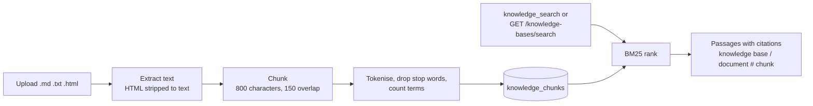

# Knowledge and Memory

Councils can draw on two kinds of stored knowledge: **knowledge bases**, which hold documents you
upload, and **memory**, which holds short notes councils (or you) save to recall in later runs.
Both are searched with BM25 inside the database: no embedding service, vector store or external
call is involved.

## Knowledge bases

| Endpoint | Purpose |
| --- | --- |
| `POST /knowledge-bases` | Create a knowledge base |
| `GET /knowledge-bases`, `GET /knowledge-bases/{id}` | List, with document and chunk counts |
| `PATCH /knowledge-bases/{id}`, `DELETE /knowledge-bases/{id}` | Rename or delete (with its documents) |
| `POST /knowledge-bases/{id}/documents` | Upload one file (multipart field `file`) |
| `GET /knowledge-bases/{id}/documents`, `DELETE .../documents/{doc_id}` | List or remove documents |
| `GET /knowledge-bases/{id}/search?q=...&k=10` | Search one knowledge base |
| `GET /knowledge-bases/search?q=...&kb=<id>&kb=<id>` | Search several, or all of yours |

Accepted files are Markdown, plain text and HTML, up to 5 MB each. PDF is recognised and refused
with `415` (convert it to text first). Limits: 2,000 chunks per knowledge base, 100 knowledge
bases per account, and `k` up to 50.

During a run, agents with `knowledge_search` (most roles; see [Runs and Modes](runs.md#modes-and-tools))
search your knowledge bases and get ranked passages labelled `[knowledge base/document#chunk]`,
which they are told to cite. They can restrict a search to named knowledge bases.

## Memory

Memory is scoped to a council. Agents save durable notes with `memory_write` and recall them with
`memory_search`; runs without a saved council share your council-less memory.

| Endpoint | Purpose |
| --- | --- |
| `GET /memory` | List or search notes: `scope` (`all`, `council` or `global`), `council_id`, `q` |
| `POST /memory` | Add a note (optionally for a council) |
| `DELETE /memory/{id}` | Remove a note |

Notes are up to 4,000 characters, with up to 2,000 notes per scope. The web UI's `/knowledge`
page manages both knowledge bases and memory.

Write endpoints need the `knowledge:write` scope.
