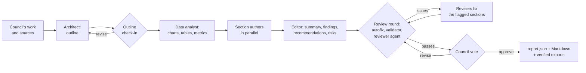

# Reports

Research and general runs deliver a **structured report**, not a single Markdown answer. After the
council has done its work, a pipeline of specialised agents outlines, charts, drafts, frames and
reviews the report, with check-ins along the way and a review loop that keeps correcting it until it
passes its quality checks. The report is stored as `report.json` beside its Markdown rendition
(`report.md` or `deliverable.md`, the run's result) and rendered to every output format you ask for.

Coding and chat runs keep their plain deliverable (`SUMMARY.md`, `answer.md`). Sub-councils do too:
their deliverable goes back to the parent as text.

## The pipeline



| Stage | Agent (the member best suited, by competence for the cost) | What it produces |
| --- | --- | --- |
| Outline | Architect, usually the chair | Sections in argument order, what each must establish, the visuals that carry its evidence |
| Outline check-in | Validator, then an independent reviewer (critic or analyst), then optionally you | Approval, or notes the architect revises the outline with |
| Data | Data analyst | Datasets for charts, tables and headline metrics, using only numbers found in the evidence |
| Sections | Section authors, spread across the most competent writers by load | Each section in depth, from the passages of evidence most relevant to it (BM25), with citations |
| Framing | Editor | Executive summary, key findings with confidence, metrics, recommendations by priority, risks, methodology, limitations, glossary |
| Review rounds | Reviewer agent plus the deterministic validator | A score from 0 to 100 and issues tied to the section they belong to |
| Revision | Revisers (section issues) and the editor (summary-level issues) | Rewrites of exactly the flagged parts |

Section authors place the analyst's charts by id (`{"type": "chart", "ref": "d1"}`), so the numbers
a chart draws are always the analyst's, never figures made up while writing.

## Check-ins

Every stage reports `report.stage` events, every check-in a `report.checkin` event and every review
round a `report.qa` event; the run's timeline shows them as they happen.

To approve the outline yourself, turn on **Let me check the outline** in the composer, or set
`guardrails.report.human_checkins`. The run pauses with an approval request once the outline is
ready. Approve it to continue, or reject it with a reason: the reason goes to the architect as
revision notes.

## The review loop

Each round:

1. **Autofix** repairs what needs no judgement: chart series that do not match their categories,
   ragged table rows, empty blocks, a line chart with a single point, more than eight series,
   citations to references that do not exist, missing ids.
2. **The validator** checks structure (sections, headings, empty sections, long paragraphs), data
   (chart and table shapes, titles, sources), content (length and visuals for the depth, findings,
   recommendations, placeholders such as `TODO`, repeated text), citations (`[n]` must name a
   reference; uncited findings, unused references) and **provenance**: numbers in charts and metrics
   that appear nowhere in the council's evidence are flagged as unverified.
3. **A reviewer agent** fact-checks the report against the evidence and scores it.

The round's score is 60% validator and 40% reviewer. A report passes with no errors and a score of at
least `pass_score` (85). Otherwise the flagged sections go to revisers and the loop runs again, up to
`max_review_rounds`. A revision that scores lower than the version before it is **rolled back**, and
the loop stops: you always get the best version the reviewers saw. Whatever is left unresolved is
listed as open issues in the report itself.

If the council then votes to revise, its critiques go through one more review round.

## Budget awareness

Before every agent call the pipeline checks the run's remaining dollars, tokens, steps and time, and
keeps headroom for the vote. A stage it cannot afford falls back to a deterministic result (the
outline from the council's plan, sections from the evidence, the summary from the section
summaries) and records `skipped` in the quality appendix. If the pipeline fails outright, the writer
synthesises a Markdown deliverable and it is converted into a structured report (sections, tables,
and a bar chart for any table with numeric columns), so a run never loses its result to the report.

## What a report contains

Title and subtitle, executive summary, headline metrics, key findings (with confidence, evidence and
citations), numbered sections and subsections, recommendations by priority, a risk register, the
methodology, limitations, a glossary, references (from the sources the council read, numbered as
the agents cited them), appendices, and two closing parts: **Quality assurance** (every review round
with its score, errors, warnings and fixes, a chart of the score by round, the check-ins, which
agent and model ran each stage, open issues) and **Council and cost** (the members and models, the
run's spend and token use).

Blocks inside a section are paragraphs, bullet and numbered lists, tables, charts, callouts (info,
success, warning, danger), quotes, metric cards and code. Charts are `bar`, `hbar`, `stacked_bar`,
`line`, `area`, `pie`, `donut` and `scatter`. Generated figures accompany the data: findings by
confidence, recommendations by priority and a likelihood-by-impact **risk matrix**.

## Output formats

| Format | What you get |
| --- | --- |
| `pdf` | Typeset with reportlab: cover page, clickable contents with lists of figures and tables, PDF bookmarks, running headers and footers, KPI cards, vector charts, citations linked to the references |
| `html` | One self-contained page with no scripts and a strict Content-Security-Policy: sticky contents, inline SVG charts each with a *Show the data* table, light and dark themes, print styles |
| `docx` | Word: title page, a contents field, styled tables, charts as images with captions, hyperlinks, page numbers |
| `latex` | A complete article: title page, contents and lists of figures and tables, booktabs tables, charts drawn natively with pgfplots and TikZ |
| `md` | GitHub-flavoured Markdown with Mermaid charts and a data table under each |
| `txt` | Plain text with aligned tables and ASCII bar charts |
| `json` | The report itself (`report.json`'s schema) |

Charts use one colour-blind-safe categorical palette in every format, at most eight series, status
colours only for state (risk level, priority, confidence) and always with a text label.

### Rendering is checked too

Every export is read back before it is saved: the PDF's extracted text must contain the title and
every section heading, the DOCX is reopened and its headings and pictures counted, the HTML is parsed
for its headings and figures (and must contain no script), LaTeX environments must balance, JSON must
load back into a report. A failing render is retried sanitised, then with every chart replaced by its
data table, then with the plain exporter, and the export's `export.status` event lists what was
needed. Exporting a finished run later (`POST /runs/{id}/exports`) reads `report.json` back, so a new
format gets the full report too.

## Settings

`guardrails.report` (run, council or mode layer; see [Guardrails](guardrails.md#reference)):

| Key | Default | Meaning |
| --- | --- | --- |
| `enabled` | `null` | `null`: on for research and general runs; `true` or `false` to force it |
| `depth` | `extensive` | `brief` (3-4 sections), `standard` (5-6) or `extensive` (7-9), with matching length and visual targets |
| `max_review_rounds` | `3` | Review rounds (0 to 6; 0 runs the validator once, with no reviewer agent) |
| `pass_score` | `85` | Score a report needs, with no errors, to pass |
| `human_checkins` | `false` | Pause for your approval of the outline |

```json
{"guardrails": {"report": {"depth": "standard", "max_review_rounds": 2, "human_checkins": true}}}
```
