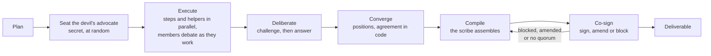

# Runs and Modes

A run is one piece of work by a council: a topic, an optional description, a mode, the output
formats you want and the guardrails that bound it. Runs are created with `POST /api/v1/runs`,
from a [template](#templates), or by other agents over [MCP or A2A](../protocols.md).

## Starting a run

| Field | Default | Meaning |
| --- | --- | --- |
| `topic` | required | What the council works on (up to 500 characters) |
| `description` | empty | Goal, constraints and context (up to 20,000 characters) |
| `mode` | `general` | `general`, `research`, `coding` or `chat` |
| `council_id` | none | Use a saved council; without it an ad-hoc council is seated |
| `size` | per mode | Seats for an ad-hoc council |
| `provider`, `model` | `mock`, `mock-1` | Provider and model for an ad-hoc council's seats |
| `outputs` | `["md"]` | Any of `md`, `txt`, `html`, `latex`, `pdf`, `docx`, `json` |
| `guardrails` | `{}` | The run's guardrail layer ([Guardrails](guardrails.md)) |

Send an `Idempotency-Key` header to make retries safe ([Integration](../integration.md#idempotent-run-creation)).

The [lifecycle](../architecture.md#run-lifecycle) is `queued`, `running` (with `paused` in
between), and then one of `completed`, `failed`, `cancelled` or `halted`. Control a run with
`POST /runs/{id}/pause`, `/resume` and `/cancel`; delete a finished run with
`DELETE /runs/{id}`. `GET /runs` lists top-level runs, newest first (sub-council runs are reached
through their parent). For a live run it includes `pending_approvals`, the approval requests
waiting for you.

## How a run works

A run goes through these phases. Each one's tasks run at the same time wherever they can, up to
`max_parallel_agents` (8 by default).



1. **Plan.** The chair splits the topic into steps with assignees, keeping them independent unless
   one truly needs another's output, so most of them start at once.
2. **Seat the devil's advocate.** One debater is picked at random, in code, and told privately
   ([The devil's advocate](councils.md#the-devils-advocate)). Only you see who.
3. **Execute.** Every step whose dependencies are done runs, in parallel. Members see each other's
   work on the board and in *Working now*, run their read-only and council tool calls at the same
   time, start [helpers](councils.md#helpers), and claim, challenge and answer while they work. The
   chair can add steps with `add_step`; they start as soon as they are ready. The phase ends when
   every step and every helper has finished.
4. **Deliberate, converge, compile, co-sign.** The council argues out what is still open, takes
   positions, has the agreed text compiled by a scribe and co-signs it
   ([A collective conclusion](councils.md#a-collective-conclusion)).
5. **Deliver.** The deliverable, with its *How the council reached this* section and the authors'
   byline, is written to the workspace and exported.

In report mode (research and general runs by default) the report pipeline builds the report after
converging, in place of the scribe, and co-signing is its vote ([Reports](reports.md)). With
`debate.enabled: false`, with fewer than two debaters, and in sub-councils, steps 4 and 5 are one
synthesis by the writer and a majority vote, with one revision if the vote fails. You can step in at
any phase ([Stepping in](#stepping-in)); the council never stops to wait for you.

## Resuming a stopped run

A run that is `halted`, `failed` or `cancelled` can be resumed where it stopped: **Resume where it
stopped** in the run workspace, or `POST /runs/{id}/continue`. That starts a new run with the same
topic, council, outputs and linked knowledge, and `resumed_from_id` pointing back. Its guardrails
are the old run's, with any `{"guardrails": {...}}` you send merged over them, for example a bigger
budget.

The new run goes through the same sequence: plan, steps, report stages, votes. Every agent task the
old run finished is **replayed**: its recorded answer comes back at once, with no model call and no
step counted. Only work that never finished calls a model. A run halted while writing its report
therefore goes straight back to the report, with its research intact. Citations keep their
numbers. The whole board carries over: step results, reviews and helpers' results as well as notes
(every note is recorded as a `board.note` event). Workspace files carry over too, but exports are
made again. Linked knowledge bases carry over, and one deleted since is left out instead of
refusing the resume. The timeline opens with
a *Resumed from the earlier run* row saying how much was reused.

The debate and the council's growth resume too:

* **The devil's advocate** is the same member as in the old run (its pick is recorded as a finished
  task).
* **Debate moves** (claims, challenges, answers, resolutions) made while the old run worked are put
  back on record before deliberating. Deliberation, positions, compiling and co-signing are tasks
  like any other: finished ones replay with their moves, and ids follow from content, so nothing is
  recorded twice.
* **Steps the chair added** with `add_step` are added again, with the same ids, at the start of the
  execute phase (from the old run's `step.added` events); their finished work replays.
* **Helpers** keep their ids when the same member spawns the same work again, so a helper that had
  finished replays its answer. A step that had finished replays without spawning its helpers again.

Each finished task is recorded as a `task.completed` event, which is what a resume replays. Runs
from before resuming existed have no such records. For those, the plan and every finished step are recovered
from the run's other events, and the report is built again.

*Start a follow-up run* is different: it only copies the topic into Home, for a fresh run on the
same subject.

## Shared knowledge between runs

What a council learns is not left behind in the run that learned it:

* **The board is inherited.** A new run starts with the board of the latest earlier run of the same
  council, or, for runs without a council, of your other runs without one. That's the 40 newest
  notes, each marked *(earlier run)* and still credited to the member that wrote it. The timeline
  opens with a *Started with the board of the earlier run* row.
  * The next run inherits the same notes, so a chain of runs keeps building one board.
  * Turn it off with `guardrails.graph.inherit_board: false`.
* **All your knowledge is in reach.** Every run is told about all the knowledge it can search:
  * the knowledge bases linked to it, which are searched first;
  * every other knowledge base you added;
  * the research library of sources earlier runs read.

  `knowledge_search` covers all of it, unless a council limits its knowledge bases.
* **The council's knowledge graph** recalls what earlier runs of the same council knew (see
  [graph context](councils.md#the-council-knowledge-graph)).

## Modes and tools

| Mode | What the council does | Key tools |
| --- | --- | --- |
| `research` | Frames sub-questions, gathers evidence, analyses, writes a cited report | `web_search`, `web_fetch` (every fetch becomes a numbered source), `notes_*`, `knowledge_search`, the `research-report` skill |
| `coding` | Designs, implements, tests and documents software | `fs_read`, `fs_write`, `fs_edit`, `fs_list`, `fs_search`, `fs_delete` on a versioned workspace, `shell` in the sandbox |
| `chat` | Answers directly with an overseer watching | notes, skills, knowledge, web (assistant) |
| `general` | Plans and produces whatever is asked | every permitted tool |

Which tools a seat may call comes from its role's defaults (listed by `GET /api/v1/roles`) or
the seat's own `tools`, always within the run's guardrails. Most roles get notes, artifacts,
skills, `knowledge_search`, `knowledge_read`, `memory_*` and the `mcp__*` tools of your MCP
servers; the researcher and assistant add the web tools (including `news_search` and
`market_data`) and `remote_agent`; the scout, market analyst and fact checker are built around the
live web tools, and the data analyst around `knowledge_read`; the coder and tester add `fs_*`
and `shell`, and the chair adds `remote_agent` and `subcouncil`. Of the overseers, the critic
and monitor have no tools and the security officer can only read files, notes and artifacts.

**Sandbox.** `shell` commands run in the separate `sandbox` container: no network route (an
internal Docker network), a read-only root filesystem, a tmpfs work area, all capabilities
dropped, and CPU, memory and pid limits plus per-command rlimits. The workspace is copied in and
changed files are versioned back. Because the sandbox is isolated, coding councils that use it run
`shell` without per-command approval; everything else in `approval_required` still asks.

**Web.** `web_fetch` fetches only `http` and `https` URLs. It enforces
`guardrails.network.allow_domains`, rejects hosts that resolve to private, loopback, link-local
or metadata addresses (checked again on every redirect), caps size and content types, strips
scripts and navigation, and treats page text as untrusted data. `web_search` uses SearXNG, Tavily
or Brave (`ARGUS_SEARCH_PROVIDER`); without one configured there is no general web search.

**Live data.** Two keyless tools work without a search provider and under the same network checks
as `web_fetch` (allowed domains, private-address blocking, per-redirect checks):

- `market_data(symbols, period)`: the latest quote, or a daily history (`5d` to `5y`) with first,
  last, low and high, for up to 10 symbols per call. Stocks (`AAPL`, `RELIANCE.NS`), indices
  (`^NSEI`), FX (`USDINR=X`), crypto (`BTC-USD`) and futures (`GC=F`), from the Yahoo Finance
  chart API with Stooq as a fallback for plain quotes. Every answer carries the market time and
  the retrieval time, and each symbol that fails says so rather than being filled in.
- `news_search(query, when, region)`: recent articles from the Google News feed (last day, week,
  month or any time), with outlet and publication time. The feed's DOCTYPE is removed before
  parsing, so no XML entity is ever expanded.

Both record every data URL as a numbered source. With `network.allow_domains` narrowed, add
`query1.finance.yahoo.com`, `stooq.com` and `news.google.com` for them to work. `web_fetch` also
reads CSV, TSV, RSS and Atom documents (for example a statistics agency's CSV download).

## Stepping in

`POST /runs/{id}/interventions` takes a `kind`, an optional `target` (`member_id`,
`thought_id`, `intercept_id`), optional `text` and an optional `scope` (`thought`, `member` or
`council`).

| Kind | Effect |
| --- | --- |
| `message` | Send a message to one member or the whole council |
| `intercept`, `hold` | Hold a member; with `text`, correct it and release it straight away |
| `release` | Release a held member |
| `correct` | Correct one member (and release it) or, with no target, the whole council |
| `halt_all` | Hold every member |
| `release_all` | Release every member |

Helpers are members too while they work: you can message, hold and correct them like any seat.

A message from you is an A2A message with role `user` ([How members talk to each
other](councils.md#how-members-talk-to-each-other)). The members it addresses that are working
receive it at their next turn, and it stays in every addressed member's instructions for the rest
of the run, so a member that starts work later still follows it. Members acknowledge it with the
`reply_to_user` tool, giving its message id; the timeline shows the answer as *Ben replied to
you*. Your message is recorded in the ledger as an inbound A2A entry, and each reply as an outbound
one.

`POST /runs/{id}/a2a` takes the same message in A2A form (the params of `message/send`) and
returns the recorded A2A message with `202`:

```bash
curl -X POST localhost:8000/api/v1/runs/$RUN/a2a -H "Authorization: Bearer $TOKEN" \
  -H 'content-type: application/json' \
  -d '{"message": {"role": "user", "parts": [{"kind": "text", "text": "Use only 2025 sources"}],
       "metadata": {"to": "Analyst"}}}'
```

`metadata.to` names one member by name or role. Leave it out (or use `council`) to address the
whole council. A name that matches no member, or a role held by several, returns `404`; a run that
is not live returns `409`. An optional `messageId` is kept as the message's id. The call needs the
`runs:write` scope.

Approvals are answered with `POST /runs/{id}/approvals/{approval_id}` and
`{"decision": "approve" | "reject", "edited_args": {...}, "reason": "..."}`; `edited_args` replaces
the tool call's arguments. Approvals still open when a run ends expire.

## Events, replay and streaming

Every durable event is stored with a per-run sequence number:

* `GET /runs/{id}/events?after_seq=N` returns the log.
* `GET /runs/{id}/snapshot?at_seq=N` rebuilds the run's state (plan, members, budget, votes) as of
  any point, for replay.
* `POST /runs/{id}/stream-ticket` then `GET /runs/{id}/events/stream?ticket=...` streams events
  live with Server-Sent Events, resuming from `after_seq` or `Last-Event-ID`.

Every outbound MCP or A2A call an agent makes appears on the stream as a `protocol.call`
event carrying the protocol, peer, method, status, latency and the matching ledger entry's
`ledger_id` and `hash` ([Ledger](../protocols.md#ledger)).

## Outputs and artifacts

The deliverable is written to the run's workspace (`report.md`, `SUMMARY.md`, `answer.md` or
`deliverable.md` by mode) and exported to every requested format when the run completes. Exports
escape raw HTML from model output and drop unsafe link schemes.

| Endpoint | Purpose |
| --- | --- |
| `GET /runs/{id}/artifacts` | List the workspace's files and exports |
| `GET /runs/{id}/artifacts/content?path=...` | Read a text artifact |
| `GET /runs/{id}/artifacts/download?path=exports/...` | Download a file |
| `POST /runs/{id}/exports` | Export the deliverable again, to any format |

## Templates

A template is a saved run set-up (topic, description, mode, council or size, provider and model,
outputs and guardrails) whose topic and description may contain `{{variables}}`.

```bash
curl -X POST localhost:8000/api/v1/templates -H "Authorization: Bearer $TOKEN" \
  -H 'content-type: application/json' \
  -d '{"name":"weekly-brief","topic":"What changed in {{field}} this week","mode":"research","outputs":["md","pdf"]}'

curl -X POST localhost:8000/api/v1/templates/$TID/run -H "Authorization: Bearer $TOKEN" \
  -H 'content-type: application/json' -d '{"variables":{"field":"battery chemistry"}}'
```

Templates report the variables they need. Running one with a variable missing, or with values
that do not make a valid run, returns `422`. Templates need the `runs:write` scope and are
managed in the UI at `/templates`.

## Notifications

Argus creates an in-app notification when one of your runs completes, fails or is halted by a
guardrail, and when a tool call needs your approval (including from sub-councils). The web UI
shows them in the header bell.

| Endpoint | Purpose |
| --- | --- |
| `GET /notifications` | List notifications |
| `GET /notifications/unread-count` | The bell's counter |
| `POST /notifications/{id}/read` | Mark one as read |
| `POST /notifications/read-all` | Mark all as read |

For notifications outside the UI, use [webhooks](../integration.md#webhooks).
