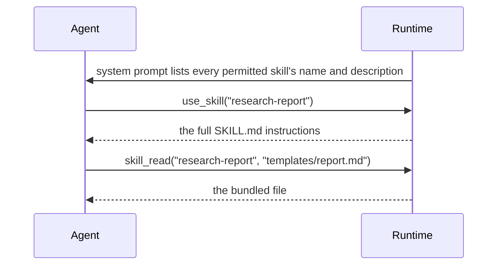

# Skills

Skills are packaged instructions an agent loads when it needs them: a folder with a `SKILL.md`
and any templates or references it uses, the same idea as Claude Code skills.

```markdown
---
name: research-report
description: Plan, evidence and write a rigorous research report with inline citations. Use for ...
allowed-tools: [web_search, web_fetch, notes_write]
---
# Research report
1. Frame ... 2. Gather ... 3. Analyse ... 4. Write using templates/report.md ...
```

## Progressive disclosure



Agents see only names and descriptions until they call `use_skill`, so a large library costs
little context. `skill_read` opens files bundled with the skill.

## Where skills come from

| Source | Skills |
| --- | --- |
| Built-in | `research-report`, `latex-paper`, `code-review`, `python-project`, `source-evaluation`, `executive-summary` |
| Marketplace | `adr-writer`, `api-design-review`, `changelog-writer`, `data-analysis-report`, `incident-postmortem`, `literature-review`, `test-plan`, `threat-model` |
| Yours | Created in the editor, with `POST /api/v1/skills`, or imported from a zip |

A skill of yours with the same name as a built-in overrides it for your runs. Built-in skills are
read-only and cannot be deleted.

## Marketplace

The marketplace is a curated catalogue that ships with Argus (`backend/argus/skills/marketplace/`).
`GET /api/v1/skills/marketplace` lists it with each skill's version, tags, allowed tools and files,
and whether you have installed it; `GET /skills/marketplace/{name}` shows the full `SKILL.md` and
files. `POST /skills/marketplace/{name}/install` copies a skill into your library, after the same
validation as an upload, and you can then edit it like any skill of your own.

## Managing your skills

| Endpoint | Purpose |
| --- | --- |
| `POST /skills/validate` | Check a `SKILL.md` and its files without saving |
| `POST /skills` | Create a skill |
| `POST /skills/import` | Import a zip |
| `PUT /skills/{name}` | Replace a skill (records a new version) |
| `PATCH /skills/{name}` | Enable or disable it |
| `DELETE /skills/{name}` | Delete it and its history |
| `GET /skills/{name}/export` | Download it as a zip |
| `GET /skills/{name}/usage` | Which councils use it (`used_by_councils`) |
| `GET /skills/{name}/versions` | Version history: number, semantic version, author, note, files |
| `GET /skills/{name}/versions/{n}` | One stored version |
| `POST /skills/{name}/versions/{n}/restore` | Restore a version (recorded as a new version) |

Writes need the `skills:write` scope. Uploads are validated: frontmatter rules, text files only, no
hidden files or path traversal, and size limits checked before a zip is extracted.

## Which skills a council may use

Guardrails decide, with glob patterns:

```json
{"skills": {"allow": ["*"], "deny": ["latex-*"]}}
```

A disabled skill is not offered to agents. Sub-councils inherit the parent's skill deny list.
