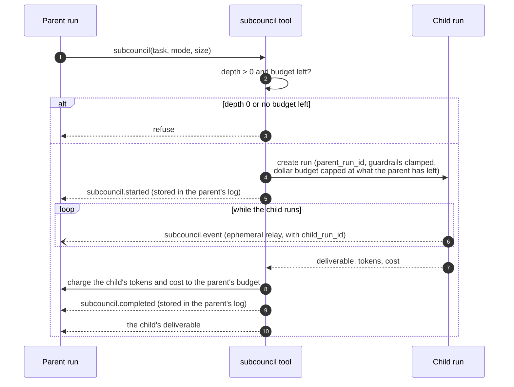

# Sub-councils

A member can hand a self-contained task to a smaller child council with the `subcouncil` tool.
The child is a real run, linked to its parent by `parent_run_id`, with its own plan, members,
oversight and vote. Only the chair has the tool by default; give it to other seats through their
`tools`.

```json
{"task": "Compare the three leading solid-state electrolyte families", "mode": "research", "size": 3}
```

| Argument | Meaning |
| --- | --- |
| `task` | The self-contained task for the child |
| `mode` | The child's mode |
| `size` | Seats, 2 to 6 (default 3) |

The child seats an ephemeral roster for its mode, using the calling member's provider and model.
The tool returns the child's deliverable, or an error if the child did not complete. The tool
carries the risk tag `subcouncil`: add it to `approval_required` to approve each delegation.

## Guardrails are clamped

The child's guardrails never exceed the parent's:

| Aspect | Rule |
| --- | --- |
| Budgets, steps, runtime, parallelism, iterations | The minimum of the child's and the parent's |
| Depth | `max_subcouncil_depth` drops by one per level; at 0 the tool refuses |
| Tool and skill deny lists, `approval_required` | The union of both |
| Tool allow list | Intersected with the parent's when the parent restricts it |
| Dollar budget | Capped at what the parent has left; with nothing left the tool refuses |

## Budget charge-back



Because the child's spend is charged back, the parent's budget meter and its `halted` check
always include everything its sub-councils spent.

## Live relay and lifetime

`subcouncil.started` and `subcouncil.completed` are stored in the parent's event log. The child's
plan, step, member, thought, tool, intercept, correction, approval, vote, `protocol.call`, nested
sub-council and status events are relayed live to the parent's stream as ephemeral
`subcouncil.event` envelopes carrying `child_run_id`, so the parent's [run views](../run-views.md)
draw the child's members and traffic. Approvals requested inside a child still notify you.

The child is stopped if it exceeds its runtime or the parent is cancelled. `GET /api/v1/runs`
lists top-level runs only; open a child with `GET /api/v1/runs/{child_run_id}`.
