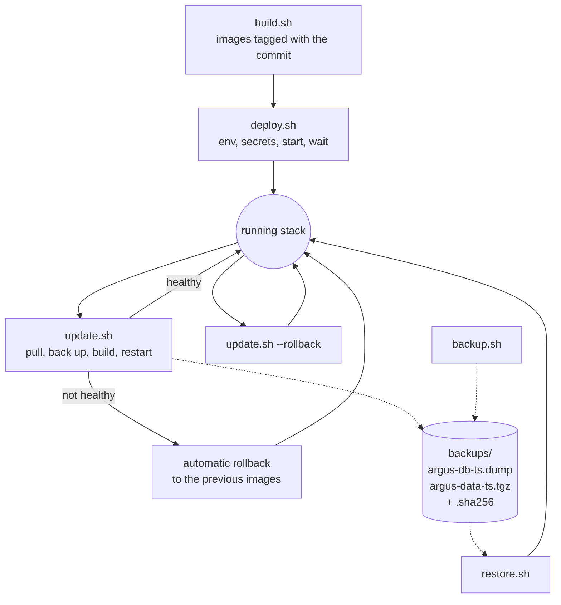

# Deployment and Operations

Argus Council ships as a Docker Compose stack (`deploy/docker-compose.yml`) driven by a few
scripts. Each script prints its options with `--help`. This page covers deploying, updating,
rolling back, backing up and restoring, data retention and observability.



## Deploy

```bash
./scripts/deploy.sh             # build, run every pending migration, start, wait until ready
./scripts/deploy.sh --pull      # git pull first: a full update in one command
./scripts/deploy.sh --smoke     # also run the end-to-end smoke test afterwards
./scripts/deploy.sh --no-build  # start the images already built (see build.sh)
./scripts/deploy.sh --no-backup # existing deployment: skip the pre-update backup
./scripts/deploy.sh --ca FILE   # trust an extra CA while building
```

`deploy.sh` handles installs and updates alike. On a fresh install it builds, applies all database
migrations (`alembic upgrade head`) as their own step, and only then starts the stack; if a migration
fails nothing is started. On an existing deployment (`deploy/.version` exists) it hands over to
`update.sh`, below: backup, build, migrate, restart, automatic rollback.

On first run `deploy.sh` copies `deploy/.env.example` to `deploy/.env` and generates any empty
secret (`ARGUS_SECRET_KEY`, `POSTGRES_PASSWORD`, `REDIS_PASSWORD`, `ARGUS_SANDBOX_TOKEN`). It waits
until the web container answers and the API reports ready through it, then records the running
version in `deploy/.version`.

To build images only:

```bash
./scripts/build.sh                     # tag with the current commit and :latest
./scripts/build.sh --version 1.2.0     # explicit tag
./scripts/build.sh --ca corp-ca.crt    # trust an extra CA during the build (egress proxies)
./scripts/build.sh --no-cache --pull web
```

Builds retry up to three times, because base-image pulls fail transiently.

### Exposing it

By default the web container listens on all interfaces at port 8080 and the API only on
`127.0.0.1:8000`. Put a TLS-terminating reverse proxy in front of port 8080 for anything beyond a
trusted network, set `ARGUS_CORS_ORIGINS` to your public origin, and close registration
(`ARGUS_ALLOW_REGISTRATION=false`) once your accounts exist.

## Update and roll back

```bash
./scripts/update.sh                          # git pull, back up, build, restart, wait until ready
./scripts/update.sh --no-pull                # deploy the code already checked out
./scripts/update.sh --no-backup              # skip the backup (a rollback then uses alembic downgrade)
./scripts/update.sh --images TAG             # deploy images already built as TAG instead of building
./scripts/update.sh --rollback               # go back to the version that ran before the last update
./scripts/update.sh --rollback --restore-db  # ...and load the pre-update backup instead of downgrading
```

`update.sh` refuses to pull over local changes. Before it builds, it tags the images that are
running as `rollback-<time>`, records the database's Alembic revision, takes a backup and writes
`deploy/.rollback-state`, so a rollback still works if the script is interrupted. It then stops the
old API and applies every pending migration with the new images as a separate step (the log shows
the revision before and after), starts the new version, and gives it `ARGUS_READY_TIMEOUT` seconds
(default 240) to become ready. A failed migration rolls back the same way as an unhealthy start.

If it does not, the update rolls back by itself: the API and web containers are stopped, the
pre-update backup is restored when the schema changed (or, with no usable backup, the schema is
downgraded with `alembic downgrade` using the newer image), and the snapshot images are started
again. Re-running a rollback is safe.

`--rollback` downgrades the schema and keeps data written since the update. `--restore-db` loads
the pre-update dump instead, which loses that data. A second `--rollback` rolls forward again.

Version tags include `-dirty-<time>` when the working tree has uncommitted or untracked changes,
so a rebuild never overwrites the image a rollback would return to. The newest three snapshot tags
are kept, plus any tag still in use. `update.sh`, `backup.sh` and `restore.sh` take a lock, so
they never run at the same time.

## Back up and restore

```bash
./scripts/backup.sh                      # back up now; prints the new dump's path (cron-safe)
./scripts/restore.sh --list              # list the backups and whether their checksums match
./scripts/restore.sh                     # restore the newest backup (asks for confirmation)
./scripts/restore.sh 20261027T120000Z    # restore the backup with this timestamp
./scripts/restore.sh path/to/argus-db-<ts>.dump
./scripts/restore.sh --db-only ...       # leave the artifact volume as it is
./scripts/restore.sh --yes ...           # do not ask for confirmation (for automation)
```

`backup.sh`, and `update.sh` before every update, write a pair of files to `backups/` (or
`ARGUS_BACKUP_DIR`): a tarball of the artifact volume `argus-data-<timestamp>.tgz` and a `pg_dump`
custom-format dump `argus-db-<timestamp>.dump`, each with a `.sha256` file. Each file is written
as `.partial`, read back completely (`gzip -t`, `pg_restore` of the whole archive) and only then
renamed, so an interrupted or failed backup never looks valid. The newest `ARGUS_BACKUP_KEEP`
backups (default 14) are kept.

`restore.sh` checks every file against its `.sha256` and reads it to the end before it changes
anything, and refuses a truncated or altered backup; backups from before checksums existed restore
with a warning. The `api` and `web` containers are stopped while the database is replaced (the
`public` schema is dropped and the dump loaded in one transaction, committed only if `pg_restore`
succeeded) and started again afterwards, also when the restore fails. The artifact tarball, when
present, replaces the contents of the artifact volume.

!!! tip "Back up on a schedule"
    `update.sh` backs up before every update, but nothing backs up in between. Run
    `./scripts/backup.sh` from cron, and copy `backups/` off the host.

## Data retention

The API prunes old data in small batches every `ARGUS_RETENTION_INTERVAL_S` seconds (hourly by
default). `0` days keeps data forever.

| Setting | Default | Deletes |
| --- | --- | --- |
| `ARGUS_RETENTION_RUN_DAYS` | `0` | Finished top-level runs with their sub-runs, events, artifacts and blob files |
| `ARGUS_RETENTION_EVENT_DAYS` | `0` | Only the event log of finished runs; the run, result and artifacts stay |
| `ARGUS_RETENTION_AUDIT_DAYS` | `365` | Audit rows |
| `ARGUS_RETENTION_LEDGER_DAYS` | `0` | Ledger entries. Keep `0`: pruning breaks verification permanently |
| `ARGUS_RETENTION_TRASH_DAYS` | `30` | Runs moved to the trash this many days ago, like `RUN_DAYS` deletes them |

Blob directories whose run no longer exists are swept as well. Admins can see the policy and the
last pass under *Settings, Data and privacy*, or with `GET /api/v1/admin/retention`, and run a pass
now with `POST /api/v1/admin/retention/run` (`{"dry_run": true}` only counts what would go).

### Account export and deletion

Every user can download everything they own as a zip with `POST /api/v1/me/export` (up to
`ARGUS_EXPORT_MAX_BYTES`); secrets such as encrypted credentials, password and key hashes and
webhook secrets are never included. `DELETE /api/v1/me` with the account password deletes the
account and its data. The last active admin cannot delete their account until another admin
exists.

## Observability

| Signal | Where |
| --- | --- |
| Health | `GET /health/live`, `GET /health/ready` (database and cache) |
| Metrics | `GET /metrics` (Prometheus): HTTP traffic and latency; runs started, finished and active; LLM calls, tokens, cost and latency per provider and model; tool calls and latency; intercepts; guardrail violations; approvals; protocol calls. Set `ARGUS_METRICS_TOKEN` to scrape it in production |
| Audit log | Every state-changing request (actor, action, target, IP, user agent, outcome), including failed sign-ins; secrets are never stored. `GET /api/v1/audit`, admins add `?all=true`; the UI at `/insights/audit` exports CSV |
| Insights | `GET /api/v1/insights?days=30`: success rate, spend and latency per model, tool error rates, intercepts by reason, guardrail violations, top failure reasons. The UI at `/insights` |
| Logs | JSON logs with request ids (`ARGUS_LOG_JSON=true`); every response carries `X-Request-ID`. Docker rotates container logs at 10 MB, five files |

`/metrics` is served by the API container only; the web container does not proxy it. With the
default `ARGUS_API_BIND=127.0.0.1`, scrape it from the Docker host, or publish the API port on an
interface your Prometheus can reach.

```yaml
# prometheus.yml
scrape_configs:
  - job_name: argus
    metrics_path: /metrics
    authorization:
      credentials: <ARGUS_METRICS_TOKEN>
    static_configs:
      - targets: ["127.0.0.1:8000"]
```
