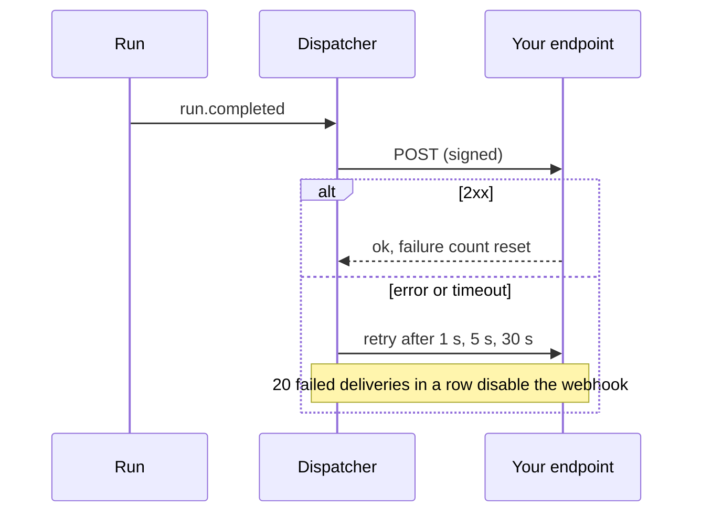

# Integration

This page covers what you need to build on the API: authentication, API keys and scopes, roles,
webhooks, idempotent run creation and pagination. The full endpoint list is in the
[API Reference](api/index.md); agent-to-agent integration is in [Protocols and Ledger](protocols.md).

## Authentication

| Credential | How to get it | Use |
| --- | --- | --- |
| Access token | `POST /api/v1/auth/login` (or `/register`) | `Authorization: Bearer <token>`; short-lived JWT (`ARGUS_ACCESS_TOKEN_TTL_MINUTES`) |
| Refresh token | Returned with the access token | `POST /api/v1/auth/refresh`; single-use and rotated on every refresh |
| API key | *Settings, API keys* or `POST /api/v1/auth/api-keys` | `Authorization: Bearer argus_...`; shown once at creation |
| Stream ticket | `POST /api/v1/runs/{id}/stream-ticket` | `?ticket=` on the SSE stream, which cannot carry headers |

Creating or revoking keys and changing the password need a signed-in session, never a key.

## API keys and scopes

Every key can read. Writes need a scope:

| Scope | Allows |
| --- | --- |
| `runs:write` | Start, steer, pause, cancel and delete runs; templates; protocol calls that change runs |
| `councils:write` | Create and change councils and seats |
| `providers:write` | Add, change, delete and test providers |
| `skills:write` | Create, import, install, update, restore and delete skills |
| `connections:write` | MCP servers and remote agents |
| `webhooks:write` | Webhooks |
| `knowledge:write` | Knowledge bases, documents and memory |
| `*` | All of the above |

A key with no scopes (or `read`) is read-only.

## Roles

| Role | Can do |
| --- | --- |
| `admin` | Everything a member can, plus user management, data retention, and `?all=true` on the audit log |
| `member` | Create and change their own councils, runs, skills, providers, connections, knowledge, webhooks and keys |
| `viewer` | Read only. Every state-changing route and protocol write returns `403`, whatever the key's scopes, and viewers can only create keys with `scopes: ["read"]` |

Admins manage accounts with `GET /api/v1/admin/users` (role, active flag, last sign-in, run count)
and `PATCH /api/v1/admin/users/{id}` (`role`, `is_active`). An admin cannot demote or deactivate
themselves, and the last active admin cannot be demoted or deactivated (`409`).
`GET /api/v1/auth/me` returns the caller's `role`.

## Webhooks

Register an HTTPS endpoint with `POST /api/v1/webhooks` (`url`, `events`) to be notified of
`run.started`, `run.completed`, `run.failed`, `run.halted`, `run.cancelled` and
`approval.requested` (`GET /api/v1/webhooks/events` lists them). The signing secret is shown once
at creation; rotate it with `POST /webhooks/{id}/rotate-secret` and send a test with
`POST /webhooks/{id}/test`.

```
X-Argus-Event: run.completed
X-Argus-Delivery: <id, stable across retries>
X-Argus-Signature: t=<unix ts>,v1=<hex HMAC-SHA256(secret, "<ts>.<raw body>")>
```

```python
import hashlib, hmac, time

def verify(secret: str, body: bytes, header: str, tolerance_s: int = 300) -> bool:
    parts = dict(p.split("=", 1) for p in header.split(","))
    ts = int(parts["t"])
    if abs(time.time() - ts) > tolerance_s:
        return False
    expected = hmac.new(secret.encode(), f"{ts}.".encode() + body, hashlib.sha256).hexdigest()
    return hmac.compare_digest(expected, parts["v1"])
```

Verify the signature over the raw body and reject old timestamps. Failed deliveries are retried
after 1 s, 5 s and 30 s; an endpoint that fails 20 times in a row is disabled.
`GET /webhooks/{id}/deliveries` shows the recent attempts. Private and loopback addresses are
refused.



## Idempotent run creation

Send `Idempotency-Key: <unique string>` with `POST /api/v1/runs` to make retries safe. A repeat with
the same key and body within 24 hours returns the original response with
`Idempotent-Replayed: true`. The same key with a different body, or while the first request is
still in flight, returns `409`.

## Pagination

`GET /api/v1/runs` returns runs newest first; pass the last run's `created_at` as `?before=` for the
next page. `GET /api/v1/audit` uses `?before_id=`.

## Errors

Errors are JSON of the form `{"error": {"code": ..., "message": ..., "details": ...}}`: a stable `code`, a human-readable `message` and, where useful, `details`
(for example the failing fields of an invalid guardrail layer, or the missing variables of a
template). Rate-limited requests get `429`.
