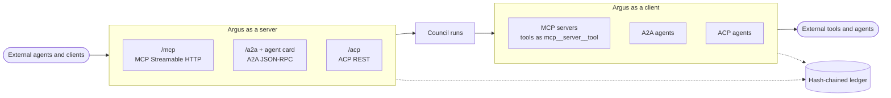
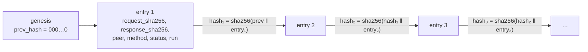

# Protocols and Ledger

Argus speaks the three main agent interoperability protocols in both directions: other agents
can start and steer councils, and councils can call external tools and delegate to remote agents.
Every one of those calls, in or out, is written to a tamper-evident ledger.



| Protocol | Argus as a server | Argus as a client |
| --- | --- | --- |
| **MCP** | `POST /mcp` (Streamable HTTP, JSON-RPC). Tools: `start_run`, `get_run`, `list_runs`, `intervene`, `cancel_run`, `list_councils`. Run deliverables are **resources**, skills are **prompts**. | Register MCP servers (`/api/v1/mcp-servers`, HTTP, or stdio for admins when `ARGUS_MCP_ALLOW_STDIO=true`). Their tools appear to agents as `mcp__<server>__<tool>`, filtered by `tool_allow`, gated by `risk` tags and by the server's trust level. |
| **A2A** | Agent card at `/.well-known/agent-card.json` (and `/.well-known/agent.json`), JSON-RPC at `/a2a` (`message/send`, `tasks/get`, `tasks/cancel`). Each task is a council run. | Register remote agents (`/api/v1/remote-agents`, `protocol: a2a`). Councils delegate with the `remote_agent` tool; `requires_approval` (default `true`) gates each delegation. |
| **ACP** | REST under `/acp`: `GET /ping`, `GET /agents` (the modes plus your saved councils), `GET /agents/{name}`, `POST /runs` (sync or async), `GET /runs/{id}`, `POST /runs/{id}/cancel`. | Register remote ACP agents (`protocol: acp`, `agent_name`) and use them through the same `remote_agent` tool. |

Inbound calls authenticate with an API key (`Authorization: Bearer argus_...`). Calls that start,
steer or cancel runs need the `runs:write` scope, like `POST /api/v1/runs`: A2A `message/send` and
`tasks/cancel` (JSON-RPC error `-32010` otherwise), ACP run creation and cancel, and the MCP
`start_run`, `intervene` and `cancel_run` tools. Read-only keys can still query, and viewers can
never write.

## Connecting a client

```bash
claude mcp add --transport http argus http://localhost:8000/mcp \
  --header "Authorization: Bearer argus_..."
```

Any MCP client that supports Streamable HTTP works the same way. Through the web container the
URL is `http://<host>:8080/mcp`.

## MCP trust levels

Each registered MCP server has a `trust` level and an optional `require_approval` list of tool
names.

| `trust` | Effect |
| --- | --- |
| `trusted` | Tools run without extra approval (servers registered before trust levels existed behave this way) |
| `ask` | The default for new servers. Every tool call goes through the approval flow |
| `blocked` | The server is not contacted during runs and its tools are never attached |

Tools named in `require_approval` always need approval, whatever the trust level.
`POST /api/v1/mcp-servers/{id}/discover` runs `initialize` and `tools/list` and stores the tools;
`POST /api/v1/remote-agents/{id}/refresh` fetches an A2A or ACP agent's card again.

## Ledger

Every inbound and outbound MCP, A2A and ACP interaction is written to a per-user ledger. Each entry
holds the peer, protocol, direction, method, status, latency, run id and SHA-256 digests of the
request and response (not the payloads themselves), and is chained to the previous entry:



`hash = sha256(prev_hash ‖ canonical(entry))`. `GET /api/v1/ledger/verify` replays the chain
from the genesis hash and reports the first sequence number where a stored hash no longer matches,
so it detects any edit, deletion or reordering. `GET /api/v1/ledger` lists entries with filters;
the web UI's ledger browser (`/connections/ledger`) shows them and runs the verification.

Connection housekeeping is ledgered too: MCP discovery (`initialize`, `tools/list`, whether from
the discover endpoint or when a run attaches the server) and A2A and ACP card refreshes, with the
run id when they happen during a run. During a run, each outbound call is also announced live as
a `protocol.call` event carrying the entry's `ledger_id` and `hash`.

!!! warning "Do not prune the ledger"
    Verification replays the chain from its first entry, so deleting any prefix makes it report a
    broken chain forever after. `ARGUS_RETENTION_LEDGER_DAYS` is `0` (never prune) by default;
    only change it if you archive the ledger elsewhere first.
