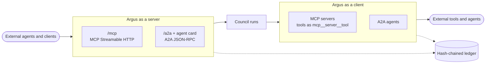
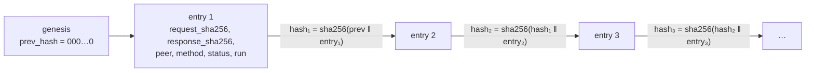

# Protocols and Ledger

Argus speaks the two main agent interoperability protocols in both directions: other agents
can start and steer councils, and councils can call external tools and delegate to remote agents.
Every one of those calls, in or out, is written to a tamper-evident ledger.



| Protocol | Argus as a server | Argus as a client |
| --- | --- | --- |
| **MCP** | `POST /mcp` (Streamable HTTP, JSON-RPC). Tools: `start_run`, `get_run`, `list_runs`, `intervene`, `cancel_run`, `list_councils`. Run deliverables are **resources**, skills are **prompts**. | Register MCP servers (`/api/v1/mcp-servers`, HTTP, or stdio for admins when `ARGUS_MCP_ALLOW_STDIO=true`). Their tools appear to agents as `mcp__<server>__<tool>`, filtered by `tool_allow`, gated by `risk` tags and by the server's trust level. |
| **A2A** | Agent card at `/.well-known/agent-card.json` (and `/.well-known/agent.json`), JSON-RPC at `/a2a` (`message/send`, `tasks/get`, `tasks/cancel`). Each task is a council run. | Register remote agents (`/api/v1/remote-agents`, `protocol: a2a`). Councils delegate with the `remote_agent` tool; `requires_approval` (default `true`) gates each delegation. |

Inbound calls authenticate with an API key (`Authorization: Bearer argus_...`). Calls that start,
steer or cancel runs need the `runs:write` scope, like `POST /api/v1/runs`: A2A `message/send` and
`tasks/cancel` (JSON-RPC error `-32010` otherwise), and the MCP
`start_run`, `intervene` and `cancel_run` tools. Read-only keys can still query, and viewers can
never write.

The members of a council are A2A agents among themselves as well: each has an agent card with a
`url` of the form `argus://runs/{run}/agents/{member}` and the `in-process` transport, and they
exchange A2A messages and tasks inside Argus, without HTTP
([How members talk to each other](concepts/councils.md#how-members-talk-to-each-other)). This is
separate from Argus's own public A2A endpoint and agent card above.

## Internal A2A forms

Every internal message carries its form in `metadata.form`. Besides the eight communication forms
(`direct`, `request`, `broadcast`, `group`, `delegate`, `topic`, `board`, `review`), the
[debate](concepts/councils.md#the-debate) adds six. Each has a `text` part and a `data` part
`{"kind": "data", "data": {"type": "argus.<form>", ...}}`:

| Form | Addressed to | A2A shape | `data` |
| --- | --- | --- | --- |
| `claim` | the board | `message/send` | `claim_id`, `author_id`, `statement`, `evidence` (`[{source, quote?}]`), `confidence`, `status` |
| `challenge` | the target | `tasks/send`: opens a task, state `input-required` | `challenge_id`, `claim_id`, `challenger_id`, `target_id`, `objection`, `demand`, `round` |
| `response` | the challenger | `message/send` on that task, `metadata.inReplyTo` the challenge | `challenge_id`, `responder_id`, `stance`, `argument`, `evidence`, `unsupported` |
| `resolution` | the target | `message/send` on that task, in reply to the answer | `challenge_id`, `outcome`, `note` |
| `position` | the council | `message/send` | `member_id`, `round`, `conclusion`, `stances`, `alternative` |
| `signature` | the council | `message/send` | `member_id`, `action` (`sign`, `amend`, `block`), `reason`, `amendment`, `claim_id` |

A [helper](concepts/councils.md#helpers) has its own agent card while it lives, and its work is a
`delegate` task with `metadata.spawned: true`, from `submitted` to `working` to `completed`,
`failed` or `canceled`. All of these are ledgered as protocol `a2a`, direction `internal`, like the
other council exchanges ([Ledger](#ledger)).

## Connecting a client

```bash
claude mcp add --transport http argus http://localhost:8000/mcp \
  --header "Authorization: Bearer argus_..."
```

Any MCP client that supports Streamable HTTP works the same way. Through the web container the
URL is `http://<host>:8080/mcp`.

## MCP trust levels

Each registered MCP server has a `trust` level and an optional `require_approval` list of tool
names.

| `trust` | Effect |
| --- | --- |
| `trusted` | Tools run without extra approval (servers registered before trust levels existed behave this way) |
| `ask` | The default for new servers. Every tool call goes through the approval flow |
| `blocked` | The server is not contacted during runs and its tools are never attached |

Tools named in `require_approval` always need approval, whatever the trust level.
`POST /api/v1/mcp-servers/{id}/discover` runs `initialize` and `tools/list` and stores the tools;
`POST /api/v1/remote-agents/{id}/refresh` fetches an A2A agent's card again.

## Ledger

Every inbound and outbound MCP and A2A interaction is written to a per-user ledger. So is
every outbound web request an agent makes through a built-in tool (`web_fetch`, `web_search`, the
market and news tools), as protocol `http`, with the host as the peer. Messages and tasks between
the members of a council are recorded as protocol `a2a` with direction `internal` (*Council* in
the ledger browser). Every `use_skill` and `skill_read` call is recorded as protocol `skill`,
direction `internal` (*Skill* in the ledger browser): the peer is `<name>@<version>` (`<name>@unknown`
for a skill that does not exist), the method is `use_skill` or `skill_read`, and the detail holds the
member and the file path. Browser use is recorded as protocol `browser`, direction `outbound`: the peer is the page's host, the method is the action (`open`, `click`,
`snapshot`, ... plus `session.open` and `session.close`), and the detail holds the member, the
session id, the page URL and its title. The `browse` tool is not also recorded as `http`. Each entry
holds the peer, protocol, direction, method, status, latency, run id and SHA-256 digests of the
request and response (not the payloads themselves), and is chained to the previous entry:



`hash = sha256(prev_hash ‖ canonical(entry))`. `GET /api/v1/ledger/verify` replays the chain
from the genesis hash and reports the first sequence number where a stored hash no longer matches,
so it detects any edit, deletion or reordering. `GET /api/v1/ledger` lists entries with filters;
the web UI's ledger browser (`/connections/ledger`) shows them and runs the verification.

Connection housekeeping is ledgered too: MCP discovery (`initialize`, `tools/list`, whether from
the discover endpoint or when a run attaches the server) and A2A card refreshes, with the
run id when they happen during a run. During a run, each outbound call is also announced live as
a `protocol.call` event carrying the entry's `ledger_id` and `hash`.

Older entries with protocol `acp` stay in the ledger, because ACP was removed and deleting them would
break the chain. They still verify, and the ledger browser shows them as "ACP (removed)". Migration
0022 deleted saved ACP remote agents on upgrade and logged their names.

!!! warning "Do not prune the ledger"
    Verification replays the chain from its first entry, so deleting any prefix makes it report a
    broken chain forever after. `ARGUS_RETENTION_LEDGER_DAYS` is `0` (never prune) by default;
    only change it if you archive the ledger elsewhere first.
