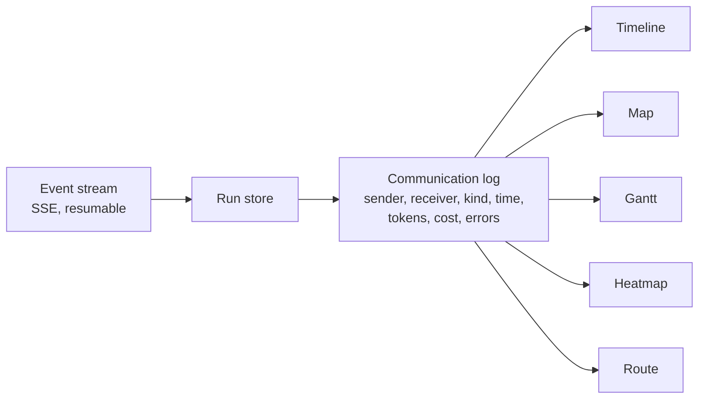

# Run Views

The run workspace (`/runs/:runId`) shows a live or finished run in five views, switched from the
toolbar. All five read one communication log derived from the run's event stream: who sent what
to whom, including relayed [sub-council](concepts/sub-councils.md) traffic and ledgered
`protocol.call`s. Selecting an item in any view jumps to it in the timeline.

| View | Shows |
| --- | --- |
| **Timeline** | A chronological feed of the plan, thoughts, tool calls, intercepts, corrections, approvals and votes, with a density control |
| **Map** | An isometric map of agents, overseers, sub-councils, tools, MCP servers and remote agents, with live message pulses along the links, filters, pause and live, zoom and pan, and a details panel that includes the ledger id and hash of protocol calls |
| **Gantt** | Steps and per-agent activity over time, with a live now-line |
| **Heatmap** | Who talks when: rows for agents, sub-agents and external peers, auto-sized time bins, and intensity by messages, tokens, cost or errors |
| **Route** | The plan as a trail from start to deliverable (solid where covered, dashed ahead) with pins for intercepts, corrections, approvals, votes, sub-councils and protocol calls, beside a chronological run log |

Around the views, the workspace has the intercept and correct controls, pending approvals (with
argument editing), votes, a budget meter, an inspector for the selected item, and the deliverable
with its exports.

## Accessibility

The views are keyboard-navigable, every graphical view has a text alternative, and animation
stops under `prefers-reduced-motion`.

## Replaying a finished run

A finished run opens with its full event log, so every view works the same after the fact. Its
replay bar feeds the stored events back through the same reducer the live stream uses, at 1×, 2×,
4× or 8× (gaps between events compressed), so every view shows the run as it unfolded without
touching the real run state. The API can rebuild the state at any point with
`GET /api/v1/runs/{id}/snapshot?at_seq=N`.
