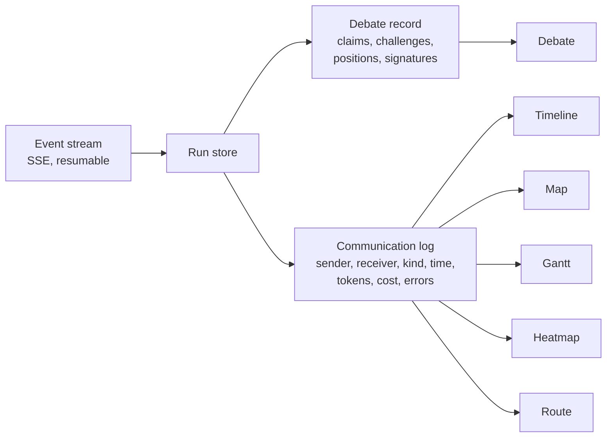

# Run Views

The run workspace (`/runs/:runId`) shows a live or finished run in seven views, switched from the
toolbar. Six of them read one communication log derived from the run's event stream: who sent
what to whom, including relayed [sub-council](concepts/sub-councils.md) traffic and ledgered
`protocol.call`s. The **Debate** view reads the debate's record from the same stream. Selecting an
item in any view jumps to it in the timeline.

| View | Shows |
| --- | --- |
| **Timeline** | A chronological feed of the plan, thoughts, tool calls, intercepts, corrections, approvals, votes and messages between members, with a density control |
| **Debate** | The council's argument: the phase it is in, the claims with their challenge threads, each member's position on each claim, and the co-signed conclusion ([below](#the-debate-view)) |
| **Skills** | Each skill the run used, with who loaded it, the files read from it and the tool calls made under it, filterable by agent ([below](#the-skills-view)) |
| **Map** | An isometric map of agents, overseers, sub-councils, tools, MCP servers and remote agents, with live message pulses along the links, filters, pause and live, zoom and pan, and a details panel that includes the ledger id and hash of protocol calls |
| **Gantt** | Steps and per-agent activity over time, with a live now-line |
| **Heatmap** | Who talks when: rows for agents, sub-agents and external peers, auto-sized time bins, and intensity by messages, tokens, cost or errors |
| **Route** | The plan as a trail from start to deliverable (solid where covered, dashed ahead) with pins for intercepts, corrections, approvals, votes, sub-councils and protocol calls, beside a chronological run log |

Around the views, the workspace has the intercept and correct controls, pending approvals (with
argument editing), votes, a budget meter, an inspector for the selected item, and the deliverable
with its exports. Under the budget meter, once the [knowledge graph](concepts/councils.md#the-council-knowledge-graph)
has kept text out of prompts, a *Context N chars saved (x%)* line sums the run's `context.saved`
events: the characters its digests avoided sending, against pasting the raw text.

## The council rail

The council rail lists the members in groups: Chair, Workers, **Helpers** and Overseers. Each card
shows the member's model, status and spend, with **Focus**, and **Hold** (or **Release**) and
**Message** while the run is live. Under the status, *Working now* shows the member's current task and the tail
of its latest thought, as its teammates see it.

* A [helper](concepts/councils.md#helpers) is badged *Helper of* the member that spawned it, with
  its state (working, finished, failed or cancelled). Once it has left, the card keeps the start of
  its result and drops the live controls. In the **Send to** list of the intervention bar it is
  marked *(helper)*.
* The [devil's advocate](concepts/councils.md#the-devils-advocate) carries a *Devil's advocate*
  badge, here, on its thought cards and wherever the Debate view names it. The badge says
  "Secret: only you can see this; the council does not know". It is shown only to you: the
  council is never told, and nothing the badge shows goes back to the server.

## The Debate view

The **Debate** view follows the [debate](concepts/councils.md#the-debate) as it happens:

* **Phases.** Deliberate, Converge, Compile and Co-sign, with the one under way highlighted, its
  round, and the number of open challenges. Before the first phase it reads "Members debate while
  they work". Beside it: who the devil's advocate is (with the secret badge), or why there is none,
  and how much context the graph saved.
* **Conclusion.** The co-signing outcome (*Signed by the council*, *Sent back to revise* or *Not
  signed*), whether the quorum was met, and each author's signature, amendment (with the proposed
  text) or block, with the reason.
* **Positions.** A table of each member's stance (endorse or object, with the reason on hover) on
  each key claim, a row with the agreement computed for each claim (agreed, contested or rejected),
  and every member's conclusion.
* **Claims.** Each claim with its number, status, author, confidence and evidence (links for URLs),
  and under it its challenge threads: who challenged whom, the demand, each answer (defended,
  conceded or revised, marked *unsupported* when a proof demand got no evidence) and the
  challenger's resolution. Challenges against a member's work rather than a claim are listed
  separately.

On a live run, every claim and challenge has **Message** buttons for its author, challenger or
target. They send an ordinary message to that member, about that claim or challenge; nothing
waits for your answer.

## The Skills view

Skills are traced as they are used. The view lists each skill the run loaded (`use_skill`) or read
a file from (`skill_read`), with its version, the members that loaded it, the files read from it
and the tool calls made while it was in effect. A skill stays in effect for the member that loaded
it until the run ends. The agent filter narrows the list to one member.

In the timeline, a skill load or read expands to show exactly the text the agent received. It says
"Content not saved" when the text could not be kept (see
[Events](concepts/runs.md#skill-events)). Tool-call rows show a chip for each skill in effect.
The ledger browser has a *Skill* filter.

## Header controls

| Control | Shown | Does |
| --- | --- | --- |
| **Pause** / **Resume**, **Stop** | Live runs | Pause, continue or cancel the run |
| **Auto mode** | Live runs | Two switches: *Approve requests* answers every approval request except limit raises, and *Approve limit raises* grants them within the run's extension cap. Turning one on also answers the requests already waiting for it. Blocked actions stay blocked |
| **Budget** | Live runs | Add to the budget now, or set the reserve the run draws on, without asking, when it reaches its budget instead of halting. The button shows the reserve as a badge |
| **Resume where it stopped** | Halted, failed and cancelled runs | Starts a new run that reuses the stopped run's finished work without calling a model, then does only what never finished, and opens it |

These call `POST /runs/{id}/auto-mode`, `/budget` and `/continue`; see
[Integration](integration.md#steering-a-run).

## Thought cards

Each agent turn is a thought card.

**Reasoning.** When the model returns its reasoning, a *Reasoning* section sits above the answer,
with its token count when the provider reports it.

- It is open and updates live while only reasoning has arrived, and it collapses once the answer
  is there.
- The *Reasoning* chip in the timeline's *Show* menu hides or shows these sections; your browser
  remembers the choice.
- What models return depends on `guardrails.oversight.reasoning`:
  - `auto` (the default) records whatever the model gives without asking for more.
  - `on` asks Claude models (adaptive thinking with a summarized display) and Gemini 2.5 models
    (thoughts included) to return a readable summary of their reasoning.
  - Models served through an OpenAI-compatible API show reasoning only when the server returns it.
- Reasoning is shown to you only. No other agent ever sees it: not on the board, in *Working now*,
  in the knowledge graph, or in an answer. The secret devil's advocate's giveaways are removed from
  it, as from everything else it writes.

**Readable JSON.** A reply that is JSON is shown as a view built for it, not as raw text. That
applies whether the JSON is the whole reply, inside a code fence, or embedded in prose.

- A plan is a numbered list of steps: the assignee, which steps each one waits for, and the
  instructions, cut to three lines with *Show more*.
- Debate moves, co-signatures, amendment votes, ballots and overseer reviews are labelled rows
  with chips: the demand, the stance (defend, concede, revise, endorse, object), sign, amend or
  block, and severity.
- Any other JSON is a tree with collapsible levels.
- *View raw* shows the JSON exactly as written, and *Copy JSON* copies it.
- JSON that is still streaming, or malformed, stays as text.

## Timeline rows

Messages between council members (see
[Council communication](architecture.md#council-communication)) show as A2A rows:
"*sender* → *recipients*", with a badge for the form (Message, Question, Broadcast, Group
message, Delegated task, Topic, Board post or Review request) and the topic, if any. Replies are
badged Answer, Task result or Review. A badge turns the danger colour when the exchange failed. Board
posts are addressed to "the board" and broadcasts to "the council". A member's answer to you shows
as a bubble headed "*name* replied to you". Your own messages show as your usual message bubble,
not as A2A rows.

Debate exchanges are not shown as A2A rows. They have rows of their own:

| Row | Event |
| --- | --- |
| "*name* is the devil's advocate (picked at random from N debaters)", with the secret badge, or "No devil's advocate this run: *reason*" | `council.role_assigned` |
| "*author* claimed #n", with its status and statement | `debate.claim` |
| "*challenger* challenged *target* on claim #n", with the demand and the objection | `debate.challenge` |
| "*member* defended / conceded / revised", marked *unsupported* when it should be | `debate.response` |
| "*challenger* accepted / rejected the response" | `debate.resolution` |
| "Deliberate / Converge / Compile / Co-sign round N started / finished · N open challenges" | `debate.round` |
| "*member* took a position: endorses N, objects to N" | `debate.position` |
| "Converging, round N: N agreed, N contested, N rejected", then "Co-signing: *outcome*, N signed, N amended, N blocked · quorum met" | `debate.consensus` |
| "*member* spawned helper *name* (*role*, *model*)" and "Helper *name* finished / failed / cancelled", with the start of its result | `member.joined`, `member.left` |
| "*chair* added a step: *title* → *assignee*" | `step.added` |

Co-signing also shows as a vote card (Sign, Amend, Block), as the vote did before.

A few system rows record changes to what the run can do:

| Row | When |
| --- | --- |
| "Resumed from the earlier run: N finished tasks reused, … carried over" | First in a resumed run; links to the stopped run and counts the sources, notes and files it brought over |
| "Reached its budget (or token cap) and drew the reserve: *from* → *to*" | The run hit its budget and drew its reserve instead of halting |
| "Raised the *rule* limit from … to …" | You, or auto mode ("Auto-raised"), granted a limit raise |
| "*You* changed the budget …, reserve …" | Someone used the **Budget** control or `POST /runs/{id}/budget` |
| "*You* set auto mode: …" | Someone switched auto mode |

The density control sets which rows the timeline shows:

| Density | Shows |
| --- | --- |
| **Decisions** | Everything except tool calls, citations and system rows (debate and helper rows stay) |
| **Working** (default) | Everything except system rows, other than run status changes |
| **Everything** | Every row |

At every density the resumed, reserve, limit-raise and budget-change rows stay visible. Selecting an
item in another view that the current density hides switches the timeline to **Everything**.

A2A messages are a kind of their own in the communication log. The **Map** draws them as dashed
edges in the info colour, labelled "A2A" in its legend and filters. Each recipient gets its own
edge from the sender (or you) to that member, or to the council for board posts and your
council-wide messages. An edge's details include the ledger id and hash of the recorded message.
The **Heatmap** counts A2A messages, and its cell tooltips list them as `a2a` beside the other
kinds.

Two more kinds come from the debate and from helpers. The Map draws them in its legend and filters
as **Debate** and **Helpers**, and the Heatmap counts them as `challenge` and `spawn`:

* **Debate** edges, in the warning colour: a challenge from the challenger to its target, the
  answer back to the challenger, and the resolution from the challenger to the member who answered.
  The A2A messages of these forms are not drawn a second time. Claims, positions and signatures,
  which go to the whole council, stay A2A edges to the council.
* **Helpers** edges, in the success colour: from the parent to the helper when it is spawned
  (labelled with its role) and back from the helper when it leaves (with the start of its result).

## Accessibility

The views are keyboard-navigable, every graphical view has a text alternative, and animation
stops under `prefers-reduced-motion`.

## Replaying a finished run

A finished run opens with its full event log, so every view works the same after the fact. Its
replay bar feeds the stored events back through the same reducer the live stream uses, at 1×, 2×,
4× or 8× (gaps between events compressed), so every view shows the run as it unfolded without
touching the real run state. The API can rebuild the state at any point with
`GET /api/v1/runs/{id}/snapshot?at_seq=N`.
