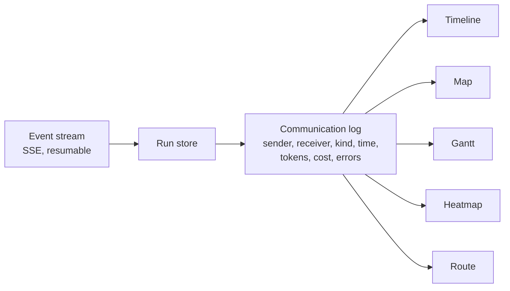

# Run Views

The run workspace (`/runs/:runId`) shows a live or finished run in five views, switched from the
toolbar. All five read one communication log derived from the run's event stream: who sent what
to whom, including relayed [sub-council](concepts/sub-councils.md) traffic and ledgered
`protocol.call`s. Selecting an item in any view jumps to it in the timeline.

| View | Shows |
| --- | --- |
| **Timeline** | A chronological feed of the plan, thoughts, tool calls, intercepts, corrections, approvals, votes and messages between members, with a density control |
| **Map** | An isometric map of agents, overseers, sub-councils, tools, MCP servers and remote agents, with live message pulses along the links, filters, pause and live, zoom and pan, and a details panel that includes the ledger id and hash of protocol calls |
| **Gantt** | Steps and per-agent activity over time, with a live now-line |
| **Heatmap** | Who talks when: rows for agents, sub-agents and external peers, auto-sized time bins, and intensity by messages, tokens, cost or errors |
| **Route** | The plan as a trail from start to deliverable (solid where covered, dashed ahead) with pins for intercepts, corrections, approvals, votes, sub-councils and protocol calls, beside a chronological run log |

Around the views, the workspace has the intercept and correct controls, pending approvals (with
argument editing), votes, a budget meter, an inspector for the selected item, and the deliverable
with its exports.

## Header controls

| Control | Shown | Does |
| --- | --- | --- |
| **Pause** / **Resume**, **Stop** | Live runs | Pause, continue or cancel the run |
| **Auto mode** | Live runs | Two switches: *Approve requests* answers every approval request except limit raises, and *Approve limit raises* grants them within the run's extension cap. Turning one on also answers the requests already waiting for it. Blocked actions stay blocked |
| **Budget** | Live runs | Add to the budget now, or set the reserve the run draws on, without asking, when it reaches its budget instead of halting. The button shows the reserve as a badge |
| **Resume where it stopped** | Halted, failed and cancelled runs | Starts a new run that reuses the stopped run's finished work without calling a model, then does only what never finished, and opens it |

These call `POST /runs/{id}/auto-mode`, `/budget` and `/continue`; see
[Integration](integration.md#steering-a-run).

## Timeline rows

Messages between council members (see
[Council communication](architecture.md#council-communication)) show as A2A rows:
"*sender* → *recipients*", with a badge for the form (Message, Question, Broadcast, Group
message, Delegated task, Topic, Board post or Review request) and the topic, if any. Replies are
badged Answer, Task result or Review. A badge turns the danger colour when the exchange failed. Board
posts are addressed to "the board" and broadcasts to "the council". A member's answer to you shows
as a bubble headed "*name* replied to you". Your own messages show as your usual message bubble,
not as A2A rows.

A few system rows record changes to what the run can do:

| Row | When |
| --- | --- |
| "Resumed from the earlier run: N finished tasks reused, … carried over" | First in a resumed run; links to the stopped run and counts the sources, notes and files it brought over |
| "Reached its budget (or token cap) and drew the reserve: *from* → *to*" | The run hit its budget and drew its reserve instead of halting |
| "Raised the *rule* limit from … to …" | You, or auto mode ("Auto-raised"), granted a limit raise |
| "*You* changed the budget …, reserve …" | Someone used the **Budget** control or `POST /runs/{id}/budget` |
| "*You* set auto mode: …" | Someone switched auto mode |

The density control sets which rows the timeline shows:

| Density | Shows |
| --- | --- |
| **Decisions** | Everything except tool calls, citations and system rows |
| **Working** (default) | Everything except system rows, other than run status changes |
| **Everything** | Every row |

At every density the resumed, reserve, limit-raise and budget-change rows stay visible. Selecting an
item in another view that the current density hides switches the timeline to **Everything**.

A2A messages are a kind of their own in the communication log. The **Map** draws them as dashed
edges in the info colour, labelled "A2A" in its legend and filters. Each recipient gets its own
edge from the sender (or you) to that member, or to the council for board posts and your
council-wide messages. An edge's details include the ledger id and hash of the recorded message.
The **Heatmap** counts A2A messages, and its cell tooltips list them as `a2a` beside the other
kinds.

## Accessibility

The views are keyboard-navigable, every graphical view has a text alternative, and animation
stops under `prefers-reduced-motion`.

## Replaying a finished run

A finished run opens with its full event log, so every view works the same after the fact. Its
replay bar feeds the stored events back through the same reducer the live stream uses, at 1×, 2×,
4× or 8× (gaps between events compressed), so every view shows the run as it unfolded without
touching the real run state. The API can rebuild the state at any point with
`GET /api/v1/runs/{id}/snapshot?at_seq=N`.
