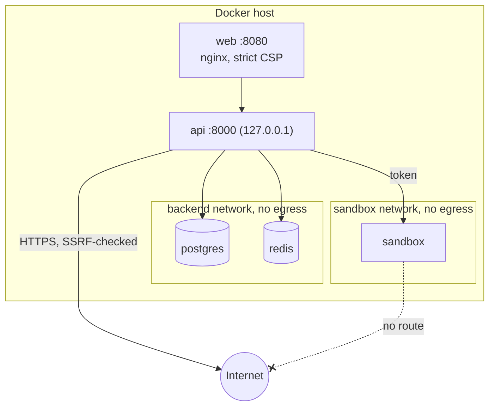

# Security

Argus runs LLM agents that browse the web, execute code and talk to other agents, so it assumes
that model output and anything an agent reads are untrusted. This page summarises the controls in
place. To report a vulnerability, follow the
[security policy](https://github.com/morpheuslord/Argus-Council/blob/main/SECURITY.md); do not open
a public issue.

## Containment

* **Containers**: non-root users, read-only root filesystems (`api`, `web`, `sandbox`), every
  capability dropped, `no-new-privileges`, CPU and memory limits, and a pid limit on the sandbox.
* **Networks**: Postgres and Redis are on an internal network with no egress; the sandbox is on
  its own internal network, reachable only by the API with a shared token.
* **Sandbox**: `shell` commands run with a tmpfs work area and per-command rlimits; the workspace
  is copied in and changed files are versioned back. Destructive shell commands are blocked by a
  deterministic guardrail before they reach it.
* **Web access**: `web_fetch` allows only `http` and `https`, enforces the run's domain allow
  list, rejects hosts that resolve to private, loopback, link-local or metadata addresses on every
  redirect, caps size and content types, and treats page text as data. Webhook targets on private
  or loopback addresses are refused too.
* **Protocols**: stdio MCP servers spawn local processes, so they are off unless
  `ARGUS_MCP_ALLOW_STDIO=true` and then admin-only. New MCP servers default to the `ask` trust
  level and remote-agent delegations to `requires_approval: true`.

## Identity and access

* Passwords are hashed with Argon2id. Access tokens are short-lived JWTs; refresh tokens are
  single-use and rotated.
* API keys carry write scopes per area (see [Integration](integration.md#api-keys-and-scopes)).
  Keys cannot create or revoke keys or change passwords.
* Roles: `admin`, `member` and `viewer`. Viewers are read-only everywhere, including the protocol
  endpoints, whatever their key's scopes.
* Requests are rate-limited per user or API key (`ARGUS_RATE_LIMIT_PER_MINUTE`).

## Secrets and data

* Provider API keys are encrypted at rest (`ARGUS_ENCRYPTION_KEY`, or a key derived from
  `ARGUS_SECRET_KEY`) and never returned; responses show a masked `key_hint`.
* Production refuses to start without a strong `ARGUS_SECRET_KEY` (at least 32 characters).
* Secret-like values in agent output and tool output are redacted by the guardrails.
* Webhook secrets are shown once. Account exports never include credentials, hashes or secrets.
* Every state-changing request is audited, including failed sign-ins; the protocol ledger is
  hash-chained and verifiable ([Protocols and Ledger](protocols.md#ledger)).

## Web UI and exports

* The web container serves the UI with a strict Content-Security-Policy (`default-src 'self'`, no
  inline scripts, `frame-ancestors 'none'`), `nosniff`, `no-referrer` and a restrictive
  Permissions-Policy. The API adds HSTS in production.
* Exports escape raw HTML from model output and drop unsafe link schemes.
* Skill uploads are validated: frontmatter rules, text files only, no hidden files or path
  traversal, and size limits checked before a zip is extracted.

## Hardening checklist

- [ ] Put a TLS-terminating proxy in front of port 8080 and set `ARGUS_CORS_ORIGINS`.
- [ ] Set `ARGUS_ALLOW_REGISTRATION=false` once accounts exist.
- [ ] Set a separate `ARGUS_ENCRYPTION_KEY` and keep `deploy/.env` (mode `600`) out of backups
      that leave the host unencrypted.
- [ ] Set `ARGUS_METRICS_TOKEN` if you scrape metrics.
- [ ] Keep `approval_required` on for `shell`, `remote_agent` and `network_write` unless the run
      uses the isolated sandbox.
- [ ] Give API keys the narrowest scopes they need, and use `viewer` accounts for read-only users.
- [ ] Copy `backups/` off the host on a schedule.
