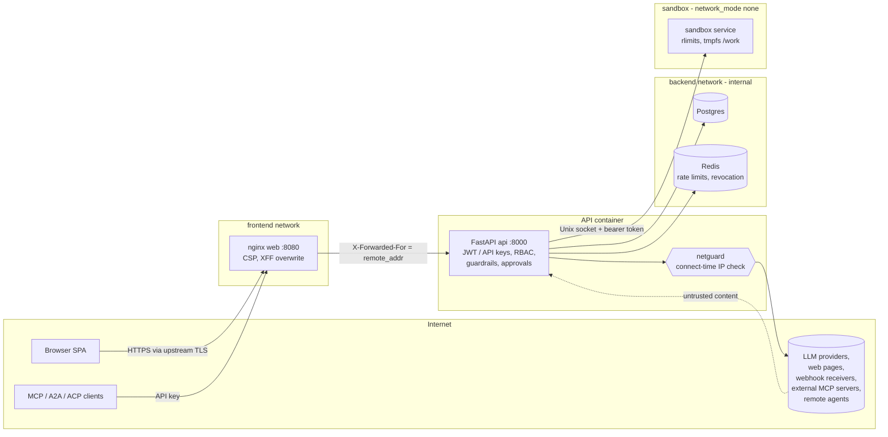

# Security audit: Argus Council

| | |
|---|---|
| Date | 2026-10-27 |
| Commit audited | `83d91ae` (main), fixes on top of it |
| Scope | `backend/` (FastAPI API, runtime, tools, protocols, sandbox), `frontend/` (SPA, nginx), `deploy/`, `backend/Dockerfile`, `frontend/Dockerfile`, `.github/workflows/` |
| Companion | [`threat-model.md`](threat-model.md) (TM-x threats), [`/SECURITY.md`](../../SECURITY.md) (reporting policy) |

## Summary

Three High findings, all fixed: login brute-force protection could be bypassed by spoofing
`X-Forwarded-For` (SEC-01), and two server-side request forgery (SSRF) paths let a member reach
internal services and cloud metadata. One went through the `web_fetch` tool, whose private-network
block any run could switch off (SEC-02). The other went through webhooks, MCP servers and remote
agents, which allowed private targets by default and could be bypassed with DNS rebinding (SEC-03).

Five Medium findings. Four are fixed: scoped admin API keys (SEC-04), session revocation (SEC-05),
the sandbox reaching the API (SEC-07) and open registration in the example config (SEC-09, partly).
One is still open: users share a sandbox uid (SEC-08).

The rest are Low and Info. Authorisation is consistent: every router checks ownership, so no
cross-user access (IDOR) was found. The scanners report no known vulnerable dependencies.

The two issues fixed before this audit still hold, and regression tests cover them (SEC-P1, SEC-P2).

## Method

1. **Manual review** of every router in `backend/argus/api/v1/` and `backend/argus/protocols/`,
   checking authentication, role, API-key scope and object ownership on each route (table below).
   Also reviewed: the runtime approval and guardrail path, all outbound HTTP clients, the sandbox
   service and executor, skill and knowledge upload parsing, the export, artifact and blob paths,
   secret storage and masking, Markdown rendering in the frontend, nginx headers, compose
   hardening and CI.
2. **Threat model** produced with the sec-review `threatmodel_perform_threat_model` tool, covering
   web endpoints, authentication, sessions, authorisation, uploads, outbound requests, webhooks,
   secrets, the frontend, shell/code execution, containers, LLM integration and agent tools. The
   result is in `threat-model.md`.
3. **Static and dependency scanning:**
   - `bandit -r argus`: 0 High; 1 Medium, a false positive (`B108`, `HOME=/tmp` for stdio MCP
     children); 19 Low (asserts, `try/except/pass`, non-crypto `random` for jitter).
   - `pip-audit` on the locked runtime dependencies (`uv export --frozen --no-dev`): no known
     vulnerabilities.
   - `npm audit` (prod and dev): 0 vulnerabilities.
   - `git grep` for committed secrets: none. The only hit is a fake AWS key used in a redaction
     test.
4. **Fixes** each come with a regression test (`backend/tests/test_security_audit.py`; each test's
   docstring names its finding ID). Checked with `ruff check`, `ruff format --check`, the full
   `pytest` suite, and frontend `typecheck` and `lint`.

## Architecture and trust boundaries

Trust boundaries, from least to most trusted:

1. Anonymous internet → nginx. Only register, login, refresh, logout, health and the agent card
   need no credentials.
2. Authenticated users → API. Roles are admin > member > viewer. API keys carry scopes; reads need
   no scope, and every write needs its router's `*:write` scope.
3. Untrusted content → LLM context. Web pages, MCP results, remote-agent replies and knowledge
   documents are treated as data, screened, and kept away from risky tools by approval gates.
4. Agent-written code → sandbox. It has no network, rlimits, and a read-only root fs. It shares
   one uid across users; see SEC-08.
5. API → outbound destinations chosen by users or models. These go through `netguard`, except LLM
   provider calls; see SEC-14.

## Findings

Severity follows impact × likelihood for a multi-user deployment reachable from the internet.
Locations point at the pre-fix code (`83d91ae`) unless the finding is still open.

| ID | Severity | Title | Status |
|---|---|---|---|
| SEC-01 | High | Login and registration throttles bypassable through a spoofed `X-Forwarded-For` | Fixed |
| SEC-02 | High | SSRF through `web_fetch`: any run could disable the private-network block | Fixed |
| SEC-03 | High | SSRF through webhooks, MCP servers and remote agents (private allowed by default, DNS rebinding, metadata) | Fixed |
| SEC-04 | Medium | Admin mutations accepted from read-only or narrowly scoped API keys | Fixed |
| SEC-05 | Medium | Sessions not ended on logout, password change or refresh-token reuse | Fixed |
| SEC-06 | Low | Refresh-token rotation race: concurrent reuse both succeed | Fixed |
| SEC-07 | Medium | Sandbox shared a Docker network with the API | Fixed |
| SEC-08 | Medium | All sandbox executions share one uid and container (cross-tenant workspace access) | **Open** (partly mitigated) |
| SEC-09 | Medium | Self-registration open by default in deployments | Partly fixed |
| SEC-10 | Low | First account to register on a fresh install becomes admin | Accepted risk |
| SEC-11 | Low | A2A endpoint not rate limited; client-chosen blocking wait unbounded | Fixed |
| SEC-12 | Low | Unbounded response bodies from MCP/A2A/ACP peers | Open |
| SEC-13 | Low | stdio MCP servers keep running after their admin owner is demoted | Open |
| SEC-14 | Low | LLM provider base URLs not re-checked at connect time (DNS rebinding) | Partly fixed |
| SEC-15 | Low | Rate-limit and revocation state can be evicted from the cache | Accepted risk |
| SEC-16 | Low | Secret-encryption key derived from `ARGUS_SECRET_KEY` when unset | Accepted risk |
| SEC-17 | Low | Request-size limit relies on `Content-Length` (chunked bodies) | Accepted risk |
| SEC-18 | Low | Refresh token kept in `sessionStorage` | Accepted risk |
| SEC-19 | Info | SSE stream ticket travels in the query string | Accepted risk |
| SEC-20 | Info | Registration reveals whether an email has an account (409) | Accepted risk |
| SEC-21 | Info | Run owners can relax tool approvals for their own runs | Accepted risk |
| SEC-22 | Info | No multi-factor authentication | Open (recommendation) |
| SEC-23 | Info | GitHub Actions pinned by tag, not commit SHA | Open (recommendation) |
| SEC-24 | Info | Web container serves plain HTTP; TLS must be terminated upstream | Accepted (documented) |
| SEC-P1 | (was Critical) | Empty-scope API keys had full access | Fixed earlier; verified |
| SEC-P2 | (was High) | Read-only keys could start or cancel runs over A2A/ACP/MCP | Fixed earlier; verified |

### SEC-01 · High · Throttles bypassable through spoofed X-Forwarded-For

- **Location:** `frontend/nginx.conf` API `location` block (`proxy_set_header X-Forwarded-For $proxy_add_x_forwarded_for`),
  `deploy/docker-compose.yml:87` (`FORWARDED_ALLOW_IPS: "*"`), `backend/argus/api/v1/auth.py:_throttle`.
- **Description:** nginx appended the client's own `X-Forwarded-For` to the header. When every
  proxy is trusted, uvicorn's proxy-headers middleware takes the **left-most** entry as the client
  address, and the client controls that entry. The login (10/min) and register (5/min) throttles
  key on that address, and the audit log records it.
- **Exploit:** send each login attempt with a different `X-Forwarded-For: <random IP>` and the
  per-IP limit never trips. The result is unlimited credential stuffing against any account. Each
  attempt also costs one Argon2 hash (64 MiB), so the same trick works as a memory and CPU
  denial-of-service. Audit rows record attacker-chosen IPs.
- **Fix:** nginx now overwrites the header (`proxy_set_header X-Forwarded-For $remote_addr`). Login
  is also throttled per account (10/min, keyed on a hash of the email), which no IP trick can
  spread. Behind another TLS proxy, configure nginx's `real_ip` module so `$remote_addr` is the
  real client.
- **Trade-off:** an attacker can keep one account's login throttled one minute at a time. That is
  a bounded denial of service, chosen over unlimited password guessing. The user's existing
  sessions are not affected.
- **Status:** Fixed. Tests: `test_login_throttled_per_account_across_ips`,
  `test_nginx_overwrites_forwarded_for`.

### SEC-02 · High · SSRF through web_fetch guardrail override

- **Location:** `backend/argus/runtime/guardrails.py:NetworkPolicy.block_private_ips`,
  `backend/argus/tools/web.py:check_url`.
- **Description:** the only private-network block for `web_fetch` was the run's guardrail
  `network.block_private_ips`. Any member, any `runs:write` API key, and the MCP `start_run` tool
  can set this per run.
- **Exploit:** start a run with `{"guardrails": {"network": {"block_private_ips": false}}}` and ask
  the agents to fetch `http://169.254.169.254/latest/meta-data/iam/security-credentials/` or
  `http://redis:6379/`. The response text comes back as the tool result and lands in the run's
  events and deliverable. This gives cloud credential theft and lets an attacker map internal
  services. Text from a fetched page can steer the agents into the same request.
- **Fix:** a server-side ceiling, `ARGUS_WEB_FETCH_ALLOW_PRIVATE_URLS` (default `false`). A run can
  still tighten the policy but never loosen it. Link-local addresses are refused even when private
  networks are allowed. `web_fetch` now connects through the guarded client (see SEC-03), so
  DNS rebinding between the pre-check and the connect is also closed.
- **Status:** Fixed. Test: `test_web_fetch_guardrail_cannot_open_private_networks`.

### SEC-03 · High · SSRF through webhooks, MCP servers, remote agents; DNS rebinding

- **Location:** `backend/argus/api/v1/webhooks.py:_check`, `backend/argus/api/v1/connections.py`
  (create and update MCP servers and remote agents), `backend/argus/services/llm.py:validate_base_url`,
  `backend/argus/core/config.py:provider_allow_private_urls = True`, and the outbound clients in
  `services/webhooks.py`, `protocols/{mcp,a2a,acp}_client.py` and `tools/remote.py`.
- **Description:** webhook, MCP and remote-agent URLs were validated with
  `provider_allow_private_urls`, which defaults to `true` for self-hosted LLMs, so loopback,
  private and link-local targets were all accepted. Validation also ran only when a URL was saved.
  At send time the client resolved the name again, so a host that resolved to a public IP when
  saved could resolve to an internal one later (DNS rebinding).
- **Exploit:**
  - Register a webhook `http://169.254.169.254/...` or `http://postgres:5432/` and read the
    delivery log's status codes and timings: a blind SSRF and port-scan oracle.
  - Register an A2A agent and press *refresh*: the API GETs `/.well-known/agent-card.json` from
    the target and returns the parsed JSON.
  - Register an MCP server: discovery errors echo up to 200 characters.
  - Use a rebinding domain to get past the save-time check entirely.
- **Fix:** new module `argus/core/netguard.py`. Its `guarded_client()` puts an httpcore network
  backend in place that:
  - resolves the host itself and refuses to connect if any resolved address is disallowed;
  - connects to the vetted IP literal, while TLS still verifies the original hostname;
  - follows no redirects and ignores proxy environment variables.

  Webhooks, HTTP MCP servers, A2A/ACP clients (refresh and the `remote_agent` tool) and
  `web_fetch` all use it. Private targets for these connections need
  `ARGUS_CONNECTIONS_ALLOW_PRIVATE_URLS=true`, which defaults to `false` and is exposed in
  `deploy/.env.example` and compose. `validate_base_url` now always refuses link-local, multicast
  and unspecified addresses, provider base URLs included. With `require_dns=False`, a name that
  does not resolve yet is still accepted at save time for guarded peers, because the connect-time
  check covers it.
- **Status:** Fixed. Tests: `test_ip_blocked_matrix`,
  `test_guarded_client_refuses_loopback_and_metadata`, `test_guarded_backend_blocks_dns_rebinding`,
  `test_validate_base_url_policy`, `test_connections_refuse_internal_urls`,
  `test_webhook_dispatcher_uses_guarded_client`.
- **Upgrade note:** existing deployments that point webhooks, MCP servers or remote agents at
  internal hosts must set `ARGUS_CONNECTIONS_ALLOW_PRIVATE_URLS=true`.

### SEC-04 · Medium · Admin mutations accepted from scoped API keys

- **Location:** `backend/argus/api/v1/admin.py:update_user`, `backend/argus/api/v1/data.py:run_retention`
  (`AdminPrincipal` checks the role only).
- **Description:** admin routes required `role == admin` but ignored the API key's scopes, so an
  admin's `["read"]` key could change roles, deactivate accounts and run data retention.
- **Exploit:** a monitoring key with `scopes: ["read"]` leaks. The holder runs
  `PATCH /api/v1/admin/users/{id} {"role":"admin"}` to promote their own account, or deactivates
  every other admin.
- **Fix:** a new `AdminWriter` dependency (`deps.require_admin_writer`). Admin mutations need a
  signed-in session or a key with the full `*` scope. Admin reads are unchanged.
- **Status:** Fixed. Test: `test_scoped_admin_key_cannot_change_users`.

### SEC-05 · Medium · Sessions not ended on logout, password change or token reuse

- **Location:** `backend/argus/api/v1/auth.py` (no logout route; `update_me`; `refresh`).
- **Description:** JWTs were purely stateless:
  - There was no server-side logout; the SPA only forgot its tokens.
  - Changing the password left every existing refresh token (14 days) and access token (60
    minutes) valid.
  - Reusing an already-rotated refresh token was rejected, but the token it had been exchanged
    for kept working.
- **Exploit:** a stolen refresh token keeps working for 14 days after the victim logs out or
  changes the password. When the theft is detected through reuse, the attacker's newer token
  chain survives.
- **Fix:** `argus/services/sessions.py`.
  - Every login mints a session id (`sid`) that its access and refresh tokens share and that
    survives rotation.
  - `POST /auth/logout` revokes the session, so its access tokens stop working immediately. The
    SPA now calls it on sign-out (`frontend/src/lib/api.ts:auth.revoke`).
  - Reusing a refresh token revokes the whole session.
  - Changing the password voids every token issued earlier, except those of the session that made
    the change.
  - Revocation state lives in Redis with the refresh-token TTL. `get_principal` checks it on every
    JWT request.
- **Residual:** the protocol endpoints (`/mcp`, `/a2a`) and the SSE `Authorization` fallback call
  `resolve_principal` without the cache. A revoked JWT used there still works until it expires (at
  most 60 minutes). These endpoints normally use API keys, which are revoked directly.
- **Status:** Fixed. Tests: `test_logout_ends_session_server_side`,
  `test_refresh_reuse_revokes_whole_session`, `test_password_change_signs_out_other_sessions`.

### SEC-06 · Low · Refresh-token rotation race

- **Location:** `backend/argus/api/v1/auth.py:refresh` (cache `get`, then `set`).
- **Description:** the check and the mark were separate cache calls, so concurrent requests with
  the same refresh token could each get a fresh token pair.
- **Fix:** an atomic `INCR` on `refresh-used:<jti>`; any count above 1 counts as reuse (see SEC-05).
- **Status:** Fixed. Test: `test_concurrent_refresh_only_one_wins`.

### SEC-07 · Medium · Sandbox could reach the API

- **Location:** `deploy/docker-compose.yml` (api and sandbox both on the `sandbox` network).
- **Description:** the compose comment said agent code had "no route to the internet or other
  services". In fact the sandbox shared a network with the API, which listens on `0.0.0.0:8000`.
  Code the agents ran could therefore call every unauthenticated API route (register, login,
  `/mcp`) directly. Because `FORWARDED_ALLOW_IPS=*`, it could also forge any client IP and so
  bypass the IP throttles.
- **Fix:** the sandbox now runs with `network_mode: none` and serves the API over a Unix socket on
  a shared volume (`sandboxsock`, seeded by the image with `argus` ownership).
  `RemoteSandbox` accepts `unix:/path` URLs. The `sandbox` network is gone and the API is no longer
  attached to it. A new CI compose-smoke assertion checks that sandbox code cannot reach `api:8000`.
- **Status:** Fixed. Test: `test_remote_sandbox_over_unix_socket`, plus the CI check
  (`.github/workflows/ci.yml`).
- **Verification note:** `docker compose config` validates the new compose file. The Docker daemon
  was not reachable in the audit environment, so the container wiring itself is exercised only by
  CI's compose smoke test.

### SEC-08 · Medium · Sandbox executions share one uid (open)

- **Location:** `backend/argus/sandbox/executor.py:execute`, `backend/argus/sandbox/server.py`.
- **Description:** every command, for every user, runs in the same container as the same uid
  (10001) as the sandbox server. Each workspace is a `mkdtemp` directory under `/work`. These
  directories are mode 0700, but all of them belong to that one uid.
- **Exploit:** code in one run, for example written after a prompt injection, can:
  1. start a process that calls `setsid` to escape the process-group kill and outlives the
     command;
  2. read or modify other users' workspaces under `/work/run-*` while their commands run;
  3. replace the server's Unix socket to intercept later requests;
  4. read the sandbox token from `/proc/<pid>/environ`. The token only grants access to the
     sandbox itself.
- **Mitigation applied:** the sandbox has no network (SEC-07), so nothing can be exfiltrated
  except through the run's own output. After each command the executor also kills the process
  group, which reaps ordinary background jobs (`cmd &`).
- **Recommended fix:** give each execution its own uid from a pool. This needs `CAP_SETUID` and
  `CAP_SETGID`, with the server starting as root and the children dropping to that uid. After the
  command, kill every process of that uid (`kill -9 -1` run as the uid), and keep the socket
  directory unwritable for it. A stronger option is one short-lived container (or gVisor or
  Firecracker sandbox) per execution.
- **Status:** **Open.** Fixing this needs a privilege model change in the container that could
  not be validated without a Docker daemon. Until then, treat runs on one deployment as mutually
  trusted, or run one sandbox per tenant.

### SEC-09 · Medium · Self-registration open by default

- **Location:** `backend/argus/core/config.py:allow_registration = True`, `deploy/.env.example`
  (`ARGUS_ALLOW_REGISTRATION=true`), `deploy/docker-compose.yml:64`.
- **Description:** a deployment reachable from the internet lets anyone create a member account.
  That account can spend the operator's system LLM keys (`ANTHROPIC_API_KEY` and others), run
  code in the sandbox and use `web_fetch`.
- **Fix:** `deploy/.env.example` now ships `ARGUS_ALLOW_REGISTRATION=false`. The first account can
  still register, because `register` always allows it while there are no users.
- **Residual:** the compose fallback (`${ARGUS_ALLOW_REGISTRATION:-true}`) and the `Settings`
  default stay `true`, because CI and the e2e smoke test register several users. Operators who
  start from `.env.example` get the safe default.
- **Status:** Partly fixed.

### SEC-10 · Low · First registrant becomes admin

- **Location:** `backend/argus/api/v1/auth.py:register`.
- **Description:** on a fresh install, whoever registers first becomes admin.
- **Status:** Accepted risk. Set `ARGUS_BOOTSTRAP_ADMIN_EMAIL` and `ARGUS_BOOTSTRAP_ADMIN_PASSWORD`,
  or keep the site private until the admin exists (as `scripts/deploy.sh` already advises).

### SEC-11 · Low · A2A rate limit and unbounded blocking wait

- **Location:** `backend/argus/protocols/a2a.py:a2a_endpoint` and the `message/send` handler
  (`float(meta.get("timeout_s", 600))`).
- **Description:** `/a2a` skipped the per-principal rate limit that `/mcp` applies. A client-chosen
  `timeout_s` was unbounded, so one request could hold a worker and a DB session indefinitely, and
  a non-numeric value caused a 500.
- **Fix:** the endpoint now applies the per-principal rate limit, and `_wait_seconds` clamps the
  wait to 0–600 s and ignores invalid values.
- **Status:** Fixed. Test: `test_a2a_blocking_wait_is_bounded`.

### SEC-12 · Low · Unbounded peer response bodies

- **Location:** `backend/argus/protocols/mcp_client.py:_request` (`resp.text`),
  `a2a_client.py` and `acp_client.py` (`resp.json()`).
- **Description:** a malicious or broken MCP server or remote agent can return a body of any size,
  which is read fully into memory. `web_fetch` already caps reads at 2 MB.
- **Status:** Open. Recommended fix: stream responses and stop after N MB. The risk is low because
  these peers are configured by the user.

### SEC-13 · Low · stdio MCP servers outlive their owner's admin role

- **Location:** `backend/argus/services/connections.py:build_mcp_client`.
- **Description:** only admins can register stdio MCP servers, and only when
  `ARGUS_MCP_ALLOW_STDIO=true`. If the owner is later demoted, the server still spawns its command
  in their runs, with environment variables they chose.
- **Status:** Open. Recommended fix: check the owner's role when attaching stdio servers. The risk
  is low because stdio is off by default.

### SEC-14 · Low · Provider base URLs not re-checked at connect time

- **Location:** `backend/argus/providers/*` (the OpenAI-compatible, Anthropic and Gemini clients).
- **Description:** private provider URLs are allowed by design, since self-hosted models live on
  private networks. A public hostname can be rebound to a link-local address after it is saved.
- **Fix applied:** link-local, multicast and unspecified addresses are now refused when the URL is
  saved.
- **Status:** Partly fixed. To close it, give provider SDK clients the netguard transport with
  `allow_private=settings.provider_allow_private_urls`.

### SEC-15 to SEC-24 · Low / Info

- **SEC-15 (Low, accepted):** rate-limit counters and session-revocation keys live in the cache.
  - In production Redis runs with `allkeys-lru`, so it can evict them under memory pressure.
  - The in-memory development backend evicts first-in-first-out after 10,000 keys.
  - Mitigation: size Redis generously, or switch to `volatile-lru`; every such key has a TTL.
- **SEC-16 (Low, accepted):** when `ARGUS_ENCRYPTION_KEY` is unset, the key that encrypts stored
  secrets is derived from `ARGUS_SECRET_KEY`. Rotating the JWT secret then makes stored secrets
  unreadable, and one leaked value exposes both. Set a separate `ARGUS_ENCRYPTION_KEY`, as
  `.env.example` says.
- **SEC-17 (Low, accepted):** the request-size limit in `main.py:_edge` checks `Content-Length`,
  so chunked bodies skip it. nginx enforces `client_max_body_size 10m`, and the API port is bound
  to 127.0.0.1 by default.
- **SEC-18 (Low, accepted):** the refresh token sits in `sessionStorage`, where an XSS could steal
  it. The strict CSP (`script-src 'self'`) and sanitised Markdown make XSS unlikely. An HttpOnly
  refresh cookie is the long-term fix.
- **SEC-19 (Info, accepted):** the SSE stream ticket appears in the URL, and so in nginx access
  logs. It is single-use, valid for 5 minutes, and limited to one run.
- **SEC-20 (Info, accepted):** `POST /auth/register` returns 409 for a known email. Login gives no
  such hint: it equalises timing and uses the same message for both cases.
- **SEC-21 (Info, accepted):** a run owner can empty `approval_required` or widen tool allow-lists
  for their own runs. This makes prompt-injection-driven tool use possible, but only inside their
  own data and the network-less sandbox. The defaults are safe: shell, package installs, remote
  agents and network writes all need approval, and MCP servers start in the `ask` trust level.
- **SEC-22 (Info, open):** there is no MFA. Recommended for admins.
- **SEC-23 (Info, open):** workflow actions use version tags (`@v4`, `@v6`), not commit SHAs.
  Workflow permissions are `contents: read`.
- **SEC-24 (Info, documented):** the web container listens on plain HTTP on port 8080. Put a TLS
  proxy in front of it. The API sends HSTS in production.

### SEC-P1 / SEC-P2 · Previously fixed issues, verified

- **SEC-P1:** an empty scope list now means read-only (`deps._principal_from_api_key`). Covered by
  `test_auth.py::test_empty_scopes_are_read_only` and
  `test_security_audit.py::test_prior_fixes_hold`.
- **SEC-P2:** A2A `message/send` and `tasks/cancel`, ACP `POST /runs` and `/runs/{id}/cancel`, and
  the MCP tools `start_run`, `intervene` and `cancel_run` all call `require_scope("runs:write")`.
  Covered by `test_protocol_scopes.py::test_read_only_key_cannot_write_over_protocols` and
  `test_prior_fixes_hold`.

## Authorisation review per router

Reads need an authenticated principal. Writes need the router's scope, through `write_scope` or
an explicit `require_scope`, and viewers are rejected. "Owner" means the object is looked up by id
and `owner_id`, and a mismatch returns 404.

| Router | Auth | Write scope | Ownership / role | Result |
|---|---|---|---|---|
| `auth` | public: register, login, refresh, logout; principal: `me`; session (JWT): key management | n/a | keys filtered by `user_id`; API keys cannot change the password or manage keys | OK (SEC-01, SEC-05, SEC-06 fixed) |
| `admin` | admin | `AdminWriter` on PATCH | last-admin and self-demotion guards | Fixed (SEC-04) |
| `councils` | principal | `councils:write` | `get_council(owner)`; members resolved inside the owned council | OK |
| `providers` | principal | `providers:write` (also `/llm/complete`, `/test`) | `_get(owner)`; `resolve` by owner, then system providers; keys never returned (hint only) | OK |
| `runs` | principal; SSE by single-use ticket or bearer | `runs:write` (stream-ticket exempt, owner-checked) | `_own_run` on every route; artifacts scoped to run; blob path containment checked | OK |
| `skills` | principal | `skills:write` (`/validate` exempt: no state change) | `_row(owner)`; built-ins read-only | OK |
| `connections` | principal | `connections:write` | `_get(owner)`; stdio only for admins with `ARGUS_MCP_ALLOW_STDIO`; secrets never returned | OK (SEC-03 fixed, SEC-13 open) |
| `webhooks` | principal | `webhooks:write` | `_own(owner)`; secret shown once | OK (SEC-03 fixed) |
| `knowledge` | principal | `knowledge:write` | `_owned_kb(owner)`; documents checked against the KB; memory `council_id` ownership checked | OK |
| `templates` | principal | `runs:write` | `_own(owner)`; referenced council checked | OK |
| `notifications` | principal | `runs:write` (mark-read exempt, own inbox only) | `user_id` check | OK |
| `observability` | principal | n/a (read-only) | audit filtered by actor; `all=true` admin-only; insights by owner | OK |
| `data` | session (JWT) for export and delete; admin for retention | `AdminWriter` on retention run | export and delete only the caller; password re-check; last-admin guard | OK (SEC-04 fixed) |
| `health`, `/metrics` | public; metrics need the bearer token, or return 404 in production when unset | n/a | n/a | OK |
| `/mcp` | API key or JWT; rate limited | `runs:write` for `start_run`, `intervene` and `cancel_run` | `_own_run`; resources and prompts scoped to owner | OK |
| `/a2a` | bearer | `runs:write` for `message/send` and `tasks/cancel` | `_owned_run` | Fixed (SEC-11) |
| `/acp` | principal | `runs:write` on run create and cancel | `_own`; agents derived from the owner's councils | OK |

## Areas reviewed without findings

- **SQL injection:** only SQLAlchemy Core and ORM expressions. The single `text()` is a constant
  (`SELECT 1`).
- **Deserialization:** `yaml.safe_load` and `safe_dump`, plus `orjson` and `json`. No pickle,
  `yaml.load` or `eval`.
- **Archives and uploads:** skill zips are parsed in memory and never extracted to disk.
  - Entry count, declared size (which `zipfile` enforces while decompressing) and per-file and
    total caps all apply.
  - Paths must be relative and non-hidden with no `..`, and only text suffixes are allowed.
  - Knowledge uploads are capped at 5 MB, restricted to text, Markdown and HTML (HTML is stripped
    to text), and rejected if binary.
  - Multipart bodies are capped at 9 MB by the API and 10 MB by nginx.
- **Path traversal:** workspace paths are normalised by `GuardrailEngine.normalize_path`.
  - Blob files are named by run id and SHA-256.
  - Downloads check that the resolved blob stays inside the blob root.
  - Export zip entries go through `_safe_name`.
  - Download filenames have quotes stripped (Starlette rejects CR/LF).
- **XSS:** `react-markdown` runs with `skipHtml` and `rehype-sanitize`, and links are limited to
  `https?:`, `mailto:` and `#`.
  - Images are not loaded.
  - No `dangerouslySetInnerHTML` anywhere.
  - Citation `href`s come from validated http(s) fetches, and React 19 blocks `javascript:` URLs.
  - Artifact content is served as `text/plain` with `nosniff`, and downloads as attachments.
- **CSRF and CORS:** tokens travel in the `Authorization` header and no cookies are used, so CSRF
  does not apply. CORS uses an explicit allow-list with `allow_credentials=False`.
- **Security headers:** both the API and nginx send CSP (`default-src 'none'` on the API,
  `script-src 'self'` on the SPA), `frame-ancestors 'none'`/`DENY`, `nosniff`,
  `Referrer-Policy: no-referrer` and COOP. The API adds HSTS in production. `/docs` and
  `/openapi.json` are disabled in production.
- **JWT:** HS256 is pinned. Issuer, `typ`, `exp`, `iat`, `sub` and `jti` are required. Production
  refuses to start with the default secret or one under 32 characters, and development uses a
  random per-process secret.
- **Passwords:** Argon2id (argon2-cffi defaults) with rehash-on-login. Minimum length is 12
  characters. Login equalises timing and answers unknown and wrong credentials the same way.
- **API keys:** 256-bit `token_urlsafe` values. Only the SHA-256 is stored, the prefix is
  displayed, and keys support expiry and revocation.
- **Secrets:** stored secrets are Fernet-encrypted at rest.
  - Provider keys are shown only as a hint of 3 + 4 characters, and MCP headers only by name.
  - The remote-agent token is reported only as `has_token`.
  - The account export drops `*_enc`, hash and secret columns.
  - Tool arguments are redacted in events, and the audit detail is scrubbed.
- **Webhook signing:** HMAC-SHA256 over `"<ts>.<raw body>"`, with a stable delivery id across
  retries. Receivers are told to reject timestamps older than 5 minutes and duplicate ids. No
  redirects are followed. Hooks are disabled after 20 consecutive failures.
- **Containers:**
  - Images run as non-root (10001; nginx-unprivileged 101) with `cap_drop: ALL` and
    `no-new-privileges`.
  - Root filesystems are read-only, with tmpfs for `/tmp` and `/work`.
  - Postgres and Redis sit on an internal network. Redis requires a password and has `CONFIG` and
    `FLUSHALL` disabled.
  - CPU, memory and pid limits are set.
  - The API port is bound to 127.0.0.1 by default.
- **CI:** `permissions: contents: read`, no `pull_request_target`, and generated throw-away
  secrets for the compose smoke test.

## Files changed by this audit

- New: `backend/argus/core/netguard.py`, `backend/argus/services/sessions.py`,
  `backend/tests/test_security_audit.py`, `docs/security/audit.md`,
  `docs/security/threat-model.md`, `SECURITY.md`.
- Backend:
  - `api/deps.py`
  - `api/v1/{auth,admin,data,connections,webhooks}.py`
  - `core/config.py`
  - `services/{llm,webhooks,connections}.py`
  - `protocols/{a2a,a2a_client,acp_client,mcp_client}.py`
  - `tools/{web,remote}.py`
  - `sandbox/{client,executor}.py`
  - `Dockerfile`
  - `tests/test_protocols.py`, where an unreachable-MCP test URL moved from `127.0.0.1` to
    `.invalid`.
- Frontend: `nginx.conf`, `src/lib/api.ts`, `src/stores/session.ts`.
- Deploy and CI: `deploy/docker-compose.yml`, `deploy/.env.example`, `.github/workflows/ci.yml`.

New configuration: `ARGUS_CONNECTIONS_ALLOW_PRIVATE_URLS` and `ARGUS_WEB_FETCH_ALLOW_PRIVATE_URLS`,
both defaulting to `false`. The new endpoint is `POST /api/v1/auth/logout`, which takes
`{"refresh_token": ...}` and returns 204.
